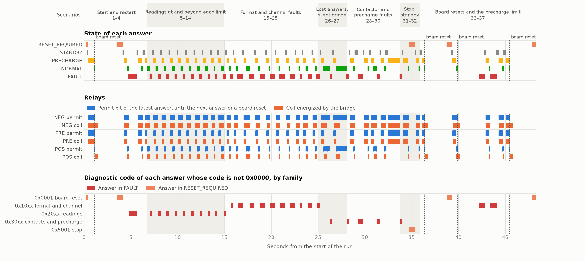
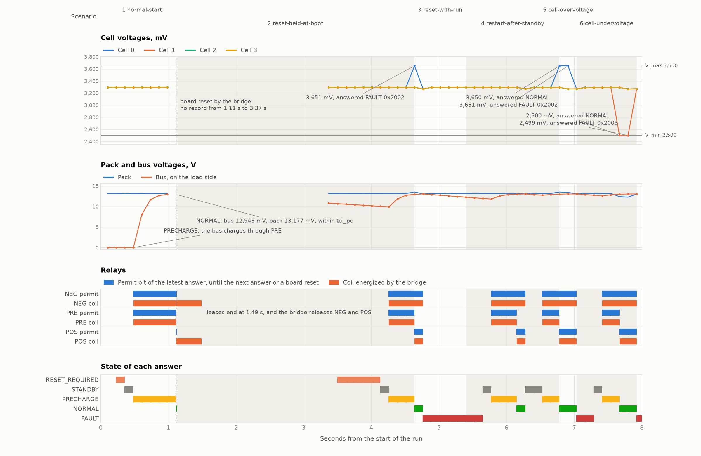

# BMS protection

[The requirements](requirements.md) specify the protection layer of a battery management system for a pack of four lithium iron phosphate cells, a machine that answers each record of a bridge with the permits of three relays, and [the review](review.md) records their decisions.  The machine's specification and its theorems carry the code SPEC of [the index](../../index.md), the step that the verified compiler compiles carries WASM, and the flash images of the Cortex-M7 back end, with theorems about their runs from reset, carry M7.

[The host side](Host.md) describes the bridge and pack simulator that play the far end of the board's USART3, its bridge rules, its models, its fault-injection scenarios, the format of its logs, and their replay against the specification in native Lean.

## A run on a NUCLEO-F767ZI

In this run the board executes `bms.bin`, and [the host program](../../tests/baremetal/uart_bms.py) plays the bridge over the ST-LINK's virtual COM port, simulating the pack, the relays, and the operator.  In normal operation the bridge sends a record every 126 ms with the readings of four cells, two temperature sensors, the pack current, the pack and bus voltages, and the digital inputs, and the board answers each record with a state and a permit bit for each of three relays: the negative contactor NEG, the precharge relay PRE, and the positive contactor POS.  The bridge energizes a relay's coil only while an answer to a record sampled less than 500 ms earlier permits that relay, so the relays open when the board stops answering.  The run follows the [fault-injection schedule](requirements.md#fault-injection-schedule), whose 37 scenarios push readings to and beyond their limits, damage bytes on the wire, drop answers, simulate failed contactors, and reset the board.



All 37 scenarios passed in 48.2 s, with 286 sampled records, 4 board resets, and 288 answers, one for each non-empty segment that the board received, damaged ones included.  `bms-replay`, a native Lean program, recomputes the answers from the bytes that the bridge sent with the Lean specification of the machine and finds all 288 equal to the board's.  [The run's report](board-run/report.md) gives a table of every scenario, fault, lease expiry, and relay change.

The panels share one time axis, in seconds from the start of the run, and the strip above them groups the scenarios.  The first panel shows the state of each answer, with a mark where each answer arrived.  The second shows, for each relay, the permit bit of the latest answer above the coil that the bridge energized.  The third shows the diagnostic code of each answer that reports one, grouped by family.  Dashed lines mark the four board resets.

Each fault appears as a run of `FAULT` answers, in red, and the coils are off once the first of them arrives.  The code families follow the scenario groups: reading faults in scenarios 5 to 14, format and channel faults in 15 to 25, and contact and precharge faults in 26 to 30.  After a fault, a reset press and a run request take the answers back through `STANDBY` and `PRECHARGE` to `NORMAL`.  The coils differ from the permits in two places.  After a board reset the coils stay energized until the lease of the last answer runs out, at most 0.38 s later.  In scenarios 26 and 27, where answers are lost or the bridge stops sending, the coils drop while the latest answer still permits them, because no new answer renews the lease.



The second chart shows the first 8 seconds.  After power-up the board answered `RESET_REQUIRED` with code `0x0001`.  A press of the reset button moved it to `STANDBY`, and the run request to `PRECHARGE`, which permits NEG and PRE, so the bus charged through the precharge resistor from 0 to 12.9 V.  At 1.11 s the bus read 12,943 mV against a pack of 13,177 mV, within `tol_pc` of 500 mV, and the board answered `NORMAL`, which permits NEG and POS.

The bridge then reset the board through the ST-LINK.  The answers stopped, the leases of NEG and POS ran out at 1.49 s, the bridge released both relays, and the next record went out at 3.37 s.  Scenario 2 held the reset button through the board's reset, and the board accepted no reset until the button was released and pressed again, which moved the answers to `STANDBY` at 4.13 s.

At 4.64 s cell 0 read 3,651 mV, 1 mV above `V_max`.  The answer to that record was `FAULT` with code `0x2002` and permit 0, and the bridge released the relays when it arrived.  A reset press with the run request on was refused, and `FAULT` held until a press with the run request off, answered at 5.65 s.  In scenarios 5 and 6 a cell at `V_max`, 3,650 mV, or at `V_min`, 2,500 mV, kept the answer `NORMAL`, and 1 mV beyond gave `FAULT` with `0x2002` or `0x2003`.  The four cells read within 6 mV of each other, so their lines overlap except where a scenario moves one cell.

```sh
uv run tests/baremetal/bms_figures.py Demos/Bms/board-run/bms Demos/Bms/board-run
```

## Specification and theorems

[`Spec.lean`](Spec.lean) states the machine over natural numbers, integers, lists, and structures, independent of any program.  It holds the profile's values and the diagnostic codes as named constants, the layouts of the 35-byte scan record and the 17-byte answer with their decoding and encoding, the CRC-32 of V.42 over the link identifier and a record's bytes as `crc32Eval` of [the CRC division](../../Library/Hashing/Crc/Division.lean) computes it, the state, the 17 checks in order, and the transition rules.  `step` gives the next state and the answer for the result of one non-empty segment, a framing error or the decoded bytes, and `machine` writes the answer's raw bytes.  The specification is computable, so native Lean replays recorded records against it.

The theorems hold for every sequence `x` of segment results from the state after a board reset, `answerAt x t` is the answer to segment `t`, and the terms of their statements are defined over the earlier segments and answers alone, as the requirements define them: the permit in force, a relay's age, the previous `RESET` bit, passing the communication checks, the first failing check, a reset acceptance, and a start.  Every theorem depends on no axiom beyond `propext`, `Classical.choice`, and `Quot.sound`.

| Theorem | Statement | File |
|---|---|---|
| M1 `m1` | An answer `a_n` with a nonzero permit has a last reset acceptance `i` and a last start `j` with `1 ≤ i < j ≤ n`, and `Permitted x n i j`: segments `i − 1` to `n` are good records in sequence, records `i` to `n` pass checks 7 to 17 with `STOP_OK` 1, the reset edge precedes `i`, `RUN` holds from `j` to `n`, the answers' states run from `RESET_REQUIRED` or `FAULT` through `STANDBY` and `PRECHARGE`, at most `N_pc` records lie in `PRECHARGE`, and `NORMAL` follows a record with the precharge condition | [`Theorems.lean`](Theorems.lean) |
| M2 `m2` | Every answer's permit is its state's, `0x00`, `0x03`, or `0x05`, never PRE with POS or POS without NEG | [`Theorems.lean`](Theorems.lean) |
| M3 `m3`, `step_failure` | A segment that fails a check gets permit 0 and `FAULT`, with the first failing check's code unless the state before was `FAULT` | [`Theorems.lean`](Theorems.lean) |
| M4 `m4` | `FAULT` keeps its code until a reset acceptance leads to `STANDBY` | [`Theorems.lean`](Theorems.lean) |
| M5 `m5` | A segment whose record has `STOP_OK` 0 gets permit 0 and `RESET_REQUIRED` or `FAULT` | [`Theorems.lean`](Theorems.lean) |
| M6 `m6` | A record that passes every check with `STOP_OK` 1 and `RUN` 0 in `PRECHARGE` or `NORMAL` gets permit 0 and `STANDBY` | [`Theorems.lean`](Theorems.lean) |
| M7 `m7_count`, `m7_normal` | No `N_pc + 1` consecutive answers have `PRECHARGE`, and `NORMAL` after `PRECHARGE` answers a record with the precharge condition | [`Theorems.lean`](Theorems.lean) |
| M8 `m8` | A record whose auxiliary contacts fail check 17 gets permit 0 and `FAULT` | [`Theorems.lean`](Theorems.lean) |
| M9 `m9` | From every state, good records with consecutive sequence numbers pass the communication checks after the first | [`Theorems.lean`](Theorems.lean) |
| M10 `m10` | The first two answers have permit 0, the first has board sequence number 0, and every reset acceptance follows a record with `RESET` 0 that passed the communication checks | [`Theorems.lean`](Theorems.lean) |
| M11 `m11` | Every answer has 17 bytes, the tag `0x80`, and the CRC of `LINK` and its first 13 bytes, which `decodeAnswer` checks, the board sequence number `t` modulo 2^32, and the answered sequence number of the requirements | [`Theorems.lean`](Theorems.lean) |
| M12 `m12` | A decode error or a record shorter than 35 bytes gets `0x1001` or `0x1003` when the state before was not `FAULT` | [`Theorems.lean`](Theorems.lean) |
| `codes` | The code is 0 in `STANDBY`, `PRECHARGE`, and `NORMAL`, `0x0001` or `0x5001` in `RESET_REQUIRED`, and a fault code in `FAULT` | [`Theorems.lean`](Theorems.lean) |
| `resetAcceptance_iff`, `start_iff` | A reset acceptance is a transition from `RESET_REQUIRED` or `FAULT` to `STANDBY`, and a start one from `STANDBY` to `PRECHARGE` | [`Theorems.lean`](Theorems.lean) |
| `failure_eq` | The machine's checks of a segment are the checks that the history defines | [`Theorems.lean`](Theorems.lean) |
| `delimAnswers_eq`, `answer_stream` | The answers to bytes `bs` are the encoded answers of the run over `inputs bs`, the results of the non-empty segments, and the `n`-th segment of the bytes written decodes to the raw answer `a_n` | [`Stream.lean`](Stream.lean) |
| M1 `m1_stream` | An answer among the bytes written with a nonzero permit byte is `a_n` of the run over the non-empty segments of the bytes read, and `Permitted` holds of it | [`Stream.lean`](Stream.lean) |
| M2 `m2_stream`, M11 `m11_stream` | The permit byte of every answer written is `0x00`, `0x03`, or `0x05`, and every answer written is 17 bytes that `decodeAnswer` accepts, with the board sequence number `n` modulo 2^32 | [`Stream.lean`](Stream.lean) |
| M12 `m12_stream` | A segment that is the encoding of a 35-byte record with one byte removed gets `0x1001` or `0x1003` when the state before was not `FAULT`, since COBS decoding of `k` bytes gives fewer than `k` (`length_cobsDecode`) | [`Stream.lean`](Stream.lean) |

[`Stream.lean`](Stream.lean) carries the theorems to every byte stream: `machine` has the type of the machine of [the delimited framing](../../LeanExe/Requests/Delimited.lean), so `delimAnswers machine maxSegment init bs` is the specification of the answers to the bytes `bs`, and every theorem above holds for `inputs bs`.  M5 and M8 drop the requirements' hypothesis that the record passes the communication checks, since a record that fails them gets `FAULT` by M3.  M9 holds from every state before the first record.  [`Cases.lean`](Cases.lean) evaluates the specification when it builds: the two test vectors, the machine's answer to the scan vector, the schedule's scenarios that the machine decides, limits at and beyond their values, and the agreement of the history terms with the machine's state on a run through every state.

```sh
tools/leanrun --timeout 30m lake build Demos.Bms.Theorems Demos.Bms.Stream Demos.Bms.Cases
```

## The program

[`Program.lean`](Program.lean) writes the step in the verified compiler's dialect.  Its state, `BmsFrame`, holds 24 words: the framing's phase and the segment's length, the segment and the answer in two buffers of 40 bytes, the answer's bytes left to write, and the machine's state `BmsState`, the specification's fields as 11 words, with the protection state as its code and each flag as 0 or 1.  `bmsPhases` sends the window that receives a `0x00` after a non-empty segment to `bmsDelim` and every other window to `bmsPoll`, which stores a byte, reads the status, or writes a byte of the answer.  `bmsDelim` decodes the segment with `decodeWords` of [the framing in words](../../LeanExe/Requests/DelimitedWords.lean), reads the record's fields with `decodeRec`, computes the CRC of `LINK` and bytes 0 to 30 with five calls of `crc32Word` of [the bitwise CRC-32](../../Library/Hashing/Crc/Bitwise/Program.lean) from `linkCrc`, the CRC-32 of `LINK`, runs the checks (`failW`), the transitions (`nextW`), and the state's update (`updW`), and encodes the 17 bytes that `answerSrc` lays out with their CRC.  The temperatures and the current enter the checks biased by `2 ^ 15` and `2 ^ 31`, so every check compares words with constants.  No function has a loop or a recursive call.

[`Compiled.lean`](Compiled.lean) compiles the steps and the functions that they call with `verified_compile`, in 488 s and 5.4 GB, and `bmsCompiled.bmsTickUsart3.implements` and `bmsCompiled.bmsTick.implements` state that functions 56 and 57 of the module compute the steps for USART3 and for UART0 of QEMU's `mps2-an500` from every store without a trap.  [`Abs.lean`](Abs.lean) relates the program to the specification.  `absS` maps the machine's words to `State`, `StInv` bounds them as the specification's values stay bounded, and `bmsAbs` maps the step's state to the state of `delimTick`, the segment as the last `min len 36` bytes of its buffer and the answer as the first `k` bytes of its own.  The lemmas that the step shares with the echo of records of `tests/TestSupport/M7/Delim.lean`, the segment's store, the first byte of the answer, and the encoded answer's length, lie in [`DelimitedSteps.lean`](../../LeanExe/Requests/DelimitedSteps.lean).

| Theorem | Statement | File |
|---|---|---|
| `decodeRec_spec` | The fields that `decodeRec` reads from the last 35 bytes of a buffer are those that `decodeScan` reads from those bytes | [`Abs.lean`](Abs.lean) |
| `recCrc_spec`, `linkCrc_spec` | `recCrc` computes `crc` of bytes 0 to 30 of the record, and `linkCrc` is the CRC-32 of `LINK` | [`Abs.lean`](Abs.lean) |
| `answerSrc_spec` | The last 17 bytes of `answerSrc` are an answer's 13 bytes followed by their CRC | [`Abs.lean`](Abs.lean) |
| `failW_spec`, `nextW_spec`, `updW_spec`, `answer_eq` | The program's first failing check, next state, code, and answer bytes are the specification's, through the view `ViewOf` of a segment's result | [`Abs.lean`](Abs.lean) |
| `bmsDelim_spec` | The window of a `0x00` after a non-empty segment leaves the machine's next state and the encoded answer followed by `0x00` | [`Abs.lean`](Abs.lean) |
| `bmsPhases_abs` | `bmsPhases` computes `delimTick` of `machine` with segments of at most `maxSegment` bytes under `bmsAbs`, for every register map, on the states of `BmsInv`, and keeps `BmsInv` | [`Abs.lean`](Abs.lean) |
| `bms_usart3_prefix`, `bms_usart3_answered`, `bms_cmsdk_prefix`, `bms_cmsdk_answered` | For every bus and every sequence of the values read, the bytes that the steps' windows write begin `delimAnswers machine maxSegment init` of the bytes read, and they are all of it whenever a window reads a byte | [`Abs.lean`](Abs.lean) |
| `m1_prefix` | M1 for every complete answer in a prefix of `delimAnswers machine maxSegment init bs` | [`Abs.lean`](Abs.lean) |

## Images and board theorems

`m7-windows bms-board` writes `bms.bin`, the image of `bmsTickUsart3` for the NUCLEO-F767ZI, 99,494 bytes in the layout `bootWith initOvrdis` of [the board's definitions](../../LeanExe/M7/Board.lean), whose initialization writes `OVRDIS` to `USART_CR3` before the write of `USART_CR1` that sets UE, and `m7-windows bms-qemu` writes `bms-cmsdk-qemu.bin`, the image of `bmsTick` for `mps2-an500`, 98,758 bytes.  The kernel evaluates `reachCovered`, `usesArea`, `stackBound`, 3,480 bytes, and `staticCost`, 202,783 instructions for each step, 202,021 for `bmsDelim`, and 2,474 for `bmsPoll`, and it checks that each file holds the image's bytes, in 75 s at 20.9 GB for `bms.bin` and 66 s at 20.8 GB for `bms-cmsdk-qemu.bin`.  The theorems over the files hold for every state that reset gives while the flash holds the file, every sequence `σ` of the values that reads return, and every number `N` of windows, under the run conditions of [the board's proof](../../LeanExe/M7/Proof/Board.lean): a power-on reset, or an NRST reset with the debug registers at their power-on values, and no interrupt, debug halt, debugger access, or DMA during the run.

| Theorem | Statement | File |
|---|---|---|
| B1 `bms_board`, `bms_board_runs` | The run reaches the accesses of `initOvrdis` followed by those of the first `N` windows of `bmsTickUsart3` from `bmsInit`, and it never stops | [`BmsBoardFile.lean`](../../tests/TestSupport/M7/BmsBoardFile.lean) |
| B1 `bms_board_prefix` | The bytes written to `USART_TDR` begin the encoded answers `answerAt (inputs bs) t`, each followed by `0x00`, of the machine's run over the non-empty segments of the bytes `bs` read from `USART_RDR` | [`BmsBoardFile.lean`](../../tests/TestSupport/M7/BmsBoardFile.lean) |
| B2 `bms_confined` | Every access of the initialization lies in RCC, GPIOD, or USART3, and every access of the windows is to `USART_ISR`, `USART_RDR`, or `USART_TDR` | [`BmsLoop.lean`](../../tests/TestSupport/M7/BmsLoop.lean) |
| B3 `bms_board_steps` | Every window takes at most 202,799 steps of the model, 16 of `main` and the step's `staticCost` | [`BmsBoardFile.lean`](../../tests/TestSupport/M7/BmsBoardFile.lean) |
| B3a `bms_board_poll` | Every window other than the window of a delimiter after a non-empty segment takes at most 3,301 steps of the model, 16 of `main` and the step's dispatch with the call of `bmsPoll` | [`BmsBoardFile.lean`](../../tests/TestSupport/M7/BmsBoardFile.lean) |
| B4 `bms_qemu`, `bms_qemu_prefix`, `bms_qemu_poll` | B1's statements for `bms-cmsdk-qemu.bin` on `mps2-an500` with UART0, all the answers whenever a window reads a byte, and B3 and B3a | [`BmsQemuFile.lean`](../../tests/TestSupport/M7/BmsQemuFile.lean) |
| B5 `bms_board_safe` | Every complete segment of the bytes written that decodes to an answer whose permit byte is not 0 is the encoded answer `a_m` of that run, and `Permitted (inputs bs) m i j`, M1's conclusion, holds of it | [`BmsBoardFile.lean`](../../tests/TestSupport/M7/BmsBoardFile.lean) |

B3a bounds the windows other than the window of a delimiter after a non-empty segment, the windows whose state and value do not satisfy `BmsDecodes` of [`BmsStep.lean`](../../tests/TestSupport/M7/BmsStep.lean).  The step's code computes the dispatch's condition in 17 instructions on its parameters, `bmsDispatch`, and one `if` calls `bmsPoll` or `bmsDelim`, after which copies of the result follow.  `pathCost` of [the static bound](../../LeanExe/M7/Bound.lean) charges the frame, the test, the `if`, the call of `bmsPoll` with the copies of its arguments and results and its `staticCost` of 2,474, and the copies after the `if`, 3,285 instructions, which `bms_pollPath` evaluates.  `bms_dispatchTest` states that the test is nonzero exactly when the window calls `bmsPoll`, and `bms_poll` and `costRun_le_pathCost` bound every such run of the step by 3,285, so with the 16 of `main` each such window takes at most 3,301.  In the model's run of `m7-windows run bms-usart3`, whose output equals `delimAnswers machine maxSegment init` of its input, the windows other than the window of a delimiter took 1,752 to 2,447 instructions and the window of a delimiter 111,008 to 153,434.  The bound exceeds the model's count of the window that writes a byte, 2,376, by the 925 instructions of `divBound` that `staticCost` charges for the remainder by 2^32 in `writeReq`, whose run of `udivmod64` the model's counts omit.

## Runs

`uart_bms.py` of [the host side](Host.md) runs the fault-injection schedule against each image, and [`bms-replay`](../../tests/TestSupport/Bms/Replay.lean) checks every answer of each run's log against `delimAnswers machine maxSegment init` of the bytes written, from a board reset at the start and at each `reset` line.  On QEMU and in Renode the bridge sends its bytes at the line time of 4,800 baud, since neither emulator's UART has line time, and the scenarios with a board reset are skipped, since the script cannot reset either emulator.  QEMU connects its UART's socket before the guest runs, so on QEMU the bridge waits 3 s before its power-up.  On the board, `stlink_nrst.py` and a USB reset of the ST-LINK make the board resets of those scenarios, and the script releases the serial port before each and opens it again after it.

| Run | Scenarios | Answers equal to the mirror and to `bms-replay` | Further checks |
|---|---|---|---|
| `m7-qemu.sh bms` | 33 passed, 4 skipped | 261 | The kernel's check of `bms-cmsdk-qemu.bin` |
| `m7-board.sh emulate bms` | 33 passed, 4 skipped | 260 | No unexpected warning in Renode's log |
| `USBRESET=0483:374b m7-board.sh nrst bms /dev/ttyACM0` | 37 passed | 288, in 5 parts between board resets | `USART_CR3` read `0x00001000` over SWD after the run |
| `USBRESET=0483:374b m7-board.sh measure bms /dev/ttyACM0` | 33 passed, 4 skipped | 256 | `USART_CR3` read `0x00001000` |

[The board run's report](board-run/report.md) draws that run from its logs in [`board-run/`](board-run/), with a table of its events, and `bms-replay` and `uart_bms.py replay` both find its 288 answers equal to the specification's and the mirror's.

The measurement image `bms-dwt.bin` records the cycles of each window by the phases before and after it, with five instructions of the measurement in each, at 16 MHz and with the caches off, and `m7-board.sh measure` starts it with the reset of `st-flash`, so no theorem covers its run.  The windows other than the window of a delimiter took 1,203 to 1,766 cycles, at most 10.6% of half a byte time at 4,800 baud, and the window of a delimiter took 99,020 to 121,691 cycles, at most 7.6 ms.  The kinds of window took 0.68 to 0.73 cycles for each instruction of the model's count with the measurement's 5.  B3a's bound of 3,301 instructions fits in half a byte time, 16,667 cycles at 16 MHz, whenever the processor averages at most 5.04 cycles an instruction over the window, and at 0.73 such a window takes at most 2,410 cycles, 14.5% of half a byte time.  The cost model of `m7_timing.py` predicts 1,121 to 1,714 cycles for the model's traces of the other windows, 2% to 8% below the measured means of their kinds, and 129,034 cycles for the longest window of a delimiter in the model's run.

| Window | Windows | Cycles: least, most, mean | Instructions in the model, with the measurement's 5 |
|---|---|---|---|
| idle | 314,351 | 1,203, 1,220, 1,206.0 | 1,758 |
| rxne | 9,445 | 1,214, 1,226, 1,214.0 | 1,757 |
| byte or empty segment | 9,189 | 1,358, 1,766, 1,750.9 | 1,990 to 2,452 |
| delimiter | 256 | 99,020, 121,691, 120,396.9 | 111,013 to 153,439 |
| txwait | 84,992 | 1,504, 1,521, 1,507.3 | 2,221 |
| tx | 4,864 | 1,662, 1,724, 1,674.8 | 2,381 |
| sent | 4,864 | 1,648, 1,660, 1,650.8 | 2,370 and 2,371 |

The board's run confirms the requirements' timing values.  The time from the sampling of a record to its current answer was at most 133.6 ms in normal operation, against the estimate of 156.7 ms, since the answer arrived 7.5 to 11.5 ms after the line times of the record and the answer, of which the window of a delimiter takes 7.6 ms, against the 20 ms that the estimate allows for the window and the latency.  A lease outlasted its renewal by at least 244.3 ms in normal operation, against the estimate of 166.6 ms, and by 146.0 ms after a lost delimiter, against about 64.6 ms.  The bridge sampled and sent its first byte at most 7.6 ms late, against `T_sample` of 20 ms, and released the relays at most 1.3 ms after a lease's end, against `T_act` of 20 ms, so `T_ans` of 100 ms, `T_lease` of 500 ms, `T_sample`, and `T_act` stand.

The commands below build the modules, check the images, and run them.  `m7-board.sh check` and `m7-qemu.sh` need 24 GB for the kernel's checks of the files, and the compilation of the step takes 8 minutes.  The board's runs need the board and no Lean, so `m7-board.sh replay` checks their logs on a machine with Lean.

```sh
tools/leanrun --timeout 60m --memory-high 12G lake build Demos.Bms.Abs Demos.Bms.Compiled \
  TestSupport.M7.BmsLoop bms-replay
tests/baremetal/m7-qemu.sh bms
tests/baremetal/m7-board.sh check bms
RENODE=renode tests/baremetal/m7-board.sh emulate bms
USBRESET=0483:374b tests/baremetal/m7-board.sh nrst bms /dev/ttyACM0
USBRESET=0483:374b tests/baremetal/m7-board.sh measure bms /dev/ttyACM0
tests/baremetal/m7-board.sh replay build/baremetal/m7-board/bms
```
