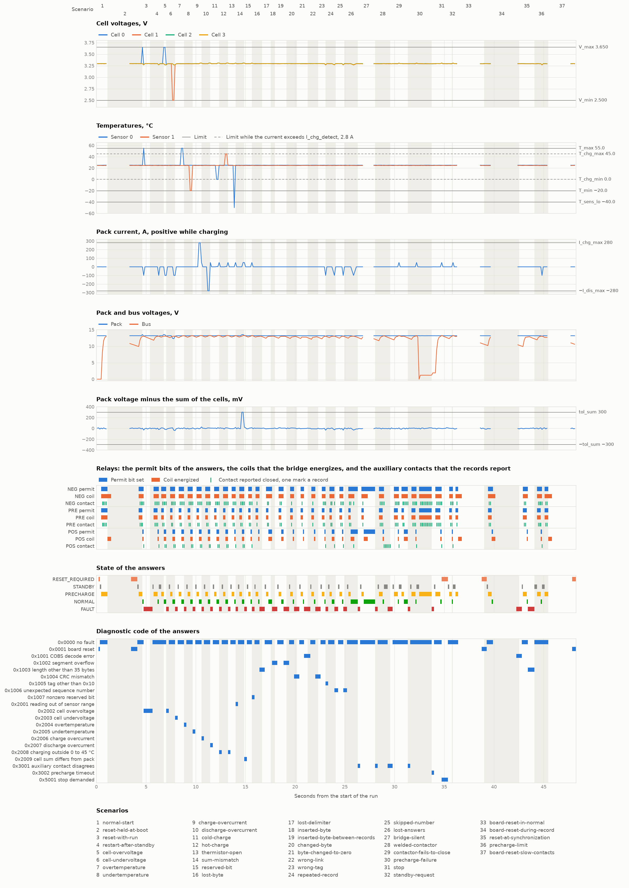

# BMS run report

The files `bms.in`, `bms.out`, and `bms.log` hold 286 records sent over 48.2 s, 288 answers, 11 timeouts, and 4 board resets.  Of the 37 scenarios, 37 passed.  The table lists each scenario's start, the injections that the log records, board resets, timeouts, lease expiries, and each answer that changed the state or the code, was not current, arrived after a timeout, or changed the leases or the coils.

| Time, s | Scenario | Event | Detail |
|---:|---:|---|---|
| 0.103 | 1 | scenario | `normal-start`: pass. |
| 0.229 | 1 | `0x00 RESET_REQUIRED 0x0001` | First answer of the run.  Answer 0 to record 4294967294, current. |
| 0.355 | 1 | `0x00 STANDBY 0x0000` | From `RESET_REQUIRED`: reset accepted.  Answer 1 to record 4294967295, current. |
| 0.482 | 1 | `0x03 PRECHARGE 0x0000` | From `STANDBY`: start.  Answer 2 to record 0, current.  The bridge energizes NEG and PRE. |
| 1.113 | 1 | `0x05 NORMAL 0x0000` | From `PRECHARGE`: precharge condition, bus 12,943 mV and pack 13,177 mV.  Answer 7 to record 5, current.  The bridge ends the lease of PRE, energizes POS, and de-energizes PRE. |
| 1.113 | 2 | scenario | `reset-held-at-boot`: pass. |
| 1.113 | 2 | board reset | The bridge resets the board. |
| 1.488 | 2 | lease expiry | The leases of NEG and POS from the answer to record 5 end 500 ms after the record's sampling, and BR6 blocks re-energization.  The bridge de-energizes NEG and POS 1.2 ms after the end. |
| 3.503 | 2 | `0x00 RESET_REQUIRED 0x0001` | First answer after the board reset.  Answer 0 to record 6, current. |
| 4.134 | 2 | `0x00 STANDBY 0x0000` | From `RESET_REQUIRED`: reset accepted.  Answer 5 to record 11, current. |
| 4.260 | 2 | `0x03 PRECHARGE 0x0000` | From `STANDBY`: start.  Answer 6 to record 12, current.  The bridge energizes NEG and PRE. |
| 4.638 | 2 | `0x05 NORMAL 0x0000` | From `PRECHARGE`: precharge condition, bus 12,715 mV and pack 13,169 mV.  Answer 9 to record 15, current.  The bridge ends the lease of PRE, energizes POS, and de-energizes PRE. |
| 4.639 | 3 | scenario | `reset-with-run`: pass. |
| 4.765 | 3 | `0x00 FAULT 0x2002` | From `NORMAL`: cell overvoltage, cell 0 at 3,651 mV.  Answer 10 to record 16, current.  The bridge ends the leases of NEG and POS and de-energizes them. |
| 5.396 | 4 | scenario | `restart-after-standby`: pass. |
| 5.648 | 4 | `0x00 STANDBY 0x0000` | From `FAULT`: reset accepted.  Answer 17 to record 23, current. |
| 5.774 | 4 | `0x03 PRECHARGE 0x0000` | From `STANDBY`: start.  Answer 18 to record 24, current.  The bridge energizes NEG and PRE. |
| 6.152 | 4 | `0x05 NORMAL 0x0000` | From `PRECHARGE`: precharge condition, bus 12,912 mV and pack 13,168 mV.  Answer 21 to record 27, current.  The bridge ends the lease of PRE, energizes POS, and de-energizes PRE. |
| 6.278 | 4 | `0x00 STANDBY 0x0000` | From `NORMAL`: `RUN` 0.  Answer 22 to record 28, current.  The bridge ends the leases of NEG and POS and de-energizes them. |
| 6.530 | 4 | `0x03 PRECHARGE 0x0000` | From `STANDBY`: start.  Answer 24 to record 30, current.  The bridge energizes NEG and PRE. |
| 6.782 | 4 | `0x05 NORMAL 0x0000` | From `PRECHARGE`: precharge condition, bus 12,912 mV and pack 13,183 mV.  Answer 26 to record 32, current.  The bridge ends the lease of PRE, energizes POS, and de-energizes PRE. |
| 6.782 | 5 | scenario | `cell-overvoltage`: pass. |
| 7.034 | 5 | `0x00 FAULT 0x2002` | From `NORMAL`: cell overvoltage, cell 0 at 3,651 mV.  Answer 28 to record 34, current.  The bridge ends the leases of NEG and POS and de-energizes them. |
| 7.035 | 6 | scenario | `cell-undervoltage`: pass. |
| 7.288 | 6 | `0x00 STANDBY 0x0000` | From `FAULT`: reset accepted.  Answer 30 to record 36, current. |
| 7.415 | 6 | `0x03 PRECHARGE 0x0000` | From `STANDBY`: start.  Answer 31 to record 37, current.  The bridge energizes NEG and PRE. |
| 7.669 | 6 | `0x05 NORMAL 0x0000` | From `PRECHARGE`: precharge condition, bus 12,855 mV and pack 13,187 mV.  Answer 33 to record 39, current.  The bridge ends the lease of PRE, energizes POS, and de-energizes PRE. |
| 7.923 | 6 | `0x00 FAULT 0x2003` | From `NORMAL`: cell undervoltage, cell 1 at 2,499 mV.  Answer 35 to record 41, current.  The bridge ends the leases of NEG and POS and de-energizes them. |
| 7.924 | 7 | scenario | `overtemperature`: pass. |
| 8.177 | 7 | `0x00 STANDBY 0x0000` | From `FAULT`: reset accepted.  Answer 37 to record 43, current. |
| 8.303 | 7 | `0x03 PRECHARGE 0x0000` | From `STANDBY`: start.  Answer 38 to record 44, current.  The bridge energizes NEG and PRE. |
| 8.557 | 7 | `0x05 NORMAL 0x0000` | From `PRECHARGE`: precharge condition, bus 12,854 mV and pack 13,168 mV.  Answer 40 to record 46, current.  The bridge ends the lease of PRE, energizes POS, and de-energizes PRE. |
| 8.811 | 7 | `0x00 FAULT 0x2004` | From `NORMAL`: overtemperature, sensor 0 at 55.1 °C.  Answer 42 to record 48, current.  The bridge ends the leases of NEG and POS and de-energizes them. |
| 8.811 | 8 | scenario | `undertemperature`: pass. |
| 9.064 | 8 | `0x00 STANDBY 0x0000` | From `FAULT`: reset accepted.  Answer 44 to record 50, current. |
| 9.191 | 8 | `0x03 PRECHARGE 0x0000` | From `STANDBY`: start.  Answer 45 to record 51, current.  The bridge energizes NEG and PRE. |
| 9.443 | 8 | `0x05 NORMAL 0x0000` | From `PRECHARGE`: precharge condition, bus 12,912 mV and pack 13,166 mV.  Answer 47 to record 53, current.  The bridge ends the lease of PRE, energizes POS, and de-energizes PRE. |
| 9.696 | 8 | `0x00 FAULT 0x2005` | From `NORMAL`: undertemperature, sensor 1 at −20.1 °C.  Answer 49 to record 55, current.  The bridge ends the leases of NEG and POS and de-energizes them. |
| 9.696 | 9 | scenario | `charge-overcurrent`: pass. |
| 9.948 | 9 | `0x00 STANDBY 0x0000` | From `FAULT`: reset accepted.  Answer 51 to record 57, current. |
| 10.075 | 9 | `0x03 PRECHARGE 0x0000` | From `STANDBY`: start.  Answer 52 to record 58, current.  The bridge energizes NEG and PRE. |
| 10.329 | 9 | `0x05 NORMAL 0x0000` | From `PRECHARGE`: precharge condition, bus 12,911 mV and pack 13,182 mV.  Answer 54 to record 60, current.  The bridge ends the lease of PRE, energizes POS, and de-energizes PRE. |
| 10.582 | 9 | `0x00 FAULT 0x2006` | From `NORMAL`: charge overcurrent, current 280,001 mA.  Answer 56 to record 62, current.  The bridge ends the leases of NEG and POS and de-energizes them. |
| 10.582 | 10 | scenario | `discharge-overcurrent`: pass. |
| 10.834 | 10 | `0x00 STANDBY 0x0000` | From `FAULT`: reset accepted.  Answer 58 to record 64, current. |
| 10.961 | 10 | `0x03 PRECHARGE 0x0000` | From `STANDBY`: start.  Answer 59 to record 65, current.  The bridge energizes NEG and PRE. |
| 11.214 | 10 | `0x05 NORMAL 0x0000` | From `PRECHARGE`: precharge condition, bus 12,923 mV and pack 13,175 mV.  Answer 61 to record 67, current.  The bridge ends the lease of PRE, energizes POS, and de-energizes PRE. |
| 11.468 | 10 | `0x00 FAULT 0x2007` | From `NORMAL`: discharge overcurrent, current −280,001 mA.  Answer 63 to record 69, current.  The bridge ends the leases of NEG and POS and de-energizes them. |
| 11.469 | 11 | scenario | `cold-charge`: pass. |
| 11.721 | 11 | `0x00 STANDBY 0x0000` | From `FAULT`: reset accepted.  Answer 65 to record 71, current. |
| 11.847 | 11 | `0x03 PRECHARGE 0x0000` | From `STANDBY`: start.  Answer 66 to record 72, current.  The bridge energizes NEG and PRE. |
| 12.101 | 11 | `0x05 NORMAL 0x0000` | From `PRECHARGE`: precharge condition, bus 12,934 mV and pack 13,186 mV.  Answer 68 to record 74, current.  The bridge ends the lease of PRE, energizes POS, and de-energizes PRE. |
| 12.356 | 11 | `0x00 FAULT 0x2008` | From `NORMAL`: charging outside 0 to 45 °C, current 2,801 mA with sensor 0 at −0.1 °C.  Answer 70 to record 76, current.  The bridge ends the leases of NEG and POS and de-energizes them. |
| 12.357 | 12 | scenario | `hot-charge`: pass. |
| 12.609 | 12 | `0x00 STANDBY 0x0000` | From `FAULT`: reset accepted.  Answer 72 to record 78, current. |
| 12.736 | 12 | `0x03 PRECHARGE 0x0000` | From `STANDBY`: start.  Answer 73 to record 79, current.  The bridge energizes NEG and PRE. |
| 12.991 | 12 | `0x05 NORMAL 0x0000` | From `PRECHARGE`: precharge condition, bus 12,933 mV and pack 13,170 mV.  Answer 75 to record 81, current.  The bridge ends the lease of PRE, energizes POS, and de-energizes PRE. |
| 13.246 | 12 | `0x00 FAULT 0x2008` | From `NORMAL`: charging outside 0 to 45 °C, current 2,801 mA with sensor 1 at 45.1 °C.  Answer 77 to record 83, current.  The bridge ends the leases of NEG and POS and de-energizes them. |
| 13.246 | 13 | scenario | `thermistor-open`: pass. |
| 13.498 | 13 | `0x00 STANDBY 0x0000` | From `FAULT`: reset accepted.  Answer 79 to record 85, current. |
| 13.624 | 13 | `0x03 PRECHARGE 0x0000` | From `STANDBY`: start.  Answer 80 to record 86, current.  The bridge energizes NEG and PRE. |
| 13.878 | 13 | `0x05 NORMAL 0x0000` | From `PRECHARGE`: precharge condition, bus 12,939 mV and pack 13,173 mV.  Answer 82 to record 88, current.  The bridge ends the lease of PRE, energizes POS, and de-energizes PRE. |
| 14.005 | 13 | `0x00 FAULT 0x2001` | From `NORMAL`: reading out of sensor range, sensor 0 at −50.0 °C.  Answer 83 to record 89, current.  The bridge ends the leases of NEG and POS and de-energizes them. |
| 14.006 | 14 | scenario | `sum-mismatch`: pass. |
| 14.259 | 14 | `0x00 STANDBY 0x0000` | From `FAULT`: reset accepted.  Answer 85 to record 91, current. |
| 14.385 | 14 | `0x03 PRECHARGE 0x0000` | From `STANDBY`: start.  Answer 86 to record 92, current.  The bridge energizes NEG and PRE. |
| 14.637 | 14 | `0x05 NORMAL 0x0000` | From `PRECHARGE`: precharge condition, bus 12,932 mV and pack 13,178 mV.  Answer 88 to record 94, current.  The bridge ends the lease of PRE, energizes POS, and de-energizes PRE. |
| 14.890 | 14 | `0x00 FAULT 0x2009` | From `NORMAL`: cell sum differs from pack, pack 13,526 mV, cell sum 13,225 mV.  Answer 90 to record 96, current.  The bridge ends the leases of NEG and POS and de-energizes them. |
| 14.891 | 15 | scenario | `reserved-bit`: pass. |
| 15.143 | 15 | `0x00 STANDBY 0x0000` | From `FAULT`: reset accepted.  Answer 92 to record 98, current. |
| 15.269 | 15 | `0x03 PRECHARGE 0x0000` | From `STANDBY`: start.  Answer 93 to record 99, current.  The bridge energizes NEG and PRE. |
| 15.523 | 15 | `0x05 NORMAL 0x0000` | From `PRECHARGE`: precharge condition, bus 12,932 mV and pack 13,183 mV.  Answer 95 to record 101, current.  The bridge ends the lease of PRE, energizes POS, and de-energizes PRE. |
| 15.649 | 15 | `0x00 FAULT 0x1007` | From `NORMAL`: nonzero reserved bit, digital word `0x006b`.  Answer 96 to record 102, current.  The bridge ends the leases of NEG and POS and de-energizes them. |
| 15.649 | 16 | scenario | `lost-byte`: pass. |
| 15.902 | 16 | `0x00 STANDBY 0x0000` | From `FAULT`: reset accepted.  Answer 98 to record 104, current. |
| 16.028 | 16 | `0x03 PRECHARGE 0x0000` | From `STANDBY`: start.  Answer 99 to record 105, current.  The bridge energizes NEG and PRE. |
| 16.282 | 16 | `0x05 NORMAL 0x0000` | From `PRECHARGE`: precharge condition, bus 12,919 mV and pack 13,184 mV.  Answer 101 to record 107, current.  The bridge ends the lease of PRE, energizes POS, and de-energizes PRE. |
| 16.406 | 16 | `0x00 FAULT 0x1003` | From `NORMAL`: length other than 35 bytes, the segment decodes to 34 bytes.  Answer 102 to a damaged segment, not current.  The bridge ends the leases of NEG and POS and de-energizes them.  BR6 blocks re-energization. |
| 16.458 | 16 | timeout | No current answer within T_ans of the record's end.  The bridge sends `0x00`. |
| 16.687 | 17 | scenario | `lost-delimiter`: pass. |
| 16.939 | 17 | `0x00 STANDBY 0x0000` | From `FAULT`: reset accepted.  Answer 105 to record 111, current. |
| 17.065 | 17 | `0x03 PRECHARGE 0x0000` | From `STANDBY`: start.  Answer 106 to record 112, current.  The bridge energizes NEG and PRE. |
| 17.318 | 17 | `0x05 NORMAL 0x0000` | From `PRECHARGE`: precharge condition, bus 12,797 mV and pack 13,178 mV.  Answer 108 to record 114, current.  The bridge ends the lease of PRE, energizes POS, and de-energizes PRE. |
| 17.494 | 17 | timeout | No current answer within T_ans of the record's end.  The bridge sends `0x00`. |
| 17.546 | 17 | `0x05 NORMAL 0x0000` | Answer 109 to record 115, current, after the timeout. |
| 17.548 | 18 | scenario | `inserted-byte`: pass. |
| 17.675 | 18 | `0x00 FAULT 0x1002` | From `NORMAL`: segment overflow.  Answer 110 to a damaged segment, not current.  The bridge ends the leases of NEG and POS and de-energizes them.  BR6 blocks re-energization. |
| 17.728 | 18 | timeout | No current answer within T_ans of the record's end.  The bridge sends `0x00`. |
| 17.959 | 19 | scenario | `inserted-byte-between-records`: pass. |
| 18.211 | 19 | `0x00 STANDBY 0x0000` | From `FAULT`: reset accepted.  Answer 113 to record 119, current. |
| 18.337 | 19 | `0x03 PRECHARGE 0x0000` | From `STANDBY`: start.  Answer 114 to record 120, current.  The bridge energizes NEG and PRE. |
| 18.589 | 19 | `0x05 NORMAL 0x0000` | From `PRECHARGE`: precharge condition, bus 12,796 mV and pack 13,188 mV.  Answer 116 to record 122, current.  The bridge ends the lease of PRE, energizes POS, and de-energizes PRE. |
| 18.842 | 19 | `0x00 FAULT 0x1002` | From `NORMAL`: segment overflow.  Answer 118 to a damaged segment, not current.  The bridge ends the leases of NEG and POS and de-energizes them.  BR6 blocks re-energization. |
| 18.895 | 19 | timeout | No current answer within T_ans of the record's end.  The bridge sends `0x00`. |
| 19.129 | 20 | scenario | `changed-byte`: pass. |
| 19.382 | 20 | `0x00 STANDBY 0x0000` | From `FAULT`: reset accepted.  Answer 121 to record 127, current. |
| 19.508 | 20 | `0x03 PRECHARGE 0x0000` | From `STANDBY`: start.  Answer 122 to record 128, current.  The bridge energizes NEG and PRE. |
| 19.762 | 20 | `0x05 NORMAL 0x0000` | From `PRECHARGE`: precharge condition, bus 12,763 mV and pack 13,188 mV.  Answer 124 to record 130, current.  The bridge ends the lease of PRE, energizes POS, and de-energizes PRE. |
| 19.888 | 20 | `0x00 FAULT 0x1004` | From `NORMAL`: CRC mismatch.  Answer 125 to a damaged segment, not current.  The bridge ends the leases of NEG and POS and de-energizes them.  BR6 blocks re-energization. |
| 19.940 | 20 | timeout | No current answer within T_ans of the record's end.  The bridge sends `0x00`. |
| 20.170 | 21 | scenario | `byte-changed-to-zero`: pass. |
| 20.423 | 21 | `0x00 STANDBY 0x0000` | From `FAULT`: reset accepted.  Answer 128 to record 134, current. |
| 20.550 | 21 | `0x03 PRECHARGE 0x0000` | From `STANDBY`: start.  Answer 129 to record 135, current.  The bridge energizes NEG and PRE. |
| 20.802 | 21 | `0x05 NORMAL 0x0000` | From `PRECHARGE`: precharge condition, bus 12,761 mV and pack 13,175 mV.  Answer 131 to record 137, current.  The bridge ends the lease of PRE, energizes POS, and de-energizes PRE. |
| 20.890 | 21 | `0x00 FAULT 0x1001` | From `NORMAL`: COBS decode error.  Answer 132 to a damaged segment, not current.  The bridge ends the leases of NEG and POS and de-energizes them.  BR6 blocks re-energization. |
| 20.975 | 21 | `0x00 FAULT 0x1001` | Answer 133 to a damaged segment, not current. |
| 21.033 | 21 | timeout | No current answer within T_ans of the record's end.  The bridge sends `0x00`. |
| 21.264 | 22 | scenario | `wrong-link`: pass. |
| 21.517 | 22 | `0x00 STANDBY 0x0000` | From `FAULT`: reset accepted.  Answer 136 to record 141, current. |
| 21.644 | 22 | `0x03 PRECHARGE 0x0000` | From `STANDBY`: start.  Answer 137 to record 142, current.  The bridge energizes NEG and PRE. |
| 21.897 | 22 | `0x05 NORMAL 0x0000` | From `PRECHARGE`: precharge condition, bus 12,680 mV and pack 13,173 mV.  Answer 139 to record 144, current.  The bridge ends the lease of PRE, energizes POS, and de-energizes PRE. |
| 22.024 | 22 | `0x00 FAULT 0x1004` | From `NORMAL`: CRC mismatch.  Answer 140 to a damaged segment, not current.  The bridge ends the leases of NEG and POS and de-energizes them.  BR6 blocks re-energization. |
| 22.079 | 22 | timeout | No current answer within T_ans of the record's end.  The bridge sends `0x00`. |
| 22.309 | 23 | scenario | `wrong-tag`: pass. |
| 22.563 | 23 | `0x00 STANDBY 0x0000` | From `FAULT`: reset accepted.  Answer 143 to record 148, current. |
| 22.689 | 23 | `0x03 PRECHARGE 0x0000` | From `STANDBY`: start.  Answer 144 to record 149, current.  The bridge energizes NEG and PRE. |
| 22.942 | 23 | `0x05 NORMAL 0x0000` | From `PRECHARGE`: precharge condition, bus 12,717 mV and pack 13,175 mV.  Answer 146 to record 151, current.  The bridge ends the lease of PRE, energizes POS, and de-energizes PRE. |
| 23.068 | 23 | `0x00 FAULT 0x1005` | From `NORMAL`: tag other than 0x10, tag `0x11`.  Answer 147 to record 152, current.  The bridge ends the leases of NEG and POS and de-energizes them. |
| 23.069 | 24 | scenario | `repeated-record`: pass. |
| 23.321 | 24 | `0x00 STANDBY 0x0000` | From `FAULT`: reset accepted.  Answer 149 to record 154, current. |
| 23.447 | 24 | `0x03 PRECHARGE 0x0000` | From `STANDBY`: start.  Answer 150 to record 155, current.  The bridge energizes NEG and PRE. |
| 23.700 | 24 | `0x05 NORMAL 0x0000` | From `PRECHARGE`: precharge condition, bus 12,851 mV and pack 13,176 mV.  Answer 152 to record 157, current.  The bridge ends the lease of PRE, energizes POS, and de-energizes PRE. |
| 23.952 | 24 | `0x00 FAULT 0x1006` | From `NORMAL`: unexpected sequence number, record 158, where 159 is expected.  Answer 154 to record 158, not current.  The bridge ends the leases of NEG and POS and de-energizes them.  BR6 blocks re-energization. |
| 24.080 | 25 | scenario | `skipped-number`: pass. |
| 24.332 | 25 | `0x00 STANDBY 0x0000` | From `FAULT`: reset accepted.  Answer 157 to record 161, current. |
| 24.459 | 25 | `0x03 PRECHARGE 0x0000` | From `STANDBY`: start.  Answer 158 to record 162, current.  The bridge energizes NEG and PRE. |
| 24.711 | 25 | `0x05 NORMAL 0x0000` | From `PRECHARGE`: precharge condition, bus 12,789 mV and pack 13,172 mV.  Answer 160 to record 164, current.  The bridge ends the lease of PRE, energizes POS, and de-energizes PRE. |
| 24.711 | 25 | injection | Skipped sequence number. |
| 24.837 | 25 | `0x00 FAULT 0x1006` | From `NORMAL`: unexpected sequence number, record 166, where 165 is expected.  Answer 161 to record 166, current.  The bridge ends the leases of NEG and POS and de-energizes them. |
| 24.964 | 26 | scenario | `lost-answers`: pass. |
| 25.216 | 26 | `0x00 STANDBY 0x0000` | From `FAULT`: reset accepted.  Answer 164 to record 169, current. |
| 25.342 | 26 | `0x03 PRECHARGE 0x0000` | From `STANDBY`: start.  Answer 165 to record 170, current.  The bridge energizes NEG and PRE. |
| 25.596 | 26 | `0x05 NORMAL 0x0000` | From `PRECHARGE`: precharge condition, bus 12,792 mV and pack 13,175 mV.  Answer 167 to record 172, current.  The bridge ends the lease of PRE, energizes POS, and de-energizes PRE. |
| 25.596 | 26 | injection | Answers dropped until the lease expires. |
| 25.722 | 26 | `0x05 NORMAL 0x0000` | Answer 168 to record 173, dropped by the injection. |
| 25.774 | 26 | timeout | No current answer within T_ans of the record's end.  The bridge sends `0x00`. |
| 25.969 | 26 | lease expiry | The leases of NEG and POS from the answer to record 172 end 500 ms after the record's sampling, and BR6 blocks re-energization.  The bridge de-energizes NEG and POS 0.4 ms after the end. |
| 26.006 | 26 | `0x05 NORMAL 0x0000` | Answer 169 to record 174.  The injection dropped 1 of its bytes, and the bridge read the other 17 as a frame that is not an authentic answer. |
| 26.058 | 26 | timeout | No current answer within T_ans of the record's end.  The bridge sends `0x00`. |
| 26.288 | 26 | `0x00 FAULT 0x3001` | From `NORMAL`: auxiliary contact disagrees, NEG reports open with its permit bit set, POS reports open with its permit bit set.  Answer 170 to record 175, current. |
| 26.288 | 27 | scenario | `bridge-silent`: pass. |
| 26.541 | 27 | `0x00 STANDBY 0x0000` | From `FAULT`: reset accepted.  Answer 172 to record 177, current. |
| 26.667 | 27 | `0x03 PRECHARGE 0x0000` | From `STANDBY`: start.  Answer 173 to record 178, current.  The bridge energizes NEG and PRE. |
| 26.919 | 27 | `0x05 NORMAL 0x0000` | From `PRECHARGE`: precharge condition, bus 12,710 mV and pack 13,172 mV.  Answer 175 to record 180, current.  The bridge ends the lease of PRE, energizes POS, and de-energizes PRE. |
| 26.920 | 27 | injection | Bridge silent. |
| 27.294 | 27 | lease expiry | The leases of NEG and POS from the answer to record 180 end 500 ms after the record's sampling, and BR6 blocks re-energization.  The bridge de-energizes NEG and POS 1.3 ms after the end. |
| 28.048 | 27 | `0x00 FAULT 0x3001` | From `NORMAL`: auxiliary contact disagrees, NEG reports open with its permit bit set, POS reports open with its permit bit set.  Answer 176 to record 181, current. |
| 28.048 | 28 | scenario | `welded-contactor`: pass. |
| 28.300 | 28 | `0x00 STANDBY 0x0000` | From `FAULT`: reset accepted.  Answer 178 to record 183, current. |
| 28.426 | 28 | `0x03 PRECHARGE 0x0000` | From `STANDBY`: start.  Answer 179 to record 184, current.  The bridge energizes NEG and PRE. |
| 28.804 | 28 | `0x05 NORMAL 0x0000` | From `PRECHARGE`: precharge condition, bus 12,885 mV and pack 13,165 mV.  Answer 182 to record 187, current.  The bridge ends the lease of PRE, energizes POS, and de-energizes PRE. |
| 28.804 | 28 | injection | POS welded. |
| 28.930 | 28 | `0x00 STANDBY 0x0000` | From `NORMAL`: `RUN` 0.  Answer 183 to record 188, current.  The bridge ends the leases of NEG and POS and de-energizes them. |
| 29.309 | 28 | `0x00 FAULT 0x3001` | From `STANDBY`: auxiliary contact disagrees, POS reports closed with its permit bit clear.  Answer 186 to record 191, current. |
| 29.563 | 29 | scenario | `contactor-fails-to-close`: pass. |
| 29.815 | 29 | `0x00 STANDBY 0x0000` | From `FAULT`: reset accepted.  Answer 190 to record 195, current. |
| 29.941 | 29 | `0x03 PRECHARGE 0x0000` | From `STANDBY`: start.  Answer 191 to record 196, current.  The bridge energizes NEG and PRE. |
| 30.321 | 29 | `0x05 NORMAL 0x0000` | From `PRECHARGE`: precharge condition, bus 12,922 mV and pack 13,180 mV.  Answer 194 to record 199, current.  The bridge ends the lease of PRE, energizes POS, and de-energizes PRE. |
| 30.447 | 29 | `0x00 STANDBY 0x0000` | From `NORMAL`: `RUN` 0.  Answer 195 to record 200, current.  The bridge ends the leases of NEG and POS and de-energizes them. |
| 30.573 | 29 | injection | POS fails to close. |
| 30.699 | 29 | `0x03 PRECHARGE 0x0000` | From `STANDBY`: start.  Answer 197 to record 202, current.  The bridge energizes NEG and PRE. |
| 30.951 | 29 | `0x05 NORMAL 0x0000` | From `PRECHARGE`: precharge condition, bus 12,990 mV and pack 13,179 mV.  Answer 199 to record 204, current.  The bridge ends the lease of PRE, energizes POS, and de-energizes PRE. |
| 31.331 | 29 | `0x00 FAULT 0x3001` | From `NORMAL`: auxiliary contact disagrees, POS reports open with its permit bit set.  Answer 202 to record 207, current.  The bridge ends the leases of NEG and POS and de-energizes them. |
| 31.331 | 30 | scenario | `precharge-failure`: pass. |
| 31.584 | 30 | `0x00 STANDBY 0x0000` | From `FAULT`: reset accepted.  Answer 204 to record 209, current. |
| 31.712 | 30 | `0x03 PRECHARGE 0x0000` | From `STANDBY`: start.  Answer 205 to record 210, current.  The bridge energizes NEG and PRE. |
| 32.091 | 30 | `0x05 NORMAL 0x0000` | From `PRECHARGE`: precharge condition, bus 12,948 mV and pack 13,184 mV.  Answer 208 to record 213, current.  The bridge ends the lease of PRE, energizes POS, and de-energizes PRE. |
| 32.218 | 30 | `0x00 STANDBY 0x0000` | From `NORMAL`: `RUN` 0.  Answer 209 to record 214, current.  The bridge ends the leases of NEG and POS and de-energizes them. |
| 32.344 | 30 | injection | Bus shorted. |
| 32.470 | 30 | `0x03 PRECHARGE 0x0000` | From `STANDBY`: start.  Answer 211 to record 216, current.  The bridge energizes NEG and PRE. |
| 33.730 | 30 | `0x00 FAULT 0x3002` | From `PRECHARGE`: precharge timeout, 10 records without the precharge condition, the last with bus 1,198 mV and pack 13,184 mV.  Answer 221 to record 226, current.  The bridge ends the leases of NEG and PRE and de-energizes them. |
| 33.730 | 31 | scenario | `stop`: pass. |
| 33.983 | 31 | `0x00 STANDBY 0x0000` | From `FAULT`: reset accepted.  Answer 223 to record 228, current. |
| 34.109 | 31 | `0x03 PRECHARGE 0x0000` | From `STANDBY`: start.  Answer 224 to record 229, current.  The bridge energizes NEG and PRE. |
| 34.618 | 31 | `0x05 NORMAL 0x0000` | From `PRECHARGE`: precharge condition, bus 12,724 mV and pack 13,183 mV.  Answer 228 to record 233, current.  The bridge ends the lease of PRE, energizes POS, and de-energizes PRE. |
| 34.744 | 31 | `0x00 RESET_REQUIRED 0x5001` | From `NORMAL`: stop, `STOP_OK` 0.  Answer 229 to record 234, current.  The bridge ends the leases of NEG and POS and de-energizes them. |
| 35.378 | 31 | `0x00 STANDBY 0x0000` | From `RESET_REQUIRED`: reset accepted.  Answer 234 to record 239, current. |
| 35.504 | 31 | `0x03 PRECHARGE 0x0000` | From `STANDBY`: start.  Answer 235 to record 240, current.  The bridge energizes NEG and PRE. |
| 35.756 | 31 | `0x05 NORMAL 0x0000` | From `PRECHARGE`: precharge condition, bus 12,756 mV and pack 13,174 mV.  Answer 237 to record 242, current.  The bridge ends the lease of PRE, energizes POS, and de-energizes PRE. |
| 35.756 | 32 | scenario | `standby-request`: pass. |
| 35.882 | 32 | `0x00 STANDBY 0x0000` | From `NORMAL`: `RUN` 0.  Answer 238 to record 243, current.  The bridge ends the leases of NEG and POS and de-energizes them. |
| 35.882 | 33 | scenario | `board-reset-in-normal`: pass. |
| 36.134 | 33 | `0x03 PRECHARGE 0x0000` | From `STANDBY`: start.  Answer 240 to record 245, current.  The bridge energizes NEG and PRE. |
| 36.386 | 33 | `0x05 NORMAL 0x0000` | From `PRECHARGE`: precharge condition, bus 12,992 mV and pack 13,175 mV.  Answer 242 to record 247, current.  The bridge ends the lease of PRE, energizes POS, and de-energizes PRE. |
| 36.386 | 33 | board reset | The bridge resets the board. |
| 36.760 | 33 | lease expiry | The leases of NEG and POS from the answer to record 247 end 500 ms after the record's sampling, and BR6 blocks re-energization.  The bridge de-energizes NEG and POS 0.1 ms after the end. |
| 38.761 | 33 | `0x00 RESET_REQUIRED 0x0001` | First answer after the board reset.  Answer 0 to record 248, current. |
| 39.013 | 34 | scenario | `board-reset-during-record`: pass. |
| 39.265 | 34 | `0x00 STANDBY 0x0000` | From `RESET_REQUIRED`: reset accepted.  Answer 4 to record 252, current. |
| 39.391 | 34 | `0x03 PRECHARGE 0x0000` | From `STANDBY`: start.  Answer 5 to record 253, current.  The bridge energizes NEG and PRE. |
| 39.770 | 34 | `0x05 NORMAL 0x0000` | From `PRECHARGE`: precharge condition, bus 12,733 mV and pack 13,173 mV.  Answer 8 to record 256, current.  The bridge ends the lease of PRE, energizes POS, and de-energizes PRE. |
| 39.910 | 34 | board reset | The bridge resets the board. |
| 40.144 | 34 | lease expiry | The leases of NEG and POS from the answer to record 256 end 500 ms after the record's sampling, and BR6 blocks re-energization.  The bridge de-energizes NEG and POS 1.2 ms after the end. |
| 42.253 | 34 | `0x00 FAULT 0x1001` | First answer after the board reset: COBS decode error.  Answer 0 to a damaged segment, not current. |
| 42.305 | 34 | timeout | No current answer within T_ans of the record's end.  The bridge sends `0x00`. |
| 42.541 | 35 | scenario | `reset-at-synchronization`: pass. |
| 42.793 | 35 | `0x00 STANDBY 0x0000` | From `FAULT`: reset accepted.  Answer 3 to record 260, current. |
| 42.919 | 35 | `0x03 PRECHARGE 0x0000` | From `STANDBY`: start.  Answer 4 to record 261, current.  The bridge energizes NEG and PRE. |
| 43.298 | 35 | `0x05 NORMAL 0x0000` | From `PRECHARGE`: precharge condition, bus 12,711 mV and pack 13,175 mV.  Answer 7 to record 264, current.  The bridge ends the lease of PRE, energizes POS, and de-energizes PRE. |
| 43.422 | 35 | `0x00 FAULT 0x1003` | From `NORMAL`: length other than 35 bytes, the segment decodes to 34 bytes.  Answer 8 to a damaged segment, not current.  The bridge ends the leases of NEG and POS and de-energizes them.  BR6 blocks re-energization. |
| 43.474 | 35 | timeout | No current answer within T_ans of the record's end.  The bridge sends `0x00`. |
| 44.081 | 35 | `0x00 STANDBY 0x0000` | From `FAULT`: reset accepted.  Answer 12 to record 269, current. |
| 44.081 | 36 | scenario | `precharge-limit`: pass. |
| 44.333 | 36 | `0x03 PRECHARGE 0x0000` | From `STANDBY`: start.  Answer 14 to record 271, current.  The bridge energizes NEG and PRE. |
| 44.711 | 36 | `0x05 NORMAL 0x0000` | From `PRECHARGE`: precharge condition, bus 12,914 mV and pack 13,173 mV.  Answer 17 to record 274, current.  The bridge ends the lease of PRE, energizes POS, and de-energizes PRE. |
| 44.837 | 36 | `0x00 STANDBY 0x0000` | From `NORMAL`: `RUN` 0.  Answer 18 to record 275, current.  The bridge ends the leases of NEG and POS and de-energizes them. |
| 45.089 | 36 | `0x03 PRECHARGE 0x0000` | From `STANDBY`: start.  Answer 20 to record 277, current.  The bridge energizes NEG and PRE. |
| 45.468 | 36 | `0x05 NORMAL 0x0000` | From `PRECHARGE`: precharge condition, bus 12,675 mV and pack 13,175 mV.  Answer 23 to record 280, current.  The bridge ends the lease of PRE, energizes POS, and de-energizes PRE. |
| 45.469 | 37 | scenario | `board-reset-slow-contacts`: pass. |
| 45.469 | 37 | board reset | The bridge resets the board. |
| 45.842 | 37 | lease expiry | The leases of NEG and POS from the answer to record 280 end 500 ms after the record's sampling, and BR6 blocks re-energization.  The bridge de-energizes NEG and POS 0.5 ms after the end. |
| 47.870 | 37 | `0x00 RESET_REQUIRED 0x0001` | First answer after the board reset.  Answer 0 to record 281, current. |
