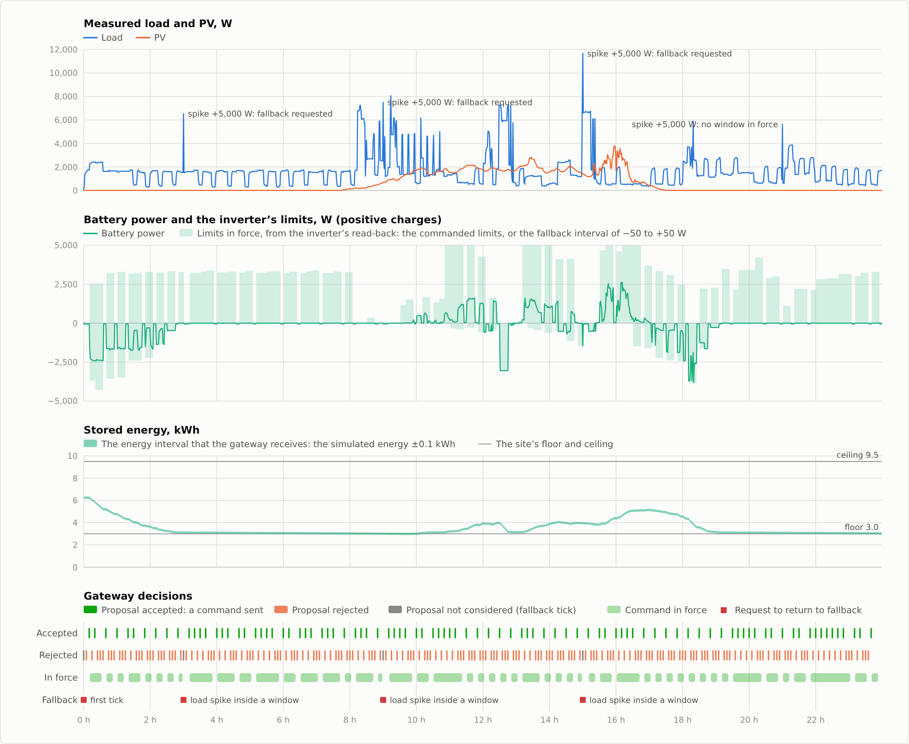
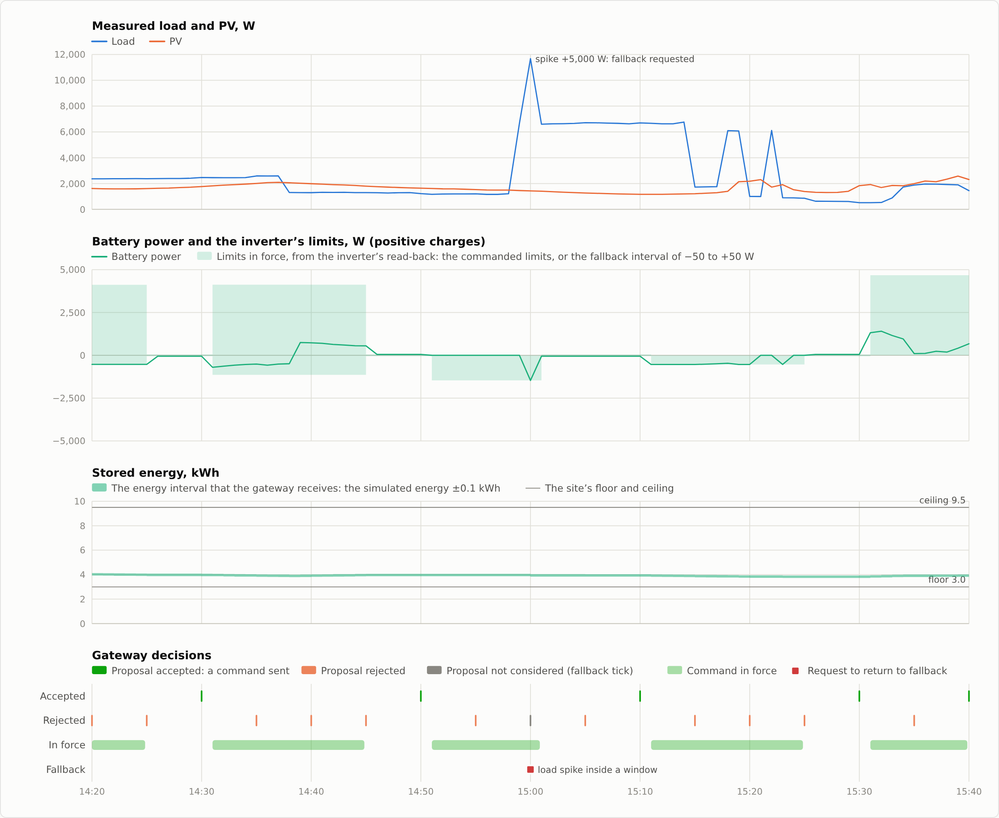

# Energy: authorization of battery power limits

[The program](Program.lean) decides whether a gateway may send proposed battery power limits to the inverter of a behind-the-meter solar-and-battery site for one window of time.  The inverter's own self-consumption mode follows the load within the limits, and a held setpoint `s` is the limits `[s, s]`.  An optimizer without proofs proposes the limits, and the authorizer accepts them only when every trajectory that the model admits satisfies the site's energy and grid limits, or stays no further outside a limit than an immediate return to the inverter's fallback mode would.  `verified_compile` compiles the authorizer, with the test site's profile table, into a module of 6,316 bytes, and the theorems transfer the authorizer's soundness to the module's bytes.  A gateway around the authorizer, with theorems about its rules, runs compiled in a bare-metal loop against a simulator of the plant, on QEMU's Cortex-M7 `mps2-an500` and on a NUCLEO-F767ZI board, as [a day on the board](#a-day-on-a-nucleo-f767zi) and [the gateway in the loop](#the-gateway-in-the-loop) describe.  [The plan](../../energy-controller-plan.md) gives the design, the assumptions, and the stages of the work, and [the replay study](Replay.md) measures the authorizer's margins and the bills of dispatch policies on two years of a test house's data.

## A day on a NUCLEO-F767ZI



The gateway's program for USART3 ran on a NUCLEO-F767ZI board for 1,440 ticks, one simulated day, and each of its 1,440 output records equals the record that the gateway, run in native Lean on the same input records, produces.  [The host program](../../tests/baremetal/uart_gateway.py), on the computer at the other end of the board's USB cable, played the site: load and PV from minutes 10,080 to 11,519 of NIST's minute series of the 2015–16 test year, `replay.py`'s battery, an inverter that applies each command and returns to fallback at its expiry, and an optimizer that proposes limits every five minutes.  Each tick it sent an input record of 144 bytes and checked the output record of 48 bytes that came back: its sequence number, each command against `replay.py`'s authorizer, and each request to return to fallback against the gateway's rules.  The run took 580.5 s at 4,800 baud and passed every check, with 94 commands, 4 requests to return to fallback, the first tick's and three for load spikes inside a window, and 1,342 ticks without output.

The chart's panels share one time axis, in hours from the start of the run.  From the top they show the measured load and PV that the gateway receives, with the four spikes of 5,000 W that the host adds to test the gateway's monitoring; the battery's power, positive while it charges, inside the limits that the inverter reports back; the interval of stored energy that the gateway receives, the simulated energy ±0.1 kWh, between the site's floor of 3.0 kWh and ceiling of 9.5 kWh; and the gateway's decisions.  The host proposed limits 285 times.  The 187 proposals of the full range, −5,000 to +5,000 W, were all rejected with the status export cap, since a lower limit of −5,000 W would let the site export more than its cap of 2,000 W.  Of the 98 narrower proposals, the gateway accepted 94 and did not consider 4 that arrived on ticks that requested fallback.  Sixty of the 94 commands allow no discharge, with a lower limit of 0 W.  Between 09:10 and 09:54 the simulated energy lay up to 5.4 Wh below the floor while the inverter allowed no discharge, because `replay.py`'s battery loses 10 W at all times and so loses energy at zero power.  The load spike at 21:00 drew no request, because the last command's window of 900 s had ended 5 minutes earlier.



The hour from 14:20 to 15:40 shows one window from its proposal to its end.  At 14:50 the gateway accepted the proposal of −1,465 to 0 W, whose snapshot holds a load interval of 1,160 to 6,681 W, sent it as a command with a revert timeout of 870 s, and recorded it as the window in force, and from 14:51 the inverter reported the command.  At 15:00 the host added 5,000 W to the measured load, which reached 11,675 W, outside the snapshot's load interval, so the gateway requested fallback in that tick and set aside that tick's proposal.  At 15:01 the inverter reported fallback, and the battery held −50 W, the end of the fallback interval.  The full-range proposal of 15:05 was rejected, and at 15:10 the gateway accepted −534 to 0 W.

The board ran the chain of artifacts whose theorems this README describes.  `verified_compile` compiles the gateway, the authorizer over fields, and the framing `gwTickUsart3` into the WebAssembly module `gwCompiled`.  `native-bare emit-usart3` translates the module to C with a generated `main` that calls function 34, `gwTickUsart3`, forever and performs the one register access that each call requests, and `native-bare check-usart3` requires the Clight that `clightgen` reads back from the C to equal the program of `gw_usart3_program`.  CompCert 3.18, configured `armv7m-eabihf`, compiles the C with the startup code and the board's code into an image of 80,480 bytes, whose static stack bound is 6,720 bytes, and `st-flash` writes it to the board's flash at `0x08000000` through the board's ST-LINK.  `gw_usart3_program` and `gw_usart3_prefix` hold in the Lean copy of CompCert's Clight, and the Rocq composition carries such a run to CompCert's Asm, so the run on the board tests the items of [the trusted base](../../docs/trusted-base.md#b-bare-metal-images) that no proof covers: CompCert's model of the Cortex-M7 and its run-time functions, the startup and board code, the stack-bound tool, and the device.

The board's STM32F767ZI has a Cortex-M7 with 2 MiB of flash and 512 KiB of SRAM.  The program runs from reset on the internal oscillator at 16 MHz with the caches off, as the startup code leaves them, and polls USART3, whose pins PD8 and PD9 the board connects to the ST-LINK's virtual COM port on the host.  USART3 holds one received byte and the line has no flow control, so the program must read each byte within the 33,333 cycles that a byte takes at 4,800 baud.  No theorem speaks of time, so that margin rests on tests, and over the day every one of the 1,440 records arrived whole and was answered with its own sequence number.  The site is a simulation: the battery, the inverter, and the optimizer are the host's models, and only the gateway's program ran on the board.

[`board-day`](board-day/) holds the run's input and output records, native Lean's output records, the host's summary line, the facts of the run in `meta.json`, [a page of the run](board-day/gateway1440.html) to open in a browser, with a readout of every value at each minute and tables of the events and of every record, and the two charts.  [`tests/baremetal/gateway_report.py`](../../tests/baremetal/gateway_report.py) draws the page from the records, and with a first and a last tick it draws the chart of that range.

## The authorization problem

Signed powers are in watts and positive for charging, energies are in joules, and times are in seconds.  A profile, compiled into the module as a table, holds the site's limits and device parameters: the energy floor `E_floor` and ceiling `E_max`, the largest charge `C` and discharge `D`, the import cap `I` and export cap `X`, a lower bound `η` of the charge and discharge efficiencies, a largest auxiliary loss rate `ℓ⁺`, a tolerance `e` of battery power about a command's limits, a fallback power interval `F = [f⁻, f⁺]` that contains 0, a transition time `τ`, a window length `W`, and the gateway's send deadline `a`.  A snapshot, taken at time `t_m`, holds the interval `[E⁻, E⁺]` of stored energy, the state in force, the intervals `[L⁻, L⁺]` of load and `[S⁻, S⁺]` of PV output over the window, and the proposed limits `[c⁻, c⁺]`.  The state in force is a command with limits `[h⁻, h⁺]`, whose power interval `P` is `[h⁻ - e, h⁺ + e]`, or fallback, whose power interval `P` is `F`.

The window's power interval `B` is the smallest interval that contains `P`, `[c⁻ - e, c⁺ + e]`, and `F`, so `B⁻ = min(P⁻, c⁻ - e, f⁻)` and `B⁺ = max(P⁺, c⁺ + e, f⁺)`.  Because `F` contains 0, `B⁻ ≤ 0 ≤ B⁺`.  A side of `B` that equals the same side of `F` admits only what an immediate return to fallback admits, and the authorizer accepts it without a test.  On a side where `B` extends beyond `F`, the authorizer tests that side's grid cap and energy limit:

| Side | Grid test | Energy test |
|---|---|---|
| Lower, `B⁻ < f⁻` | Export: `L⁻ + B⁻ + X ≥ S⁺` | Floor: `E_floor + ⌈\|B⁻\| · W · 10^6 / η⌉ + ℓ⁺ · W ≤ E⁻`, with `η` in ppm |
| Upper, `B⁺ > f⁺` | Import: `L⁺ + B⁺ ≤ I + S⁻` | Ceiling: `E⁺ + B⁺ · W ≤ E_max` |

The floor test subtracts from stored energy the discharge at efficiency `η` and the largest loss, rounded up, and the ceiling test adds to it the charge at efficiency 1 with no loss.  Each energy test bounds the end of the window, and because the drain and the gain are at least 0, it also bounds the start.  An accepted result includes the limits and the command's expiry `t_m + W - τ`, after which the device reaches fallback within `τ`, by the end of the window.  The profile requires `a + 2τ < W`, so that a command sent at the deadline `a` settles within `τ`, and the gateway's next snapshot follows, before the command expires.

## Interface

```text
profile  word   field                                          unit
         0      layout version, 1
         1, 2   energy floor and ceiling                       J
         3, 4   largest charge C and discharge D               W
         5, 6   import cap I and export cap X                  W
         7      efficiency bound η                             ppm
         8      largest auxiliary loss rate ℓ⁺                 W
         9      tolerance e about the limits                   W
         10, 11 fallback interval, as p + 2^32                 W
         12     transition time τ                              s
         13     window length W                                s
         14     send deadline a, which only the gateway uses   s

input    word   field                                          unit
         0      layout version, 1
         1      snapshot time t_m                              s
         2, 3   energy interval E⁻, E⁺                         J
         4      state in force: mode (0 command, 1 fallback)
         5, 6   limits in force h⁻, h⁺, as p + 2^32            W
         7, 8   load interval L⁻, L⁺                           W
         9, 10  PV interval S⁻, S⁺                             W
         11, 12 proposed limits c⁻, c⁺, as p + 2^32            W

result          status, lower limit, upper limit, expiry
status   0 accepted, 1 length, 2 version, 3 range, 4 order, 5 power, 6 exportCap, 7 floor,
         8 importCap, 9 ceiling: acceptance, or the first condition that fails
```

The profile's validity condition, `ProfileValid` in [the word layer](Words.lean), requires 15 words, version 1, `E_floor ≤ E_max ≤ 2^42`, every power at most `2^20` W, `η` from 500,000 to 1,000,000 ppm, `f⁻ ≤ 0 ≤ f⁺`, `W ≤ 3,600` s, and `a + 2τ < W`.  The authorizer rejects an input with status `length` unless it has 13 words, `version` unless word 0 is 1, `range` unless `t_m < 2^40`, both energies are at most `2^42`, the mode is 0 or 1, load and PV are at most `2^20`, and the four limit words lie within `2^20` of `2^32`, `order` unless every interval and both pairs of limits are ordered, and `power` unless `-D ≤ c⁻` and `c⁺ ≤ C`.  The words of the limits in force are checked in fallback mode too, so the gateway fills them, for example with `2^32`, the word of 0.  A rejection returns 0 for the limits and the expiry.

The test site's table, in [the site module](Site.lean), has an energy floor of 10,800,000 J, a ceiling of 34,200,000 J, `C`, `D`, and `I` of 5,000 W, `X` of 2,000 W, `η` of 900,000 ppm, `ℓ⁺` of 20 W, `e` of 50 W, `F = [-50, 50]` W, `τ` of 30 s, `W` of 900 s, and `a` of 60 s.  The authorizer reads the input as a borrowed array, uses no loop and no recursion, and allocates nothing, so the compiler's theorem for its export excludes traps without a premise on free memory.

## Theorems

[The specification](Spec.lean) defines the model in integers and reals, independently of the program and its word layout.  `ModelUntil` states assumptions A1 and A3 to A5 of [the plan](../../energy-controller-plan.md) from `t_m` to a time `t`: stored energy at `t_m` in `[E⁻, E⁺]`, efficiencies between `η` and 1, a loss rate between 0 and `ℓ⁺`, load and PV in their intervals, measurable power, efficiencies, and loss rate, and stored energy equal to its value at `t_m` plus the integral of its rate.  `AdmittedUntil` adds assumption A2, battery power in `B`.  `WithinOrFallback` states each site limit at `t`, or the model's worst case for an immediate return to fallback, whichever lies further out.  `tests/verified/run.sh` runs [the axiom audit](../../tests/energy/Axioms.lean) and fails unless every audited theorem depends only on `propext`, `Classical.choice`, and `Quot.sound`, and the kernel-evaluated examples depend only on `propext`.

| Theorem | File | Hypotheses | Conclusion |
|---|---|---|---|
| `compiled.authorize.implements` | [The compilation](Verified.lean) | A heap with the allocator invariant, a memory cap of at most 65,535 pages, the profile table at its address, and argument words that represent the borrowed input | Function 17, the `authorize` export, returns the words of `authorize xs` without a trap. |
| `compiled.authorize.native` | [The compilation](Verified.lean) | A C global environment that holds the translation's globals, memory, and functions, and the premises of `compiled.authorize.implements` | The C translation's `authorize` computes `authorize xs` as `compiled.authorize.implements` states. |
| `window_sound` | [The window lemma](Window.lean) | A positive efficiency bound, a fallback interval that contains 0, the integer conditions of the tests, `t` in the window, and a trajectory admitted until `t` | `WithinOrFallback` at `t`. |
| `authorizeWith_iff` | [The authorizer's theorems](Authorize.lean) | A valid profile table | The authorizer accepts exactly when the input is valid and the integer conditions of the tests hold. |
| `site_valid` | [The site's theorems](Theorems.lean) | None | The test site's table meets the profile's validity condition. |
| `authorize_sound` | [The site's theorems](Theorems.lean) | An accepted input, `t` in the window, and a trajectory admitted until `t` | `WithinOrFallback` at `t`. |
| `authorize_accepted` | [The site's theorems](Theorems.lean) | An accepted input | The result holds the proposed limits and the expiry `t_m + W - τ`. |
| `admitted_exists`, `authorize_admits` | [The window lemma](Window.lean), [the site's theorems](Theorems.lean) | An efficiency bound of at most 1,000,000 ppm, a fallback interval that contains 0, and ordered intervals, or an accepted input | For every time `t`, some trajectory is admitted until `t`, so `authorize_sound` is not vacuous. |
| `fallback_keeps_floor`, `_ceiling`, `_export`, `_import`, `within_of_fallback` | [The specification](Spec.lean) | Fallback's worst case within one site limit, or all four, at `t`, and `WithinOrFallback` at `t` | That limit, or `Within`, at `t`. |
| `operation_sound`, `authorize_operation` | [Consecutive windows](Compose.lean), [the site's theorems](Theorems.lean) | Accepted inputs whose snapshots lie at most `W` apart, and `t` from the first snapshot to the end of the last window | `t` lies in the window of the latest accepted snapshot at or before `t`, whose bounds hold at `t` for a trajectory that meets that window's `ModelUntil` and `OperatesIn` until `t`. |
| `operates_exists` | [Consecutive windows](Compose.lean) | An efficiency bound of at most 1,000,000 ppm, ordered intervals, and a nonempty interval of the state in force | Some trajectory and applied states meet a window's `ModelUntil` and `OperatesIn`, so the composition is not vacuous. |
| `energy_authorize` | [The site's theorems](Theorems.lean) | None | The module's bytes decode to the module, whose export `authorize` is function 17, whose start store is ready, and whose entry returns `authorize xs` without a trap from every ready store, and every accepted result meets `authorize_sound`. |
| `example_accept`, `example_export`, `example_floor`, `example_relative`, `example_renewal`, `example_limits`, `example_limits_import` | [The examples](Examples.lean) | None | The decisions of the plan's worked example, by kernel evaluation. |
| `energy_file`, `energy_file_decode` | [The file theorems](File.lean) | The file `build/verified/energy.wasm` as written | The file holds `encode compiled.module` and decodes to `compiled.module`. |
| `authorizeFlat_eq` | [The authorizer over fields](Fields.lean) | None | `authorizeFlat (Prof.of site) s` equals `authorizeWith site s.words` for every table `site` and snapshot structure `s`. |
| `gateway_command` | [The gateway's theorems](GatewayTheorems.lean) | A tick whose output is a command | G1 and G3 of [the gateway in the loop](#the-gateway-in-the-loop). |
| `gateway_fault`, `gateway_leaves` | [The gateway's theorems](GatewayTheorems.lean) | A faulty record, or a record that is not faulty with measurements outside the window in force before its end | G2: the tick requests fallback, and its state records fallback at the tick's clock and ends the window. |
| `gateway_record`, `expire_record` | [The gateway's theorems](GatewayTheorems.lean) | None | G4: the recorded state changes only to fallback at the expiry of a command whose expiry is at most the clock, to a command at the tick's clock, or to fallback at the tick's clock. |
| `gateway_states` | [The gateway's runs](GatewayRun.lean) | `Follows`, and the ticks of a run that output commands, in increasing order, including every one whose clock is at or before `t` | `OperatesIn.states` for each window of the run of their snapshots, up to `t`. |
| `gwTickWith_abs`, `gwTick_abs`, `gw_program`, `gw_prefix`, `gwTickUsart3_abs`, `gw_usart3_program`, `gw_usart3_prefix` | [The gateway's program](Loop.lean) | For `gw_program` and `gw_usart3_program`, CompCert's external declarations with `PrefixOk` | The step computes the framing of `gateway` over its UART, the program runs forever with one register access in each window for every sequence of values read, and the bytes that it writes begin the bytes of `gateway`'s output records for the input records that it reads. |

`authorize_sound` would also hold of an authorizer that rejected every input, and `authorizeWith_iff` excludes that authorizer by stating the acceptance condition exactly.  `example_accept` and `example_relative` accept a discharge of 1,000 W and a charge of 3,000 W.  `example_renewal` rejects the renewal of a 1,000 W discharge whose lower energy bound would cross the floor, because the discharge in force and its renewal extend `B` below `F`, so the authorizer tests the floor.  `example_relative` accepts a charge while PV output with the battery in idle fallback could exceed the export cap, with an export bound relative to fallback's worst case of -4,550 W.  `example_limits` accepts the limits `[-1,000, 500]` W, which the authorizer tests on both sides, and `example_limits_import` rejects `[-1,000, 1,000]` W, whose charge of 1,050 W, the upper limit and the tolerance, with the load at 4,000 W and no PV could import 5,050 W.

## Consecutive windows

[The operation's specification](Operation.lean) describes a gateway that sends one accepted command after another.  A `Run` lists the accepted authorizations in order of time, each with its snapshot and limits, and `Run.Spaced` requires each accepted snapshot to follow the previous one within `W`, which is the plan's rule 5 together with the acceptance of a snapshot in each window.  For one window, `OperatesIn` states the gateway's rules and the device's response from the window's snapshot to a time `t`, with `state w` the state that the device has applied at time `w`:

| Field | Requirement | Plan's source |
|---|---|---|
| `settled` | At the snapshot, battery power lies in the interval of the state that the snapshot records | Rule 1 |
| `states` | From the snapshot to the next accepted snapshot, the applied state is the recorded one, the command authorized from this snapshot, or fallback | Rules 2 to 4 and assumption A7 |
| `low`, `high` | From the snapshot on, battery power stays within the smallest interval that contains its value at the snapshot, 0, and the intervals of the states that the device applies | The device's transitions, protective trips and deratings toward 0, and return to fallback |

`power_in_window` derives assumption A2 from `OperatesIn`, because every allowed state's interval and 0 lie in `B`.  `run_sound` gives an accepted window's bounds at each time from its snapshot to the next, and `run_covered` shows that when the run is spaced, every time from the first snapshot to the end of the last window lies in the window of the latest accepted snapshot at or before it.  `operation_sound` combines them, and `authorize_operation` states the result for the test site's module.  Its premises at `t` concern only the window that contains `t`, so a fault in one window leaves the theorems of later windows applicable, and nothing is claimed after the end of the last window.

## The gateway in the loop

[The gateway](Gateway.lean) is a machine `gateway : GwState → GwIn → GwState × GwOut` around the authorizer, written in the verified compiler's dialect for the test site's profile.  Each step, a tick, reads one input record and writes one output record, and the records and the state are structures of words with `Flat` instances: 18 words in, 6 out, and 17 of state.  [Its program](Loop.lean) runs in the bare-metal request loop of [the bare-metal design](../../docs/native-bare-metal.md#records-over-the-uart) on QEMU's `mps2-an500`, a Cortex-M7, and exchanges the records with a simulator of the plant at the far end of UART0.  Another program exchanges them over USART3 of [the NUCLEO-F767ZI](../../docs/native-bare-metal.md#the-nucleo-f767zi), a board with a Cortex-M7, and ran a simulated day on the board, as [a day on a NUCLEO-F767ZI](#a-day-on-a-nucleo-f767zi) describes.

```text
input    word   field                                          unit
         0      sequence number
         1      clock c                                        s
         2      time of the measurements                       s
         3      battery power, as p + 2^32                     W
         4, 5   load and PV                                    W
         6, 7   energy interval E⁻, E⁺                         J
         8      read-back mode (0 command, 1 fallback)
         9, 10  read-back limits, as p + 2^32                  W
         11     1 when the record holds a proposal
         12, 13 load interval L⁻, L⁺                           W
         14, 15 PV interval S⁻, S⁺                             W
         16, 17 proposed limits c⁻, c⁺, as p + 2^32            W

output          sequence number of the input record, kind, lower limit, upper limit,
                revert timeout in s, status of the last snapshot
kind     0 nothing, 1 command, 2 request to return to fallback
```

The state holds the expected sequence number, the largest clock seen, whether a tick has run, and the status of the last snapshot.  It also holds the recorded state, which is a mode, limits, a command's expiry `t_x`, and the time of the last change, and the window in force, with its end, its interval `B`, and the snapshot's load and PV intervals.  The initial state `gw0` records fallback.  A tick takes as its clock `c` the record's clock, or the largest clock seen when the record's clock lies below it or at or above `2^40`, advances the expected sequence number by one, and applies these rules in order:

1. A recorded command whose expiry `t_x` is at most `c` becomes fallback, changed at `t_x`.
2. A faulty record requests fallback: the first tick, a sequence number other than the expected one, a clock below the largest seen or at least `2^40`, or measurements later than the clock or more than 120 s older than it.
3. Before the end `t_m + W` of the window in force, load or PV outside the snapshot's intervals, or battery power outside `B`, requests fallback.  So does a read-back that differs from the recorded state at least `τ` after the last change, a comparison that ignores the limit words in fallback mode.
4. A proposal becomes a snapshot only when the read-back equals the recorded state, measured battery power lies in the recorded state's interval, and the last change lies at least `τ` before `c`.  The snapshot's words are version 1, `c`, the energy interval, the recorded state, whose limit words are `2^32` in fallback mode, and the proposal's intervals and limits.
5. An accepted snapshot sends its command in the same tick, with the revert timeout `t_x - c`, records the command with its expiry and the change's time `c`, and becomes the window in force.  A rejected snapshot changes only the reported status.

A request to return to fallback records fallback, changed at `c`, and ends the window.  The command leaves in the tick of its snapshot, so the profile's send deadline `a` plays no part.  [The authorizer over fields](Fields.lean), `authorizeFlat`, decides each snapshot with the authorizer's code over the fields of a profile structure `Prof` of 15 words and a snapshot structure `Snap` of 13, so the compiled tick builds no array and reads no table.  `authorizeFlat_eq` states that `authorizeFlat (Prof.of site) s` equals `authorizeWith site s.words`, and the gateway's profile `siteProf` equals `Prof.of site` by `rfl`, so every theorem about `authorizeWith site` applies to the gateway's decisions.

[The gateway's theorems](GatewayTheorems.lean) state properties G1 to G4 of one tick from a state `g` and a record `i`, where `tickClock g i` is the tick's clock and `tickStart g i` the state after the expiry check.  `gateway_cases` lists the cases of a tick with the state and the output of each, from which `gateway_command`, `gateway_fault`, and `gateway_record` follow.  [The audit](../../tests/energy/Axioms.lean) includes them with the authorizer's theorems.

| Property | Theorems | Statement for one tick |
|---|---|---|
| G1 | `gateway_command` | The tick outputs a command only when `authorizeWith site` accepts `tickSnap g i`, the snapshot whose words hold the tick's clock and the recorded state of `tickStart g i`.  The command's limits are the proposed limits, its revert timeout is the decision's expiry minus the clock, and the recorded state becomes the command, with that expiry, changed at the clock |
| G2 | `gateway_fault`, `gateway_leaves` | A faulty record, or a record that is not faulty and whose measurements leave the window in force before its end, makes the tick request fallback, and the state becomes `fallbackAt` of the clock, which records fallback and ends the window |
| G3 | `gateway_command` | A tick that outputs a command found the record not faulty, the measurements inside the window in force, the read-back equal to the recorded state, measured battery power in that state's interval, and the last change at least `τ` before the clock |
| G4 | `gateway_record`, `expire_record` | The expiry check changes the recorded state only to fallback, at the expiry of a command whose expiry is at most the clock.  After it, the recorded state changes only to the command, at the tick's clock, with output kind 1, or to fallback, at the tick's clock, with kind 2, and kind 0 leaves it unchanged |

[The gateway's runs](GatewayRun.lean) derive `OperatesIn.states` from these theorems and assumption A7.  A run reads the input records `ins` from `gw0`, and its recorded state changes at most twice a tick: `change ins (2n)` is the expiry of tick `n`, at the command's expiry, and `change ins (2n + 1)` its command or request to return to fallback, at the tick's clock, each with the state that it records.  `Follows ins applied` states A7 over these changes with `τ` of 30 s: at each time `w` at which some change lies at least `τ` in the past, the device applies the state of a change whose time is at most `w` and whose slot is at or after that of every change whose time is at most `w - τ`.  Before the first change has had `τ` to take effect, `Follows` allows any state.  `last_change` states that before each tick after the first, the last change in the earlier slots records the gateway's recorded state and its time.  `states_between` follows: at each time at or after the clock of a tick that accepts a snapshot and before the clock of the next such tick, the device applies the state that the snapshot records, the snapshot's command, or fallback, because by G3 the change that set the recorded state lies at or before `w - τ`, and every later change at or before `w` is the snapshot's command or records fallback.

`gateway_states` states `OperatesIn.states` for each window `j` of `runOf J`, the run of the snapshot words of the ticks `acc 0` to `acc (J - 1)`, from its snapshot to a time `t`.  Its premises are `Follows`, ticks `acc j` in increasing order that each output a command, and the condition that every tick that outputs a command at a clock at or before `t` is one of them, since `Run.Between` puts no upper end on the last window.  By G1, `authorizeWith site` accepts each snapshot of the run, which is the acceptance premise of `authorize_operation`, and `gateway_states` supplies the field `states` of its premise `OperatesIn`.  The fields `settled`, `low`, and `high` remain premises: `settled` concerns battery power at the snapshot's time, which the gateway checks only through the measured word, and `low` and `high` state the device's response.  `ModelUntil` remains a premise, and so does `Run.Spaced`, since the spacing of accepted snapshots depends on the proposals and on the authorizer's decisions.

`gwTickWith` (`Loop.lean`) is the framing `frameTick` of [the bare-metal design](../../docs/native-bare-metal.md#records-over-the-uart) with `gateway` as its record machine, each word sent as 8 bytes, most significant first, over the UART whose register map its parameters `rx`, `tx`, `status`, `rxFull`, `txMask`, and `txRoom` give.  It holds the input record as a shift register of 18 words, the output record as one of 6, and the gateway's state, a state of 45 words.  `gwTick` instantiates it for UART0 of `mps2-an500` and `gwTickUsart3` for USART3 of the NUCLEO-F767ZI's STM32F767ZI, and each takes 46 words and returns 46.  `verified_compile (pages := 1) (cap := 1)` compiles `gwTickWith`, `gwTick`, and `gwTickUsart3`, with the gateway's functions and the authorizer over fields, into `gwCompiled`, whose functions 33 and 34 are `gwTick` and `gwTickUsart3`.  `gwTickWith_abs` states that `gwTickWith` computes `frameTick` of `gwSpec` over the UART of its parameters, under the map `gwAbs` to lists, where `gwSpec` is `gateway` over lists of words, and `gwTick_abs` and `gwTickUsart3_abs` instantiate it for the maps `gwUart` and `gwUsart3`.  `gw_program` and `gw_usart3_program` state `LoopReacts` of the programs `reqMain 33 (gwWords gwInit)` and `reqMain 34 (gwWords gwInit)` for every sequence `σ` of the values that their volatile loads read.  `gw_prefix` and `gw_usart3_prefix` state that the bytes that the first `n` windows of a program write to its UART's transmit register begin the bytes of the gateway's output records, from `gw0`, for the input records that the bytes read from the receive register in those windows encode.

`tests/baremetal/req.sh` writes the program's C text, compares the Clight that `clightgen` reads from it with the program of `gw_program`, builds it for `mps2-an500` with the stack bound and the access check, and runs it with `tests/baremetal/uart_gateway.py`, which plays the plant, the inverter, ingestion, and the optimizer at the far end of UART0, one tick per minute of a minute series that `replay.py prepare` writes.  The clock starts at 1,400,000,000 s and advances 60 s a tick, the battery is `replay.py`'s nominal plant, and the inverter applies each change at the tick of the change, reverts to fallback at the first tick at or after a command's expiry, and follows the net load within the interval of the state in force, the floor, and the ceiling, as `replay.py`'s plant does with its option `follow`.  Every five ticks the optimizer proposes as the load and PV intervals the extremes of the minute values over the window ahead, and as limits, alternately, the widest limits that `replay.py` accepts and the full range of charge and discharge, and every 360 ticks the measured load exceeds the minute's load by 5,000 W.  The script checks that each output record carries the input's sequence number, that each command is the decision of `replay.py`'s `authorize` for the snapshot words that the record and the read-back give, with the revert timeout equal to the expiry minus the clock, and that a tick requests fallback exactly when it is the first or when load, PV, or battery power leaves the last command's window before its end.  `native-bare gateway-run` then runs `gateway` in native Lean on the same input records, and the output records must equal the program's.  Over 43,200 ticks, 30 simulated days from minute 10,080 of the series of the 2015–16 test year, the program sent 2,977 commands and 72 fallback requests, the first tick's and 71 for load spikes inside a window, in 130 s, and over 10,080 ticks, the default of `req.sh`, 715 commands and 17 fallback requests in 31.4 s, each run with output records equal to native Lean's.  The static stack bound of `main` is 6,712 bytes for `mps2-an500` and 6,720 for the NUCLEO-F767ZI.

## Limits of the theorems

The theorems concern the model.  Stored energy changes only by battery power through the efficiencies and by the auxiliary loss, the grid limits are limits on instantaneous power, and load and PV output are nonnegative, so a PV inverter's standby draw counts as load.  No theorem proves the device's response, which equipment qualification and tests support, and none states anything about a time after a premise fails, or after the last window, when the fallback mode's own protections apply.  A different site needs its own profile table, its own `site_valid`, and its own module and file theorems, because the table is part of the module's bytes.

The module statements describe execution in Talos's semantics, and the agreement of Wasmtime with Talos, the decoder's reading of the bytes, Wasmtime's instantiation, and the host's placement of the input are assumptions of [the trusted base](../../docs/trusted-base.md).  The tests compare Wasmtime with native Lean on every case, which is evidence for these assumptions without proving them.  For the C translation, `compiled.authorize.native` replaces these assumptions with those that the trusted base lists for C files, among them CompCert and the Lean copy of Clight.  The replay tool implements the acceptance rule a second time and agrees with the module on every case, which is evidence that the program states the plan's rule.

The gateway's theorems concern the machine `gateway` and the bytes that its program exchanges over the UART, with A7 and the device's response as premises.  The gateway acts only on complete records and takes its clock from them, so a silent channel produces no tick and no fallback request, and only the device's expiry then returns the device to fallback, which leaves the plan's rule 4 for stopped telemetry without a counterpart.  The gateway requests fallback for a record whose sequence number differs from the expected one, which advances by one each tick, but the framing does not resynchronize after a lost or added byte, which shifts every later record.  QEMU's UART model loses no byte, and over the day on the board every record arrived whole, but one lost byte on a board would shift every later record, so a board needs a framing that resynchronizes.  The clock is a word of the input record, so A7 relates the device's times to the clock of the sender of the records, the simulator on QEMU, and a gateway that reads a hardware timer has other inputs and needs its theorems restated.

## Building, running, and testing

```sh
tools/leanrun --timeout 60m lake build Demos.Energy.Theorems Demos.Energy.Examples \
  Demos.Energy.GatewayRun Demos.Energy.Loop
tests/verified/run.sh --cases energy
build/tools/leanexe-wasmtime-host call build/verified/energy.wasm authorize list:i64,i64,i64,i64 \
  array-u64:1,0,14400000,15120000,0,4294967296,4294967296,3000,4000,0,3000,4294966296,4294967796
lake exe verified-cases-energy > cases.txt
uv run tests/energy/replay.py check cases.txt
CCOMP=ccomp CLIGHTGEN=clightgen tests/native/verified.sh --module energy
uv run tests/energy/replay.py prepare NIST_2015_DIRECTORY nist-2015.csv
CCOMP=ccomp CLIGHTGEN=clightgen SERIES=nist-2015.csv TICKS=43200 tests/baremetal/req.sh
CCOMP=ccomp CLIGHTGEN=clightgen tests/baremetal/usart3.sh build
st-flash --reset write build/baremetal/usart3/gateway.bin 0x08000000
SERIES=nist-2015.csv tests/baremetal/usart3.sh run gateway /dev/ttyACM0
uv run tests/baremetal/gateway_report.py Demos/Energy/board-day/gateway1440.records \
  Demos/Energy/board-day/meta.json gateway1440.html
RENODE=renode SERIES=nist-2015.csv tests/baremetal/usart3.sh emulate gateway
```

The run writes `build/verified/energy.wasm`, checks its file theorems, runs the axiom audit, and compares 2,056 cases between Wasmtime and native Lean from [the case generator](../../tests/TestSupport/Energy/Cases.lean).  The cases are the worked example, invalid inputs with each word one past its range, inputs on both sides of each test's boundary and at the ends of each range, and 2,000 inputs that SplitMix64 draws from a fixed seed.  The call passes the worked example's limits `[-1,000, 500]` W and prints `0`, `4294966296`, `4294967796`, and `870` on four lines: acceptance, the two limits, and the expiry.  `lake exe verified-cases-energy --summary` prints the count of each status in each class of cases, and `replay.py check` compares every case with the replay tool's rule.  The native driver translates the module to C, compares the Clight that `clightgen` reads back from the printed C with the translation, compiles the C with CompCert 3.18's `ccomp`, and runs the same 2,056 cases.

`replay.py prepare` writes the minute series of the 2015–16 test year from NIST's minute files, as [the replay study](Replay.md) describes.  `req.sh`, with `ccomp` and `clightgen` of CompCert 3.18 configured `armv7m-eabihf`, writes, checks, builds, and runs every program with requests, the gateway's among them, and prints a line for each.  For the gateway it runs `uart_gateway.py` for `TICKS` ticks from minute 10,080, 10,080 ticks unless set, compares the output records with those of `native-bare gateway-run`, and leaves the input and output records in `build/baremetal/req`.  The axiom audit of `tests/verified/run.sh` covers the gateway's theorems.

`usart3.sh build`, with the same CompCert tree, writes the C text of the echo and of the gateway's program for USART3, compares the Clight that `clightgen` reads from each with the program of its theorem, builds each for the board `nucleo-f767zi` with the stack bound and the access check, and writes `echo.bin` and `gateway.bin` in `build/baremetal/usart3`.  After the user writes `gateway.bin` to the board's flash at `0x08000000`, with `st-flash` or by copying it to the drive that the board's ST-LINK presents, and resets the board, `usart3.sh run gateway DEVICE` runs `uart_gateway.py` through the serial port `DEVICE`, the virtual COM port of the board's ST-LINK, at 4,800 baud for `TICKS` ticks, 1,440 unless set, and compares the output records with those of `native-bare gateway-run`.  A tick of 192 bytes takes 400 ms at 4,800 baud, so a simulated day takes about 580 s.  Before the gateway, bring-up runs the fault images `guard.bin` and `ldrd.bin`, whose startup code reports a fault through USART3, and then the echo of the request protocol, `echo.bin`, each with `usart3.sh run NAME DEVICE`.  `usart3.sh emulate gateway`, with `RENODE` naming Renode 1.17.0's `renode`, runs the same check on Renode's model of the board, whose USART3 has the board's registers but whose clocks, pins, and timing are those of an emulator, and over 1,440 ticks its output records equal native Lean's.  On the board, the echo passes, and the gateway passes a simulated day of 1,440 ticks, as [a day on a NUCLEO-F767ZI](#a-day-on-a-nucleo-f767zi) describes.

## References

- [Verified Energy Controller: Plan and Design](../../energy-controller-plan.md)
- [Energy: replay study](Replay.md)
- [Trusted base](../../docs/trusted-base.md)
- [LeanExe native code on bare metal: design and plan](../../docs/native-bare-metal.md)
- [Verified Compiler Manual](../../docs/verified-manual.md)
- [Talos](https://github.com/jsmorph/talos)
- [Wasmtime documentation](https://docs.wasmtime.dev/)
- [WebAssembly Core Specification](https://webassembly.github.io/spec/core/)
- [Mathlib: Mathlib.MeasureTheory.Integral.IntervalIntegral.Basic](https://leanprover-community.github.io/mathlib4_docs/Mathlib/MeasureTheory/Integral/IntervalIntegral/Basic.html)
- [Steele, Lea, and Flood, Fast Splittable Pseudorandom Number Generators, OOPSLA 2014](https://doi.org/10.1145/2660193.2660195)
