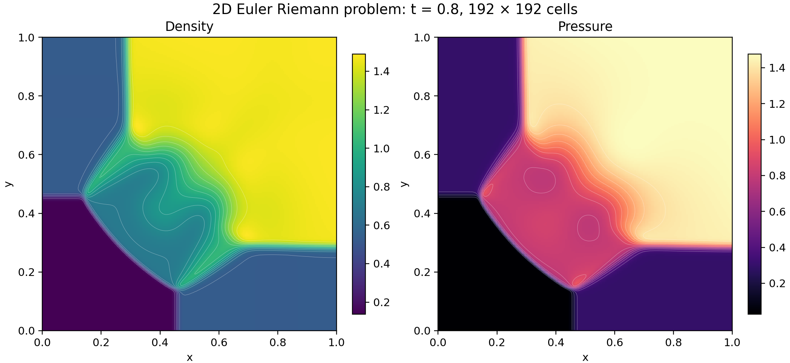
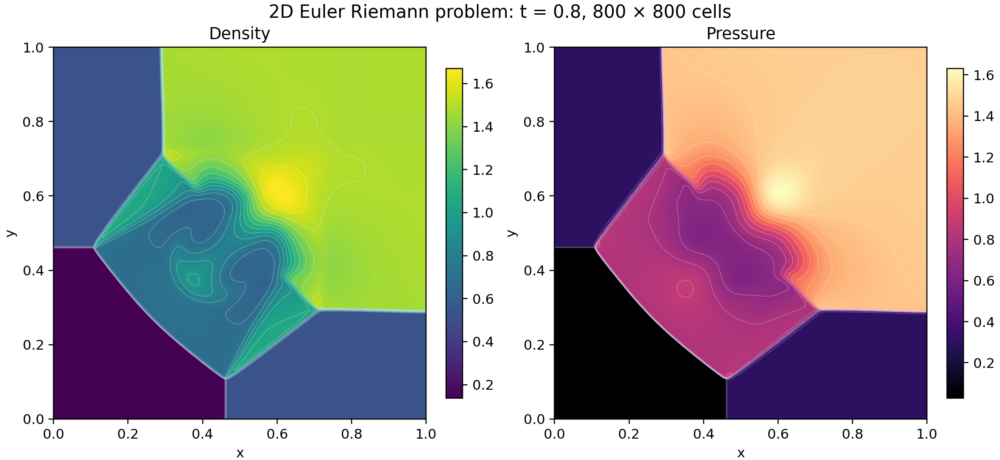

# A four-state Euler calculation in proved WebAssembly

The `solve` export of the verified Euler module, proved to compute its Lean definition, evolves
the four-quadrant problem from the [Lanyon Euler
article](https://lanyon.ai/research/euler-equations/).  Initialization, timestep selection, both
directional sweeps, retries, allocation, and final output execute inside one call of the export.
The module compiles [the buffered form](../Buffered.lean) of the solver, which equals [the
program](../Program.lean) by `solve_eq`.





The finer grid resolves thinner fronts and a higher central density maximum.  Front positions and
the curved interaction region resemble the [Lanyon density
figure](https://lanyon.ai/figs/euler-equations/2d-riem-density-final.png).  This comparison is
visual.  Colors show cell values, and white curves show interpolated isolines.  Each panel uses its
own color range.  The figures come from the output words of [the runs](#runs-and-commands).

## Problem and method

The domain is the unit square, the initial interfaces are x = y = 0.8, the final time is 0.8, and
the ideal-gas ratio of specific heats is γ = 1.4.

| Quadrant | Pressure | Density | x velocity | y velocity |
|----------|---------:|--------:|-----------:|-----------:|
| Top left | 0.3 | 0.5323 | 1.206 | 0 |
| Top right | 1.5 | 1.5 | 0 | 0 |
| Bottom left | 0.029 | 0.138 | 1.206 | 1.206 |
| Bottom right | 0.3 | 0.5323 | 0 | 1.206 |

Each cell stores density, both momenta, and total energy.  Cells cut by an initial interface receive
conservative area averages.  The first-order finite-volume method uses Rusanov fluxes, an x sweep
followed by a y sweep, and transmissive boundaries implemented by clamping neighbor indices.
Timestep selection targets CFL 0.4.  Each accepted cell update checks a rounded ceiling of 0.5.

## Program and proofs

[The solver](../Program.lean) states the method in Lean.  [The verified module](../Verified.lean)
compiles its buffered form with that of [the reconstructed solver](../reconstructed/README.md), and
[the call theorems](../VerifiedCall.lean) state the module's calls in terms of the Lean solvers.
The theorems below concern the module's `solve` export and the Lean function `solve`, which packs
the result of `run`.

| Claim | Statement | Theorem |
|-------|-----------|---------|
| Execution and memory | Encoding gives bytes that decode back to the module, whose `solve` export is entry 28.  Called with any `n` from the store in which the module starts, under a memory cap of at least `solvePages n` and at most 65,535 pages, the export returns without a trap the address of a new array that holds the words of `solve n`.  It leaves a ready store whose `top` lies at most `solveBytes n` bytes above the heap base, and `solvePages n` is at most 1,563 for every `n`. | `euler_solve_call` in [the call theorems](../VerifiedCall.lean) |
| Output | Words with status 0 hold the bits of 0.8, `2 ≤ n ≤ 800`, and `n²` positive, finite densities and pressures. | `solve_ok` in [the run properties](../Spec.lean) |
| Admissibility and hyperbolicity | Words with status 0 pack a final grid whose states have positive density and pressure in exact arithmetic with γ = 7/5.  At each such state the derivative of the flux in every unit direction has a basis of real eigenvectors with eigenvalues `un - c`, `un`, `un`, and `un + c`. | `solve_hyperbolic` in [the hyperbolicity theorems](../Hyperbolic.lean) |
| Conservation | Each run with status 0 is a chain of accepted steps along which the total of mass, of each momentum, and of energy equals its initial total, minus the boundary fluxes summed over the steps, plus a rounding residual.  The residual is at most a sum of per-update bounds computed from the words of the run. | `run_balance` in [the balance theorems](../FirstOrderBalance.lean) |
| Conservation with exact boundary fluxes | Along the same chain, each total equals its initial total minus the exact Rusanov flux through the boundary, evaluated at the values of the boundary states with the computed speeds, plus a residual.  The residual is at most the sum of the per-update bounds and of bounds on the computed boundary fluxes, all computed from the words of the run. | `run_reference_balance` in [the boundary theorems](../Reference/Boundary.lean) |
| Flux and update accuracy | Let `ε = 2⁻⁵²` and `1 ≤ M ≤ 2¹⁰⁰`.  For two states that pass the state guard, with density in `[1/M, M]`, momenta and energy at most `M` in magnitude, and internal energy at least `24 ε M³`, `flux` accepts with a positive speed at most `32 M²`, and each component is within `304 ε M⁵` of the exact Rusanov flux of the two states' values with that speed.  When `advanceCell` accepts three such states with a ratio `r ≤ 1`, each conserved output is within `ε M + 1004 ε r M⁵ + 2⁻¹⁰⁷⁴` of the exact Rusanov update. | `interface_reference_error` in [the interface theorems](../Reference/Interface.lean), `advanceCell_reference_error` in [the update theorems](../Reference/Update.lean) |

The proofs use only `propext`, `Classical.choice`, and `Quot.sound`.  Execution relies on Wasmtime
and the hardware implementing the WebAssembly semantics that the proofs model.  `solveBytes n`
covers three grids of `cells n` cells and the packed result, each with its block header, and
`solvePages n` adds the heap base of 4096 bytes.  `euler_solve_call` starts from the modeled store
in which the module starts and states no final page count.  Instantiation by a WebAssembly engine
lies outside the proofs, as [the verified compiler
manual](../../../docs/verified-manual.md#outside-the-proofs) states.

For density 1, zero momenta, and energy 1, an admissible state, `side` accepts the state and
returns a signal speed with the bits `0x3FE7F254DAB9CC3A`, which is below the exact sound speed
√(14/25): `speed_below_sound` in [the counterexample](../SpeedCounterexample.lean) proves this.
`verified_side` states that the module's `side` export, entry 4, returns the words of `side` of its
arguments on every run without a trap, and so returns these words for this state.  The theorems
therefore state no CFL bound in exact arithmetic for this solver, and whether a run from the four
quadrants reaches such a state is unproved.  [The reconstructed solver](../reconstructed/README.md)
uses outward speed bounds and has such a bound.  Convergence to a weak solution of the continuous
Euler equations remains unproved.

## Runs and commands

| Grid | Density range | Pressure range | Data | Export figures |
|------|--------------:|---------------:|------|----------------|
| 192 × 192 | 0.138–1.490131234 | 0.029–1.476780108 | [Words](https://github.com/jsmorph/leanexe-papers/blob/main/data/euler/first-order/192-run/words.u64le), [CSV](https://github.com/jsmorph/leanexe-papers/blob/main/data/euler/first-order/192-run/cells.csv.gz) | [SVG](https://github.com/jsmorph/leanexe-papers/blob/main/data/euler/first-order/192-run/density-pressure.svg), [PDF](https://github.com/jsmorph/leanexe-papers/blob/main/data/euler/first-order/192-run/density-pressure.pdf) |
| 800 × 800 | 0.138–1.671084032 | 0.029–1.632146140 | [Words](https://github.com/jsmorph/leanexe-papers/blob/main/data/euler/first-order/800-run/words.u64le), [CSV](https://github.com/jsmorph/leanexe-papers/blob/main/data/euler/first-order/800-run/cells.csv.gz) | [SVG](https://github.com/jsmorph/leanexe-papers/blob/main/data/euler/first-order/800-run/density-pressure.svg), [PDF](https://github.com/jsmorph/leanexe-papers/blob/main/data/euler/first-order/800-run/density-pressure.pdf) |

A module of the LeanExe compiler, which the repository no longer contains, computed the output
words of both runs, and the CSV files and the ranges also come from those words.  The words follow
the layout of `pack`: the status, the bits of the time, `n` twice, the `n²` densities, and the `n²`
pressures.  Each run directory holds the output words, a CSV file of the cells, and the figures
drawn from it.

The commands build the Wasmtime host and the call theorems, write the verified module, and run each
grid into a fresh directory.  [The run script](../../../tools/euler-run.py) requires status 0, the
word of 0.8, and `4 + 2n²` words.  It writes the words to `words.u64le`, and the wall time, the
peak resident size, and the SHA-256 of the words to `summary.json`.

```sh
tools/build-wasmtime-host.sh
tools/leanrun --timeout 60m lake build Demos.Euler.VerifiedCall
mkdir -p build/verified
tools/leanrun --timeout 10m --lock-timeout 1200 lake env lean --run tools/Emit.lean \
  Demos.Euler.Verified Demos.Euler.Verified.compiled.module build/verified/euler.wasm
uv run tools/euler-run.py build/verified/euler.wasm first 192 new-192-directory
uv run tools/euler-run.py build/verified/euler.wasm first 800 new-800-directory
```
