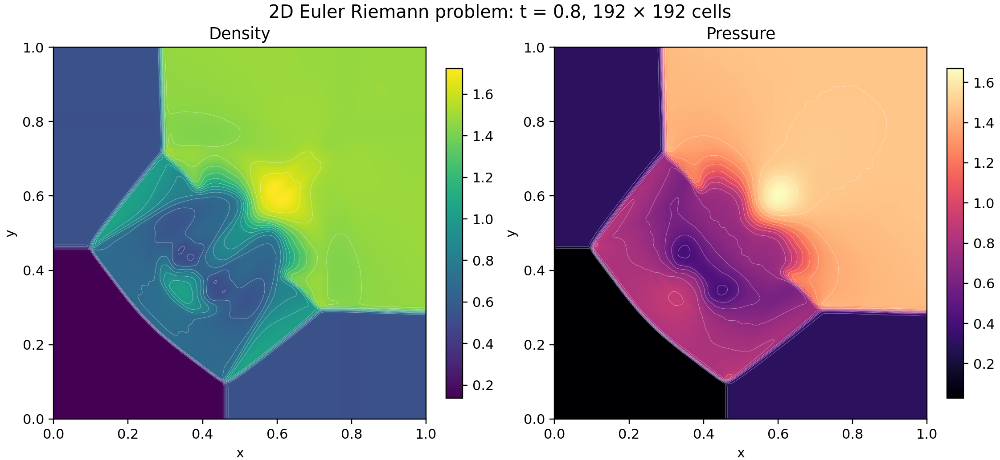
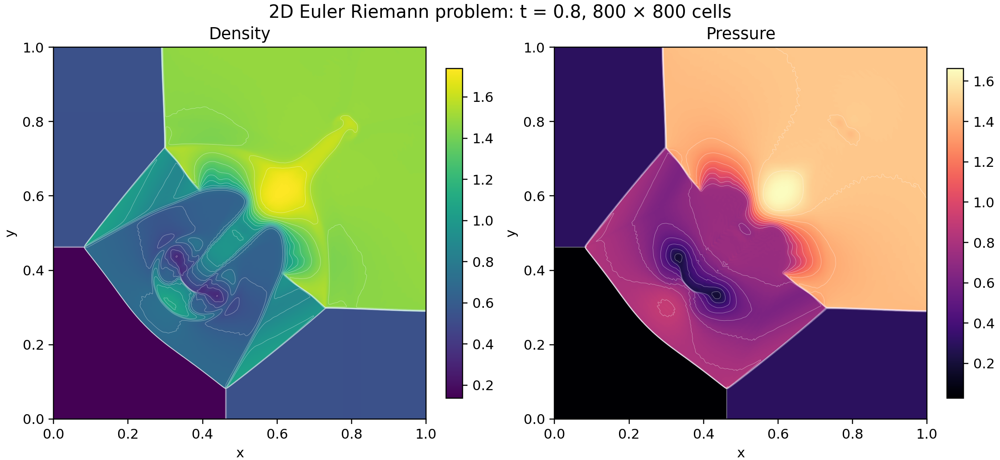

# A reconstructed Euler calculation in proved WebAssembly

The `reconstructedSolve` export of the verified Euler module, proved to compute its Lean
definition, evaluates the four-state Euler problem from the [Lanyon
article](https://lanyon.ai/research/euler-equations/).  Initialization, reconstruction, timestep
selection, both directional sweeps, retries, allocation, and final output execute inside one call of
the export.  The module compiles [the buffered form](../Buffered.lean) of the solver, which equals
[the program](../ReconstructedProgram.lean) by `reconstructedSolve_eq`.





Both calculations ran with a trial count of 8, the limit on reconstruction attempts, and reached
time 0.8 with status 0.  A module of the LeanExe compiler, which the repository no longer contains,
computed their output words.  The figures, CSV files, and ranges below come from those words.

## Problem and method

The domain is the unit square, the initial interfaces are x = y = 0.8, the target time is 0.8, and
the physical ideal-gas parameter is γ = 7/5.

| Quadrant | Pressure | Density | x velocity | y velocity |
|----------|---------:|--------:|-----------:|-----------:|
| Top left | 0.3 | 0.5323 | 1.206 | 0 |
| Top right | 1.5 | 1.5 | 0 | 0 |
| Bottom left | 0.029 | 0.138 | 1.206 | 1.206 |
| Bottom right | 0.3 | 0.5323 | 0 | 1.206 |

Each cell stores density, both momenta, and total energy.  Initialization uses conservative area
averages for cells cut by an interface.  Each directional update reads five cells, reconstructs
three of them, and evaluates Rusanov fluxes at the center cell's two faces.  Neighbor indices clamp
at the domain boundaries.  An x sweep precedes a y sweep.

Reconstruction uses componentwise minmod slopes with a common scale factor.  The program tests both
reconstructed faces for positive density and pressure, halves all four slopes after rejection, and
uses the cell average if eight attempts fail.  Componentwise minmod alone does not preserve
positive pressure: `negative_pressure` in [the
counterexample](../Equations/ReconstructionCounterexample.lean) gives three admissible states whose
exact minmod right face has pressure -1/10.  Outward-rounded speed bounds and executable CFL checks
establish dt times grid size times each physical characteristic-speed magnitude ≤ 1/2 at accepted
stages.

The finer grid resolves thinner fronts and more internal structure.  The large-scale front positions
and the high-density region near (0.6, 0.6) resemble the [Lanyon density
figure](https://lanyon.ai/figs/euler-equations/2d-riem-density-final.png).  The 800-grid image shows
finer curved layers than [the first-order calculation](../first-order/density-pressure-800.png).
On that grid the density maximum is 1.7392 against 1.6711 for the first-order solver, and the
pressure maximum 1.6635 against 1.6321.  The two solvers differ in reconstruction and in speed
arithmetic.  These are visual and numerical comparisons of the discrete fields.  Each panel uses its
own linear color range.  White curves show interpolated isolines.

## Program and proofs

[The solver](../ReconstructedProgram.lean) states the method in Lean.  [The verified
module](../Verified.lean) compiles its buffered form with that of [the first-order
solver](../first-order/README.md), and [the call theorems](../VerifiedCall.lean) state the module's
calls in terms of the Lean solvers.  The theorems below concern the module's `reconstructedSolve`
export and the Lean function `reconstructedSolve`, which packs the result of `reconstructedRun`.

| Claim | Statement | Theorem |
|-------|-----------|---------|
| Execution and memory | Encoding gives bytes that decode back to the module, whose `reconstructedSolve` export is entry 66.  Called with any `n` and trial count from the store in which the module starts, under a memory cap of at least `solvePages n` and at most 65,535 pages, the export returns without a trap the address of a new array that holds the words of `reconstructedSolve n trials`.  It leaves a ready store whose `top` lies at most `solveBytes n` bytes above the heap base, and `solvePages n` is at most 1,563 for every `n`. | `euler_solve_call` in [the call theorems](../VerifiedCall.lean) |
| Output | Words with status 0 hold the bits of 0.8, `2 ≤ n ≤ 800`, and `n²` positive, finite densities and pressures. | `reconstructedSolve_ok` in [the run properties](../ReconstructedSpec.lean) |
| Admissibility and hyperbolicity | Words with status 0 pack a final grid whose states have positive density and pressure in exact arithmetic with γ = 7/5.  At each such state the derivative of the flux in every unit direction has a basis of real eigenvectors with eigenvalues `un - c`, `un`, `un`, and `un + c`. | `reconstructedSolve_hyperbolic` in [the hyperbolicity theorems](../Hyperbolic.lean) |
| Speeds and CFL | Each accepted outward speed bound is at least the exact `\|u\| + c`.  Each run with status 0 is a chain of accepted steps.  Each step advances the time by `dt > 0` with a ratio `r ≥ dt · n`, every state of the grid it starts from is admissible, and `r` times the signal speed of every cell in either direction is at most 1/2. | `speedUpper_ge` in [the enclosures](../Enclosure.lean), `reconstructedRun_steps` in [the step theorems](../Cfl.lean) |
| Conservation | Along that chain, the total of mass, of each momentum, and of energy equals its initial total, minus the boundary fluxes summed over the steps, plus a rounding residual.  The residual is at most a sum of per-update bounds computed from the words of the run. | `reconstructedRun_balance` in [the balance theorems](../ReconstructedBalance.lean) |
| Conservation with exact boundary fluxes | Along the same chain, each total equals its initial total minus the exact Rusanov flux through the boundary, evaluated at the values of the reconstructed boundary face states with the computed speeds, plus a residual.  The residual is at most the sum of the per-update bounds and of bounds on the computed boundary fluxes, all computed from the words of the run. | `reconstructedRun_reference_balance` in [the boundary theorems](../Reference/Boundary.lean) |
| Reconstruction accuracy | Each accepted reconstruction returns the cell average or the faces of the factor after some number of halvings of 1/2.  Each face differs from `center ∓ factor · slope`, with the exact minmod slope of the three input states, by at most the rounding radii of the offset and of the face plus the factor times the slope's error, and the faces average to the center up to half the sum of their rounding radii.  When the stencil is linear, its subtractions are exact, the limiter accepts 1/2, and the face arithmetic is exact, the faces are exactly `center ∓ delta / 2`. | `reconstruct_accuracy` and `reconstruct_linear` in [the reconstruction theorems](../ReconstructionAccuracy.lean) |

The proofs use only `propext`, `Classical.choice`, and `Quot.sound`.  Execution relies on Wasmtime
and the hardware implementing the WebAssembly semantics that the proofs model.  `solveBytes n`
covers three grids of `cells n` cells and the packed result, each with its block header, for any
trial count, and `solvePages n` adds the heap base of 4096 bytes.  `euler_solve_call` starts from
the modeled store in which the module starts and states no final page count.  Instantiation by a
WebAssembly engine lies outside the proofs, as [the verified compiler
manual](../../../docs/verified-manual.md#outside-the-proofs) states.  Convergence to a solution of
the continuous Euler equations remains unproved.

## Runs and commands

| Grid | Density range | Pressure range | Data | Export figures |
|------|--------------:|---------------:|------|----------------|
| 192 × 192 | 0.138–1.725103297 | 0.029–1.670588688 | [Words](https://github.com/jsmorph/leanexe-papers/blob/main/data/euler/reconstructed/192-run/words.u64le), [CSV](https://github.com/jsmorph/leanexe-papers/blob/main/data/euler/reconstructed/192-run/cells.csv.gz) | [SVG](https://github.com/jsmorph/leanexe-papers/blob/main/data/euler/reconstructed/192-run/density-pressure.svg), [PDF](https://github.com/jsmorph/leanexe-papers/blob/main/data/euler/reconstructed/192-run/density-pressure.pdf) |
| 800 × 800 | 0.138–1.739211022 | 0.029–1.663523952 | [Words](https://github.com/jsmorph/leanexe-papers/blob/main/data/euler/reconstructed/800-run/words.u64le), [CSV](https://github.com/jsmorph/leanexe-papers/blob/main/data/euler/reconstructed/800-run/cells.csv.gz) | [SVG](https://github.com/jsmorph/leanexe-papers/blob/main/data/euler/reconstructed/800-run/density-pressure.svg), [PDF](https://github.com/jsmorph/leanexe-papers/blob/main/data/euler/reconstructed/800-run/density-pressure.pdf) |

The words follow the layout of `pack`: the status, the bits of the time, `n` twice, the `n²`
densities, and the `n²` pressures.  Each run directory holds the output words, a CSV file of the
cells, and the figures drawn from it.  [The first-order record](../first-order/README.md) gives the
runs of the first-order solver on the same grids.

The commands build the Wasmtime host and the call theorems, write the verified module, and run each
grid into a fresh directory with a trial count of 8.  [The run script](../../../tools/euler-run.py)
requires status 0, the word of 0.8, and `4 + 2n²` words.  It writes the words to `words.u64le`, and
the wall time, the peak resident size, and the SHA-256 of the words to `summary.json`.

```sh
tools/build-wasmtime-host.sh
tools/leanrun --timeout 60m lake build Demos.Euler.VerifiedCall
mkdir -p build/verified
tools/leanrun --timeout 10m --lock-timeout 1200 lake env lean --run tools/Emit.lean \
  Demos.Euler.Verified Demos.Euler.Verified.compiled.module build/verified/euler.wasm
uv run tools/euler-run.py build/verified/euler.wasm reconstructed 192 new-192-directory
uv run tools/euler-run.py build/verified/euler.wasm reconstructed 800 new-800-directory
```

## Internal References

- [Limiters](../../../Library/Numerics/Limiters/README.md)
