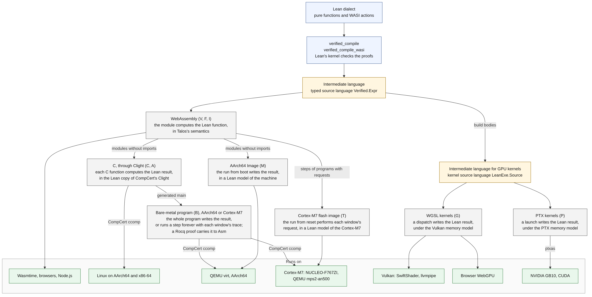
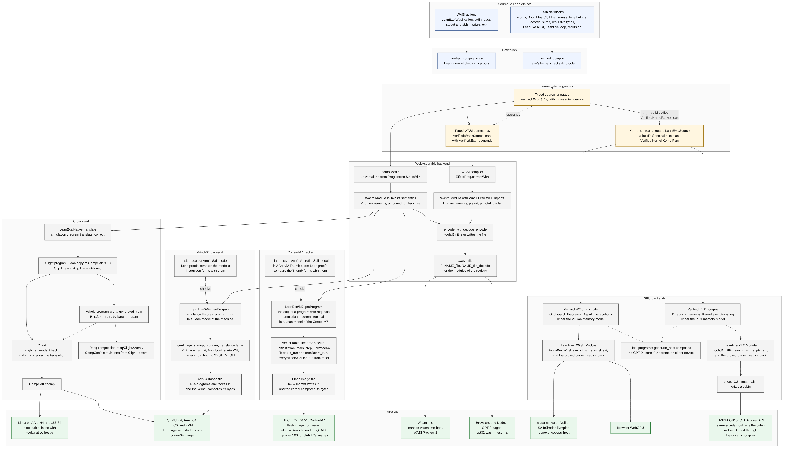

# LeanExe

LeanExe compiles functions written in a restricted dialect of Lean to WebAssembly, C, AArch64 machine code, WGSL, PTX, and Thumb-2 machine code for the STM32F767ZI microcontroller, an Arm Cortex-M7, on ST's NUCLEO-F767ZI development board, and proves in Lean that the compiled code computes those functions.



`verified_compile` reflects a Lean definition into a typed intermediate language, and each backend produces code together with a theorem that the code computes the definition's result.  The theorems hold in Talos's WebAssembly semantics, in the Lean copy of CompCert's Clight, in a Lean model of an AArch64 machine from boot, in a Lean model of the Cortex-M7 microcontroller from reset, and under statements of the Vulkan and PTX memory models, and a Rocq proof carries the theorem of a bare-metal C program to CompCert's Asm.  The names in parentheses are the artifact codes of [the table below](#artifacts), and [the overview](#overview) shows the full toolchain.

The compiler has one correctness theorem for every typed source program that it accepts.  The WebAssembly theorems hold in [Talos](https://github.com/cajal-technologies/talos)'s semantics, and an execution theorem may allow a trap at `unreachable`, which the theorem `p.f.trapFree` excludes under its allocation and call-depth premises.  The compiled modules also translate to a subset of [CompCert](https://compcert.org/compcert-C.html)'s C, with a theorem about each C function in the Lean copy of CompCert's Clight, and CompCert compiles the C for x86-64 and AArch64 under an operating system, for bare-metal AArch64, and for the Cortex-M7 of QEMU's `mps2-an500` and the Cortex-M7 microcontroller.  A bare-metal C program has a theorem about the whole program, which a Rocq proof transfers to CompCert's Asm: a termination with the result's bytes or a trap's status, or a loop that runs a step function forever with a stated trace in each window, the form of every Cortex-M7 program with a theorem.  An executable under an operating system also depends on a C host that no theorem covers.  A separate back end compiles the same modules to AArch64 machine code without C and writes an arm64 Image whose theorem covers the whole run from boot, the startup included, in a Lean model of the machine, and Lean proofs compare the model's instruction forms with traces of Arm's specification from Isla, with the results of Arm's floating-point functions taken as equations with Talos's IEEE 754 functions.  Another back end without C compiles the step functions of programs with requests to Thumb-2 machine code for the Cortex-M7 microcontroller and writes a flash image whose theorem covers every window of the run from reset in a Lean model of the microcontroller.  Array builds compile to WGSL and PTX kernels with theorems under statements of the Vulkan and PTX memory models, and Lean actions with stdin, stdout, stderr, and exit compile to WASI Preview 1 modules.

## Background

This project is inspired by small languages designed to simplify analysis, implementation, and verification: [PreScheme](https://dustycloud.org/misc/prescheme.pdf), [Low\*](https://arxiv.org/abs/1703.00053), [ACL2](https://doi.org/10.1109/32.588534), [CompCert C / Clight](https://xavierleroy.org/publi/Clight.pdf), [CakeML](https://cakeml.org/popl14.pdf), and [TinyGo](https://tinygo.org/).

Donald Knuth's [The Art of Computer Programming](https://cs.stanford.edu/~knuth/taocp.html) and in particular its "Seminumerical Algorithms" are major inspirations as well.  We are explicitly organizing some development in a similar spirit.  For example, see the current set of [elementary and special functions](https://github.com/jsmorph/leanexe/blob/main/index.md#6-elementary-and-special-functions).

We strive to be both pragmatic and demanding.  For example, floating-point operations have been in scope since the beginning of the project.  IEEE 754 is an impressive, challenging beast.  See David Goldberg's ["What Every Computer Scientist Should Know About
Floating-Point Arithmetic"](https://dl.acm.org/doi/10.1145/103162.103163).  We are building machinery for complete floating-point accuracy.  The [fused multiply-add](https://github.com/jsmorph/leanexe/blob/main/Library/Numerics/Arithmetic/Fma/FmaTheorem.lean#L144-L149) development is a good example.

These days rewriting a large codebase in a different source language is almost automatic (given appropriate stern oversight).  So inventing a new language today doesn't necessarily impose the classic high hurdles to adoption.  However, AI is of course trained on existing corpora.  Lean in particular continues to receive a lot of investment by AI companies.  So we decided to proceed from a [strict subset of Lean](https://github.com/jsmorph/leanexe/tree/main/docs).  A major benefit is being able to use fancy Lean (including Mathlib) to prove things about executable artifacts themselves.

## Demos

Here are some of the demos in this repo:

- [Binary32 GPT-2](Demos/Gpt32/README.md): one generation step of GPT-2 124M in `Float32`, compiled to WGSL kernels with dispatch theorems, to PTX kernels with launch theorems, and to WebAssembly.  `generate_host` composes the kernels' theorems into the step's scores on either GPU target, a browser page runs the model on WebGPU and in WebAssembly and compares the scores, and a CUDA session runs it on an NVIDIA GPU.
- [Binary64 GPT-2](Demos/Gpt/README.md): the model in `Float`, with `steps_exact`, which proves that cached generation equals full inference bit for bit, and `forward_causal`.
- [Euler solvers](Demos/Euler/README.md): finite-volume solvers for the compressible Euler equations.  `euler_solve_call` proves that the module returns the solvers' results without a trap within a memory cap, the balance theorems bound the rounding error of conservation, and the solver also runs as C, as a bare-metal AArch64 program, and as an arm64 Image whose theorem states that it writes the solver's result on a grid of 4 by 4 cells.
- [Drone planner](Demos/Drone/README.md): flights over terrain that `drone_compute` and `drone_safe` prove optimal and safe in a point-mass model.
- [Slew planner](Demos/Slew/README.md): spacecraft attitude slews that keep body vectors outside keep-out cones and inside keep-in cones, with `plan_safe` for the constraints and `plan_optimal` for least duration.
- [Conjunction probability](Demos/Conjunction/README.md): an interval that contains the two-dimensional probability of collision of two space objects, with `pc_enclosure` for the inclusion of the model's integral and `assess_sound` for the verdict against a threshold.
- [SGP4](Demos/Sgp4/README.md): the near-Earth SGP4 propagator of catalog element sets, as a model over the reals, a binary64 program that agrees with the reference states of the Vallado code within half a unit of the last printed digit, and an enclosing program with `sgp4Box_sound` for the inclusion of the model's position and velocity in its intervals.
- [Running sums](Demos/RunningSum/README.md): WASI programs that read numbers from stdin and print cumulative totals, with proofs of canonical output and eventual exit.  [The binary64 version](Demos/RunningSumFp/README.md) composes proved parsing, IEEE 754 addition, and printing.
- [Energy authorizer](Demos/Energy/README.md): decides whether a gateway may send proposed battery power limits to the inverter of a solar-and-battery site for one window of time.  `authorize_sound` proves that, under accepted limits, every trajectory that the model admits keeps the site's energy and grid limits or stays no further outside them than a return to the inverter's fallback mode would, and `energy_authorize` transfers the decision to the module's bytes.  Its gateway [ran a simulated day on the board](Demos/Energy/README.md#a-day-on-a-nucleo-f767zi), through CompCert and through [the Cortex-M7 back end](docs/m7-bare-metal.md), whose image has a theorem from reset, with output records equal to native Lean's in both runs.
- [BMS protection](Demos/Bms/README.md): the protection layer of a battery management system for a pack of four lithium iron phosphate cells, a machine that answers each record of a bridge with the permits of three relays.  `m1` proves that an answer with a nonzero permit follows a reset acceptance, a start, and records that passed every check in sequence, and that `NORMAL` follows a record with the precharge condition, and `bms_board_safe` carries `m1` to every answer with a nonzero permit that [the Cortex-M7 image](#cortex-m7-images) writes from reset.  The image [ran the requirements' fault-injection schedule on the board](Demos/Bms/README.md#a-run-on-a-nucleo-f767zi), and a replay in native Lean found every answer equal to the specification's.
- [Order book](Demos/OrderBook/README.md): a central limit order book for one instrument, with price-time matching of limit, market, post-only, cancel, and reduce commands and self-trade prevention.  `run_eq` proves that the array program computes the list specification of its English requirements, and `run_call` transfers the proof to the module's `run` export.  A WASI process runs the book over command records on stdin, and `initial_terminates` proves that its module writes exactly the specification's event records to stdout and exits.
- [Ranked-choice tabulation](Demos/Rcv/README.md): a tabulator for single-winner ranked-choice contests under Oakland City Charter §1105.  `tabulate_callSpec` proves that the module returns the specification's report of every file, `initial_terminates` that its WASI process writes that report and exits, and `tabulate_native` that its C translation returns it.  The majority-holder theorem relates its rounds to Alameda County's practice, the batch theorem relates them to a count without batches, and [the case study](Demos/Rcv/README.md#case-study-school-director-district-4-2022) recounts the 2022 contest for School Director, District 4: the module's figures equal those of the County's corrected report, and the County's faulty setting, applied by a Python script, gives the figures that the County first certified.  [A second module](Demos/Rcv/Maine/README.md) counts contests under Maine's 21-A M.R.S. §723-A, with its own WASI process and C translation and the same kinds of theorems.
- [SHA-256](#a-worked-example-sha-256): from a transcription of FIPS 180-4 to WebAssembly, C, and a bare-metal AArch64 image whose whole-program theorem a Rocq proof transfers to CompCert's Asm.  An [arm64 Image](#aarch64-images) of `shaCheck`, a wrapper of the library's `sha256With`, writes the digest of `abc`, with a theorem from boot, and [a Cortex-M7 step](#cortex-m7-images) built on the library's `compress` answers each block of 64 bytes on the Cortex-M7 microcontroller, with `sha_board`, which states that the answers begin the FIPS 180-4 digests of the prefixes of the blocks read.
- [CIC decimation filter](Library/Numerics/Filters/Cic/README.md): a cascaded integrator–comb filter whose AArch64 bare-metal Image, from [the back end that compiles WebAssembly to AArch64 directly](docs/a64-bare-metal.md), has `cic_outputs`: in the model of the boot machine, the Image writes to the UART the filter's outputs over ℤ, as its specification defines them, on a fixed table of 64 samples.
- [Elementary and special functions](index.md#6-elementary-and-special-functions): binary64 implementations with proved accuracy bounds, and a software [fused multiply-add](Library/Numerics/Arithmetic/Fma/README.md) proved equal to IEEE 754's fusedMultiplyAdd for all operands.

## Selected documentation

- [Verified compiler manual](docs/verified-manual.md): the dialect, `verified_compile`, the generated theorems, and the tests.
- [Verified compiler internals](Verified/README.md): the source language, the compiler, and its universal proof.
- [Algorithm index](index.md): each program with its proved results and compiled forms.
- [Trusted base](docs/trusted-base.md): what each kind of theorem trusts.
- [Design document](docs/design.md): the architecture and its decisions.

## Overview



`verified_compile` and `verified_compile_wasi` reflect Lean definitions and WASI actions into typed source languages, and Lean's kernel checks the proofs that they generate, so the reflector is outside the trusted base.  `compileWith` translates the typed source language `Verified.Expr` to a WebAssembly module, and one universal theorem, `Prog.correctStaticWith`, gives each compiled function its execution theorem in Talos's semantics.  The WASI compiler does the same for programs with effects through `EffectProg.correctWith`.  `decode_encode` carries the theorems to the module's encoded bytes, and the file theorems state that the `.wasm` file holds those bytes.

The C backend translates a module without imports to the Lean copy of CompCert's Clight, where `translate_correct` gives each C function a theorem from the module's theorem.  CompCert compiles the printed C only after `clightgen` reads it back as the same Clight program.  For bare-metal AArch64, `bare_program` adds a generated `main` and proves a theorem about the whole program, which a Rocq proof carries to CompCert's Asm.  A generated `main` can also run a step function forever, on AArch64 or on the Cortex-M7, and `ctl_program` and `req_program` then prove the judgment `LoopReacts` of the whole program, which `clight2_loop_to_asm` carries to a reactive behavior of the Asm program.  The GPU backends lower array builds to the kernel source language and translate them to WGSL and PTX, with theorems about every consistent execution under statements of the Vulkan and PTX memory models, and a proved parser reads each printed kernel back.

The AArch64 back end takes a module without imports to machine code directly.  `genProgram` generates the module's instructions, and the simulation theorem `program_sim` relates their run in a Lean model of an AArch64 machine to the module's run in the reference interpreter.  `genImage` places the code between a startup routine and a translation table in an arm64 Image, and `image_run_at` proves, from a boot state whose memory holds the Image at any base in RAM that is a multiple of 4096, that the machine reaches PSCI SYSTEM_OFF after writing the function's value to the UART.  Lean's kernel compares the written file with `genImage`'s output, and Lean proofs compare every instruction form on which a program's model runs with traces of Arm's specification that Isla produces.  The proofs of the floating-point forms take as hypotheses equations between the results of Arm's floating-point functions and Talos's IEEE 754 functions, and those equations rest on tests and on proofs over Sail's Lean translation of the functions, which `tools/sail/check.sh` checks outside the repository's build.  [The AArch64 document](docs/a64-bare-metal.md) gives each link of the chain and its evidence.

The Cortex-M7 back end takes the step function of a program with requests to Thumb-2 machine code for the Cortex-M7 microcontroller.  `genProgram` of `LeanExe/M7` generates a `main` that calls the step forever and performs each request as one device access, `step_call` relates the generated step's run in a Lean model of the Cortex-M7 microcontroller to its run in the reference interpreter, and `board_run` proves, from every state that reset gives, that the image performs the board's initialization and then the requested accesses of every window, as `areaBoard_run` does for a program with linear memory, whose image first sets up the area of the module's globals and memory in DTCM.  Lean's kernel compares each flash image with the generator's output, Lean proofs compare every instruction form of the model with Isla's traces of Arm's A-profile specification in AArch32 Thumb state, and co-simulation on QEMU and on the board tests the model.  [The Cortex-M7 document](docs/m7-bare-metal.md) gives each link of the chain and its evidence.

Applying the theorems on the platforms rests on the items of [the trusted-base document](docs/trusted-base.md), among them Talos's semantics, the decoder, the C host, the AArch64 machine model with its floating-point equations, `ptxas`, and the GPU drivers.  Applying the Cortex-M7 image theorems on the board rests on the model of the Cortex-M7 microcontroller, the reading of the M-profile pseudocode against the A-profile's, the reader of the image file, reset, which must be a power-on reset or an NRST reset with the debug registers at their power-on values, USART3 and the ST-LINK's virtual COM port, and the timing of each window, whose margins rest on cycle measurements.  The Mermaid sources of the diagrams are [`docs/toolchain.mmd`](docs/toolchain.mmd) and [`docs/toolchain-summary.mmd`](docs/toolchain-summary.mmd).  `mmdc -i docs/toolchain.mmd -o docs/toolchain.png -b white -s 2 -w 1800`, from `@mermaid-js/mermaid-cli`, renders the full diagram, and the same options render the summary.  Where Puppeteer's own browser does not run, as on AArch64 Linux, `-p` names a Puppeteer configuration whose `executablePath` is an installed Chromium.

## Artifacts

Each artifact has a code, which [the algorithm index](index.md) uses to list the compiled forms of the library algorithms, applications, and example programs.  The index also marks a specification theorem with SPEC.  [The SHA-256 example](#a-worked-example-sha-256) builds and runs the WebAssembly, file, C, and bare-metal artifacts of one program.

| Code | Artifact | Written by | Theorem and its semantics | Runs on | Examples |
|---|---|---|---|---|---|
| WASM | WebAssembly module from the verified compiler | `verified_compile` defines the module and its theorems, and `tools/Emit.lean` writes the file | `p.f.implements`, from the universal theorem `Prog.correctStaticWith`, with `p.f.bound`, `p.f.trapFree`, and `p.bytes`, in Talos's semantics and the binary decoder | Wasmtime | `Compiled` and `Verified` modules of [the library](Library/README.md), [the demos](Demos/README.md), and [the example programs](Examples), and [the compiler fixtures](Verified/Examples), most of which [the module registry](tests/verified/modules.txt) lists |
| WASMF | Emitted `.wasm` file with a file theorem | [`tests/verified/run.sh`](tests/verified/run.sh) writes `build/verified/NAME.wasm` with `tools/Emit.lean` and then checks the file module | `NAME_file` and `NAME_file_decode`: the bytes that the trusted elaborator `binary_file%` reads from the file equal `encode p.module` and decode to the module | Wasmtime | Modules of [the file-theorem registry](tests/verified/numerics.txt), which holds every module of [the module registry](tests/verified/modules.txt) but `byhand`, the hand-built module of `Verified.Examples.Modes`, which has no `p.module` |
| WASI | WASI Preview 1 module, callable or command | `verified_compile_wasi`, and `tools/Emit.lean` writes the file | Callable `p.f.implements`, command `p.start`, and the conditional `p.f.total` and `p.total`: the exports perform the actions' ordered effects with the same results and terminal outcomes, in Talos's semantics with the modeled WASI host | Wasmtime's Preview 1, through `leanexe-wasmtime-host run` for a command and `--wasi call` for a callable export | [Running sum](Demos/RunningSum/README.md), [floating-point running sum](Demos/RunningSumFp/README.md), and [the stdio example](Verified/Examples/WasiStdio.lean) |
| C | C file and its native executable | `native-verified build MODULE CONSTANT NAME DIR` writes `NAME.c` and `NAME_glue.c`, has `clightgen` read the C back, compares that Clight with the translation, and compiles `NAME.o` with `ccomp` only when they agree, and `ccomp` links the object with [the C host](tools/native-host.c) | `p.f.native`, stated as `NativeImpl`, `NativeTablesImpl`, or `NativeStaticImpl`: the C function terminates with the words of the Lean result or, when the function may abort, with a trap code, in the Lean copy of Clight | Linux on AArch64 and on x86-64 | `verified_compile` modules of the registry, [packed byte values](Verified/Examples/Bytes.lean), and [byte literals](Verified/Examples/Literals.lean) |
| CALIGN | C file without the alignment test | `native-verified build --aligned`, which refuses with status 4 a module whose theorems do not cover that translation | `p.f.nativeAligned`, stated as `NativeAlignedImpl` or `NativeTablesAlignedImpl`, from an aligned input, in the Lean copy of Clight | Linux on AArch64 and on x86-64 | [SHA-256](Library/Hashing/Sha256/Compiled.lean), [SHA-3](Library/Hashing/Sha3/Compiled.lean), [CRC](Library/Hashing/Crc/Compiled.lean), [insertion sort](Library/Sorting/Insertion/Compiled.lean), [Euler solvers](Demos/Euler/Verified.lean), and [binary32 GPT-2](Demos/Gpt32/Verified.lean) |
| METAL | Bare-metal image | `native-bare emit` or `emit-in` writes the translation with a generated `main`, `native-bare check` or `check-in` compares the Clight of `clightgen` with the whole program, and [the bare-metal build](tools/baremetal/build.sh) links it with the startup code.  For the Cortex-M7, `native-bare emit-ctl`, `emit-req`, or `emit-usart3` writes a program that runs a step forever, and [the ARMv7-M build](tools/baremetal/armv7m/build.sh) links it with the startup code and the board's code | `p.f.program`, which `bare_program` proves, and `sha256_input`: the whole program terminates with the stores of the result's bytes to the UART, in the Lean copy of Clight, and [the Rocq composition](rocq/Clight2Asm.v) transfers such a termination to Asm.  `p.f.program` also allows the code of `unreachable` with no output when the entry may abort, and `sha256_input` allows it when `alloc` traps. | QEMU's `virt` machine under TCG and under KVM, and, for programs that run a step forever, whose theorems, such as `echo_usart3_program`, state the trace of every window in the Lean copy of Clight, the Cortex-M7: QEMU's `mps2-an500` under TCG runs the filter, the echo, the deadline program, the records program, and the energy controller's program, and the board and Renode's model of it run the echo and the energy controller's program | [GCD](tests/TestSupport/Bare/Gcd.lean), [CRC-32, SHA-256, Euler, and a deep recursion](tests/TestSupport/Bare/Theorems.lean), and [SHA-256 of a loaded message](tests/TestSupport/Bare/Input.lean) |
| A64 | AArch64 Image of the direct back end | `a64-programs emit` writes `NAME.img`, the bytes that `genImage` gives for the module, the entry, and the arguments: the arm64 header, the startup, the program's code, and the translation table | Image theorems from `image_run_at`, such as `TestSupport.A64.ImageFiles.gcd`: from a boot state whose memory holds the file's bytes, which the kernel compares with `genImage`'s output, at a base in the RAM GiB that is a multiple of 4096, the machine reaches PSCI SYSTEM_OFF after writing to the UART the encoding of the Lean function's value and the status 0, or a trap's status alone where the theorem allows one, in the Lean model of the boot machine | QEMU's `virt` machine under TCG and under KVM | [GCD by a loop and by recursion, CRC-32, SHA-256, a deep recursion, and the CIC filter](tests/TestSupport/A64/ImageFiles.lean), [the `Int64` floor division and floor of the mean](tests/TestSupport/A64/ImageFilesFloor.lean), and [the conversions between `Int64` and the floats](tests/TestSupport/A64/ImageFilesConvert.lean) |
| M7 | Flash image of the Cortex-M7 back end | `m7-windows board`, `gateway-board`, `crc-board`, `sha-board`, `signed-board`, or `delim-board` writes `NAME.bin`, the bytes of the vector table, the setup of the area of a program with linear memory, the initialization, `main`, the step's functions, and `udivmod64` that the generator gives for the module, the step, and the initial state | `echo_board`, `gw_board`, `gw_board_prefix`, `crc_board`, `crc_board_prefix`, `sha_board`, `sg_board`, and `dl_board_prefix`: from every state that reset gives while the flash holds the file's bytes, which the kernel compares with the generator's output, the model of the Cortex-M7 microcontroller performs the initialization's accesses and then those of every window of the step, and never stops, the gateway's bytes written to `USART_TDR` begin its output records, the CRC-32 step's begin the low bytes of the CRC-32 of the bytes read, the SHA-256 step's, for fewer than 2^62 windows, begin the SHA-256 digests of FIPS 180-4 of the prefixes of the blocks of 64 bytes read, and the echo of records' begin the COBS encodings of its answers to the nonempty segments of the bytes read | The board, and QEMU's `mps2-an500` for the images of `echo_qemu`, `gw_qemu`, `crc_qemu`, `sha_qemu`, `sg_qemu`, and `dl_qemu` | [The echo](tests/TestSupport/M7/NucleoFile.lean), [the energy controller's gateway](tests/TestSupport/M7/GwBoardFile.lean), [the CRC-32 step](tests/TestSupport/M7/CrcBoardFile.lean), [the SHA-256 step](tests/TestSupport/M7/ShaBoardFile.lean), [the signed step](tests/TestSupport/M7/SignedBoardFile.lean), and [the echo of records](tests/TestSupport/M7/DelimBoardFile.lean) |
| WGSL | WGSL kernel | [`tools/EmitWgsl.lean`](tools/EmitWgsl.lean) prints the kernel after checking that the parser reads the text back | Dispatch theorem, such as `scale32_dispatch` or `gpu.dispatch_eq`: the dispatch writes the Lean function's result and is race-free, in the WGSL device model with strict binary32 arithmetic, and `Dispatch.executions` gives the same output words for every consistent execution under a statement of the Vulkan memory model | wgpu-native through `build/tools/leanexe-webgpu-host` on SwiftShader and llvmpipe, and WebGPU in a browser | [Binary32 example](Examples/Binary32/README.md), [binary32 GPT-2](Demos/Gpt32/README.md), and [the verified kernel examples](Verified/Examples/Wgsl.lean) |
| PTX | PTX kernel | [`tools/EmitPtx.lean`](tools/EmitPtx.lean) prints the kernel after checking that the parser reads the text back, and `ptxas -O3 --fmad=false` compiles it | `Kernel.executions_eq` for a kernel of the verified compiler, such as `words_executions`, and `addOne_executions`: in every consistent execution under a statement of the PTX memory model, no access of a thread is in a data race, every thread ends, and the copy back reads the count followed by the result: the source array's encoded elements for a compiled kernel, and each input word plus one for the add-one kernel | `build/tools/leanexe-cuda-host` on an NVIDIA GB10 | [the PTX kernel examples](Verified/Examples/Ptx.lean), [the binary32 PTX kernels](Examples/Binary32/CompiledPtx.lean), [the GPT-2 PTX kernels](Demos/Gpt32/VerifiedPtx.lean), and [the add-one kernel](LeanExe/PTX/AddOne.lean) |

### Properties transferred to the artifacts

| Property | Theorems | Artifacts |
|---|---|---|
| Specification theorems: accuracy bounds, equality with transcriptions of FIPS 180-4, FIPS 198-1, FIPS 202, ITU-T V.42, RFC 3720, the SipHash paper, and the xxHash specification, generator periods, and the safety and optimality of the drone and slew planners | Such as `exp_bytes_accuracy`, `sha256_call`, `lcg_advance`, `drone_safe`, and `plan_safe` | WASM: the theorem composes, as `sha256_call` composes `compiled.sha256.implements` with `sha256_spec` and `gcd_call` composes `compiled.gcd.pure` with `gcd_eq`.  `drone_safe` states the safety of the Lean function's result for valid nonempty terrain together with the module's execution theorem, which allows a trap, so the safety holds of every result that the module returns, and `plan_safe` states the slew planner's safety for the Lean function.  WASMF: the combination of `sha256_file_decode` with `sha256_call`.  C and CALIGN: the combination of `compiled.sha256.native` or `compiled.sha256.nativeAligned` with `sha256_spec`.  METAL: `sha256_input` composes `compiled.sha256.native` with `sha256_bytes` into the bytes of `SHS.SHA256.Impl.sha256`, or the code of `unreachable` with no output when `alloc` traps, and its combination with `SHS.Equiv.SHA256.sha256_correct` gives the digest of the transcription of FIPS 180-4.  WGSL: `generate_host` composes the kernels' dispatch theorems into the scores of `step32`.  A64: `cic_outputs` composes the CIC Image's theorem with `cic_toList`, `cascade_eq_outputs`, and `toInt_cascade_of_width` into the filter's outputs over ℤ, as its specification defines them, and `floordiv_image_spec` composes the Image's theorem of `floorDiv (-7) 2` with `floorDiv_spec` into `Int.fdiv (-7) 2`.  M7: `sha_board` states that the bytes that the SHA-256 step's image writes begin the digests that the transcription of FIPS 180-4 gives for the blocks read, through `shaSpec_fips`, which applies `sha256_spec`, and `crc_board_prefix` that the CRC-32 step's bytes begin the low bytes of the CRC-32 that the transcription of ITU-T V.42 gives for the bytes read, through `crc_replies`. |
| Allocation bounds | `p.f.bound` with its equation `p.f.bound_eq`, closed forms such as `sortInsert_bound`, `pushSquare_bound`, `jump_bound`, and the Euler solvers' `solve_bound`, the memory caps of the Euler and drone call theorems, and the WASI processes' allocation charges | WASM: `p.f.trapFree` takes room for the bound as a premise.  `euler_solve_call` and `drone_compute_call` state that room as a memory cap in pages: `solvePages n`, at most 1,563 for every grid, for the Euler solvers, from the store in which the module starts, and 35 for the drone planner, with `top` at most 8192.  `increment_call` takes room for `top` to rise by 120 bytes, the closed form `compute_bound` of the bound, from any store with the allocator invariant.  WASI: the running sums prove the allocation charges of each process step from limits on their input.  WASMF: the combination of `NAME_file_decode` with `p.f.trapFree`, for the `verified_compile` modules of the file-theorem registry. |
| Return without a trap | `p.f.trapFree`, `euler_solve_call`, `drone_compute_call`, and `increment_call`, the WASI theorems `p.f.total`, `p.total`, and `compiled_process_total_run`, and their applications `retain_total`, `initial_terminates_integer`, and `initial_terminates_fp` | WASM: under room for `p.f.bound` and the depth limit, and for the Euler solvers and the drone planner under the memory caps of `euler_solve_call` and `drone_compute_call`, and for the increment example under room for 120 bytes in `increment_call`.  WASI: under a typed resource-prefix bound and assumptions about the host operations that a run reaches.  C and CALIGN: `p.f.native` and `p.f.nativeAligned` state that the C function terminates, with no trap code for a function whose abort flag is false, as `loop_native_init` states for GCD from the state that `lx_init` leaves.  For a function that may abort, `ImplementsA.nativeImpl` applied to `p.f.trapFree` proves that conclusion under the premises of `p.f.trapFree`, and no generated theorem states it.  METAL: `p.f.program` states that the whole program terminates, with result 0 for an entry whose abort flag is false, as the GCD program's theorem does.  A64: the Image theorems of GCD by a loop, CRC-32, and SHA-256 allow the result alone, from `p.f.trapFree` and a stack bound within the stack's room, GCD by recursion also allows status 4, an overflow of the stack, and the deep recursion statuses 1 and 4.  WASMF: the combination of `NAME_file_decode` with `p.f.trapFree`, as for the allocation bounds. |

### A worked example: SHA-256

[The SHA-256 proof](Library/Hashing/Sha256/Proof.lean) relates the Lean implementation to a transcription of FIPS 180-4.  The commands require the [Wasmtime host](#commands) and CompCert 3.18's `ccomp` and `clightgen` on the search path.  A CompCert built in a source tree `DIR` and not installed needs `-stdlib DIR/runtime` on the `ccomp` link command and `CCOMP_STDLIB=DIR/runtime` for `tests/baremetal/inputs.sh`.

| Step | Code | Files written | Theorem |
|---|---|---|---|
| Verified compilation | WASM SPEC | Module constant `Library.Hashing.Sha256.compiled.module` in Lean's build | `compiled.sha256.implements`, `compiled.bytes`, and [`sha256_call`](Library/Hashing/Sha256/Bytes.lean), which composes the first with [`sha256_spec`](Library/Hashing/Sha256/Proof.lean) |
| Emission | WASMF | `build/verified/sha256.wasm` | [`sha256_file` and `sha256_file_decode`](Library/Hashing/Sha256/File.lean) |
| Call in Wasmtime | WASM | None | `sha256_call`, for the message `abc` packed into the word 6,513,249 |
| Native build | C | `build/native/sha256/sha256.c`, `sha256_glue.c`, `sha256.exports`, `sha256.depth`, `sha256.v`, `sha256.o`, and the executable `sha256` | `compiled.sha256.native` |
| Native build without the alignment test | CALIGN | Same files in `build/native/sha256-aligned/` | `compiled.sha256.nativeAligned` |
| Bare-metal image with input | METAL | `build/baremetal/inputs/sha256in.c`, `sha256in.v`, `sha256in.elf`, and its stack bound `sha256in.elf.bound` | [`sha256_input`](tests/TestSupport/Bare/Input.lean), which also allows the code of `unreachable` with no output when `alloc` traps, with `clight2_bigstep_asm_reads_ptr64` of [the Rocq composition](rocq/Clight2Asm.v) |

```sh
tools/leanrun --timeout 60m lake build Library.Hashing.Sha256.Bytes native-verified
mkdir -p build/verified build/native/sha256 build/native/sha256-aligned
tools/leanrun --timeout 10m lake env lean --run tools/Emit.lean \
  Library.Hashing.Sha256.Compiled Library.Hashing.Sha256.compiled.module build/verified/sha256.wasm
tools/leanrun --timeout 10m lake env lean Library/Hashing/Sha256/File.lean
build/tools/leanexe-wasmtime-host call build/verified/sha256.wasm sha256 \
  list:i64,i64,i64,i64 array-u64:6513249 i64:3
tools/leanrun --timeout 10m lake env .lake/build/bin/native-verified build \
  Library.Hashing.Sha256.Compiled Library.Hashing.Sha256.compiled.module sha256 build/native/sha256
ccomp -I tools -o build/native/sha256/sha256 build/native/sha256/sha256.o \
  build/native/sha256/sha256_glue.c tools/native-host.c
build/native/sha256/sha256 call sha256 list:i64,i64,i64,i64 array-u64:6513249 i64:3
tools/leanrun --timeout 10m lake env .lake/build/bin/native-verified build --aligned \
  Library.Hashing.Sha256.Compiled Library.Hashing.Sha256.compiled.module sha256 \
  build/native/sha256-aligned
tests/baremetal/inputs.sh
```

`tests/baremetal/inputs.sh` builds `native-bare`, writes and checks the program, links it with the startup code, and runs it under QEMU on eleven messages of 0 to `2^24 - 8` bytes, whose outputs must equal those of `sha256sum`, and on two longer lengths, which must give no output and the status 64.  With `ACCEL=kvm` the same script runs the image under KVM.  [The SHA-256 guide](Library/Hashing/Sha256/README.md) describes the program, and [the bare-metal design](docs/native-bare-metal.md#arguments-not-fixed-in-advance) describes the input path.

## Compiler

### Pure functions

`Verified.compileWith` translates a typed source program to a module.  The universal theorem `Prog.correctStaticWith` proves that the module computes the source meaning, `denote`, under its heap and static-data premises.  `verified_compile p := [f, …]` reflects Lean definitions into that source language and proves their correspondence.  It derives `p.f.implements` from those equations and the universal theorem, and Lean's kernel checks the generated proofs.

The command also generates each function's allocation bound and a trap-free theorem under that bound.  For a scalar function of a program without byte literals, when its rules prove that execution does not depend on the store, it generates `p.f.pure`: from any store, the call returns the Lean result and leaves the store unchanged, which lets other compiled programs call the function.  [The verified compiler manual](docs/verified-manual.md) states the type restrictions, ownership rules, generated declarations, and proof premises, and [the internals guide](Verified/README.md) describes the compiler and its universal proof.  [The verified-request skill](.claude/skills/verified-request/SKILL.md) turns an English request into a specification that a fresh agent reviews, a program, and a theorem `Verified.CallSpec` that the program's export returns the specification's value without a trap under its generated allocation bound, which [`tools/verified-request-check`](tools/verified-request-check) states and checks.

The dialect covers words, signed 64-bit integers, Booleans, floats of both widths, tuples, structures, enumerations, sums, arrays, records with array fields, packed bytes, lists, and recursive types, and each row below links fixtures that compile them.  [The verified compiler manual](docs/verified-manual.md#the-dialect) states the representations, ownership rules, and restrictions.  Integers are `UInt64` and `Int64`, so a program and its module compute the same values, wraparound included.

| Types and forms | Examples |
|---|---|
| Words, Booleans, and their operations | [`Poly`](Verified/Examples/Poly.lean), [`Mix`](Verified/Examples/Mix.lean), and [`Select`](Verified/Examples/Select.lean) |
| `Int64` values, with signed comparisons, division, remainder, and right shift, and conversions to and from the floats | [`Signed`](Verified/Examples/Signed.lean), [floor division](Examples/Floor/README.md), and [conversions](Examples/Convert/README.md) |
| Binary64 and binary32 floats | [`Floats`](Verified/Examples/Floats.lean) and [`Floats32`](Verified/Examples/Floats32.lean) |
| Tuples, structures, enumerations, and sums with scalar fields, and structure patterns that fix fields to enumeration constructors | [`Pairs`](Verified/Examples/Pairs.lean), [`Records`](Verified/Examples/Records.lean), [`Enums`](Verified/Examples/Enums.lean), [`Sums`](Verified/Examples/Sums.lean), and [structure patterns](Verified/Examples/Patterns.lean) |
| Arrays of words, Booleans, floats, tuples, and structures, with updates, growth, insertion, and removal in place | [`Arrays`](Verified/Examples/Arrays.lean), [`Elements`](Verified/Examples/Elements.lean), [`Grids`](Verified/Examples/Grids.lean), [`Tuples`](Verified/Examples/Tuples.lean), [`Updates`](Verified/Examples/Updates.lean), [`Grow`](Verified/Examples/Grow.lean), [`Insert`](Verified/Examples/Insert.lean), [`Owned`](Verified/Examples/Owned.lean), and [`Modes`](Verified/Examples/Modes.lean) |
| Records with array fields | [`Fields`](Verified/Examples/Fields.lean) |
| Packed byte buffers and byte literals | [Packed byte values](Verified/Examples/Bytes.lean) and [byte literals](Verified/Examples/Literals.lean) |
| Sums whose fields hold byte buffers, arrays, trees, and lists | [Sums with heap fields](Verified/Examples/HeapSums.lean) |
| Lists of words | [Lists](Verified/Examples/Lists.lean), [guarded list recursion](Verified/Examples/ListRecursion.lean), [list loops](Verified/Examples/ListLoops.lean), and [list tail recursion](Verified/Examples/ListTail.lean) |
| Recursive types, with one or several record constructors | [User-defined recursive values](Verified/Examples/RecursiveTypes.lean), [tagged recursive values](Verified/Examples/TaggedTypes.lean), and [the word trees](Library/Trees/README.md) |
| Tree records with `Bool`, binary64, binary32, word, structure, enumeration, and sum fields | [Trees with typed fields](Verified/Examples/TypedTrees.lean) |
| Tree records with array fields, and with byte-buffer fields and their lengths | [Trees with array fields](Verified/Examples/ArrayTrees.lean) and [trees with buffer fields](Verified/Examples/BufferTrees.lean) |
| Counted loops, builds, `repeatWhile`, and array folds | [`Loops`](Verified/Examples/Loops.lean), [`Owned`](Verified/Examples/Owned.lean), [`Repeat`](Verified/Examples/Repeat.lean), and [array folds](Verified/Examples/Fold.lean) |
| Tail recursion as loops, and guarded recursion to depth 1,000 | [Tail loops](Verified/Examples/Tail.lean), [tail conditions](Verified/Examples/TailConditions.lean), and [`Recursion`](Verified/Examples/Recursion.lean) |
| Calls, `@[inline]` helpers, constant tables, and wrappers | [`Calls`](Verified/Examples/Calls.lean), [frontend forms](Verified/Examples/Frontend.lean), [`Tables`](Verified/Examples/Tables.lean), and [the sine and cosine](Library/Numerics/Float64/Trig/Program.lean) |
| Composition and relocation of compiled programs | [Composition](Verified/Examples/Composition.lean), [scalar composition](Verified/Examples/ScalarComposition.lean), and [relocation](Verified/Examples/Relocation.lean) |

### WASI programs

`verified_compile_wasi` compiles `LeanExe.Wasi.Action` definitions with stdin reads, stdout and stderr writes, bounded effectful loops, and exit.  Actions use Lean `do` notation and `UInt64` counts, lengths, and statuses.  Callable-entry and `_start` theorems relate exported execution to the native actions, preserving ordered effects and effects committed before an error or trap.  Total execution requires a typed resource-prefix bound and assumptions about reached host operations.  [The WASI manual](docs/wasi.md) defines the API, export forms, proof premises, native interpreter, and Wasmtime's exit-acceptance policy.

`LeanExe.Wasi.Process` composes bounded actions through an unbounded outer loop.  [The running-sum application](Demos/RunningSum/README.md) reads decimal integers through EOF, prints each cumulative total, and handles short writes, and [its compiled theorem](Demos/RunningSum/Correct.lean) proves canonical output and eventual accepted exit under limits on the bytes of each line and the digits of each total.  The theorem also assumes a Talos host environment that meets the specifications of the three imports, a host whose reads return the input stream without an error and whose writes make progress, and a host that accepts the exit statuses 0 and 28.  [The floating-point version](Demos/RunningSumFp/README.md) parses binary64 values and prints each sequential binary64 total, and its proofs compose the parser and printer theorems with IEEE 754 addition and the process proof.  Each application proves the allocation charges of each step from limits on its input, and corollaries cover lines of up to 9,000,000 bytes and totals of up to 9,000,000 digits for the integer sum and lines of up to 50,000,000 bytes for the floating-point sum.  [The order book's process](Demos/OrderBook/README.md#the-wasi-process) reads command records in reads of at most 4,096 bytes and writes the events of each read before the next.  Its compiled theorem proves exact output and accepted exit under the same host assumptions for every input of fewer than 2^64 − 1 records, with one charge for every step, since the book's arrays have fixed sizes and a read holds at most 74 records.

## Native code

### The translation to C

The translator, `LeanExe.Native.translate`, accepts the modules that pass a decidable check of its subset of WebAssembly.  It writes one C function for each WebAssembly function that it translates and holds the linear memory in a static array, whose size `verified_compile` sets to `nativeCap`, 4,096 pages or 256 MiB.  Its simulation theorem, `translate_correct`, relates every Talos run that ends in a return or a trap to a terminating execution in the Lean copy of CompCert 3.18's Clight, and `p.f.native` follows from it and `p.f.implements` for each function.  The `clightgen` comparison of each build covers the printer and the written file, so neither needs a theorem.  [The translator's design](docs/native-translator.md) gives the subset, the translation scheme, the proof layers, and the trusted base.

Every module of [the module registry](tests/verified/modules.txt) lies inside the subset.  `tests/native/verified.sh` translates each module, compiles it with CompCert and the C host `tools/native-host.c`, and compares every case that the translation can run with the line that the Wasmtime host gives, with the same rules for traps and allocation counters.  `tests/native/run.sh` compares translated programs with Talos's runs, `tests/native/bytes.sh` runs the byte and literal examples, and `tests/native/clight.sh` compares the Lean copy of Clight with `ccomp -interp` on random programs under the NaN parameters of either target.

### The translation without the alignment test

The translation option `alignedAccess` makes every 64-bit load and store read or write one word of `lx_mem` after the bounds check, without the test of the address's low three bits and the eight byte accesses of an unaligned address.  With `set_option verified_compile.alignedNative true`, `verified_compile` also emits that translation, `p.translationAligned`, and the theorem `p.f.nativeAligned`, whose statement `NativeAlignedImpl` or `NativeTablesAlignedImpl` adds the premise `AlignedInput` and concludes, in addition to the conclusions of `p.f.native`, an aligned final heap and a result whose blocks meet `AlignedOutput`.  `tests/native/aligned.sh` tests the refusal of `native-verified build --aligned` for a module without those theorems, and a program with byte literals has none.

`tests/native/bench.sh` times corpus workloads in their native form and in Wasmtime.  CompCert aligns a function to 4 bytes on AArch64, so `--placements` also links each native program at sixteen code offsets and reports the mean over them, as [the benchmark method](docs/native-translator.md#benchmark-method) describes.  The placement benchmark ran on AArch64 only, with CompCert built from the 3.18 sources and Wasmtime's C API 44.0.0, and gave these mean times per call:

| Workload | Module | With the test (ms) | Without the test (ms) | Change |
|---|---|---:|---:|---:|
| `sort` | Insertion sort | 23.732 | 18.583 | -21.7% |
| `linear32` | Binary32 GPT-2 | 2.294 | 1.777 | -22.5% |
| `layernorm32` | Binary32 GPT-2 | 3.567 | 2.867 | -19.6% |
| `euler` | Euler solvers | 179.073 | 176.153 | -1.6% |
| `crc32` | CRC | 3.819 | 3.764 | -1.4% |
| `sha256` | SHA-256 | 12.891 | 12.791 | -0.8% |
| `sha3` | SHA-3 | 9.878 | 9.845 | -0.3% |

`sort`, `linear32`, and `layernorm32` run 19.6 to 22.5 percent faster without the test, and the remaining workloads change by less than 2 percent.  The translation with the test stays the default, because the whole-program theorems and the bare-metal path exist only for it.  Another run of the translation with the test measured Wasmtime's median time per call as 0.28 times the native median for `sort`, 0.71 for `crc32`, 0.78 for `euler`, 0.86 for `sha256`, 1.11 for `sha3`, 1.18 for `linear32`, and 1.38 for `layernorm32`.

### Bare-metal programs

A bare-metal program that terminates is the translation of a module, a volatile global `lx_out` at the UART's data register of QEMU's `virt` machine, and a generated `main` that calls `lx_init`, calls one entry on arguments fixed when the program is built, and writes the bytes of the result to `lx_out`.  `bare_program p.f x [args] r` proves `p.f.program`: the whole program terminates with result 0 and a trace of one volatile store per byte of the result's encoding or, when the entry may abort, with result 1 and an empty trace.  The Rocq theorem `clight2_bigstep_to_asm` in [the Rocq composition](rocq/Clight2Asm.v) composes CompCert's forward simulations from Clight to Asm, and `clight2_bigstep_asm_unique` shows that, for a trace without inputs, such a termination is the only behavior of the Asm program.  Both Rocq theorems take the termination as a judgment of CompCert's own Clight in Coq, and the step from the Lean theorem to that judgment depends on the Lean copy's agreement with CompCert's definitions and on the `clightgen` comparison of each build, which no proof covers.  The startup code in `tools/baremetal/` turns on the MMU and the caches.  The build fails when the static stack bound of `main` exceeds the stack or when the assembly contains an instruction that requires an aligned access.  [The bare-metal design](docs/native-bare-metal.md) gives the statement, the startup code, the input path, the stack bound, and the trusted base.

| Program | Entry and arguments | Theorem |
|---|---|---|
| GCD | `gcd 1071 462` of test support, whose tail recursion compiles as a loop | [GCD program](tests/TestSupport/Bare/Gcd.lean) |
| CRC-32 | `crcCheck` of the ASCII digits 1 to 9, from the library's `crcWith` and table | [Program theorems](tests/TestSupport/Bare/Theorems.lean) |
| SHA-256 of a constant | `shaCheck` of `abc`, from the library's `sha256With` and round constants | [Program theorems](tests/TestSupport/Bare/Theorems.lean) |
| Euler solver | `solve 4` of the verified Euler module | [Program theorems](tests/TestSupport/Bare/Theorems.lean) |
| Deep recursion | `recursive 1000` of [the fold example](Verified/Examples/Fold.lean), which reaches the depth limit | [Program theorems](tests/TestSupport/Bare/Theorems.lean) |
| SHA-256 with input | Library export `sha256` on a message of at most `2^24 - 8` bytes that QEMU's loader places at `lx_in` | `sha256_input` in [the input program](tests/TestSupport/Bare/Input.lean) |

`tests/baremetal/programs.sh` and `tests/baremetal/inputs.sh` run these programs on QEMU's `virt` machine, under TCG on an emulated Cortex-A57 by default and, with `ACCEL=kvm`, under KVM on AArch64 hardware.  Each run must write the bytes of the Lean result and exit with the expected status, and its stack's high-water mark must stay within the bound of `main`.  `tests/baremetal/verified.sh` runs the cases of every module of the registry on the emulated Cortex-A57 without libc or an operating system, and it fails a call whose stack exceeds its function's static bound.

A program that runs forever has a generated `main` that calls `lx_init` and then repeats a window.  A window of `ctlMain` reads a word from `lx_in` with volatile loads, calls the step, and stores the new state's bytes to `lx_out`, and a window of `reqMain` calls the step and performs the register access that the step requests with one volatile 32-bit load or store of `lx_reg`.  `ctl_program` and `req_program` prove, for every sequence of the values that the volatile loads return, the judgment `LoopReacts` of the whole program: `main` runs its first statements and then a loop whose iteration `n` has the trace of window `n`.  `clight2_loop_to_asm` of [the Rocq composition](rocq/Clight2Asm.v) carries the judgment to the Asm program, whose behavior is the concatenation of every window's trace and whose every behavior is one of these, and on ARMv7-M its uniqueness half takes the premise `int_loads`, that every integer volatile load reads an integer.

CompCert 3.18 configured `armv7m-eabihf` compiles these programs for the Cortex-M7, and `tools/baremetal/armv7m/build.sh` links them, under the stack bound and the access check, with the startup code that the boards share, which guards the stack with the MPU and leaves the caches off, and with each board's vector table and initialization.  Before the ARMv7-M tree's `ccomp` compiles a program, the same tree's `clightgen` reads its C text back, and `native-bare check-ctl` in `tests/baremetal/m7.sh`, `check-req` in `req.sh`, and `check-usart3` in `usart3.sh` compare the reading with the program of its theorem, as `ctl.sh` does for the filter with the AArch64 tree.  On ARMv7-M the trusted base holds CompCert's `arm/Asm.v` in place of `aarch64/Asm.v` and adds CompCert's run-time functions for 64-bit operations, the board code, and the devices' behavior, as [the trusted-base document](docs/trusted-base.md#metal-bare-metal-images) lists.

| Program | Step and initial state | Theorems | Runs |
|---|---|---|---|
| Filter | The low-pass filter `ctlStep` from 0 | `filter_program` of [`Ctl.lean`](tests/TestSupport/Bare/Ctl.lean) | QEMU's `virt` machine and `mps2-an500`: the output of the first 16 windows equals the states that the step computes in Lean |
| Echo | `cmsdkTick` from 3, which answers each byte on UART0 with bit 5 flipped | `echo_program` and `echo_write_after_room` of [`Req.lean`](tests/TestSupport/Bare/Req.lean) | `mps2-an500`: every reply the byte sent with bit 5 flipped |
| Deadline program | `deadlineCmsdkTick` from 5, which writes a reply only when Timer0 counted fewer than `0x1000000` ticks between its readings after the byte and before the reply | `deadline_program` and `deadline_write_on_time` of [`Req.lean`](tests/TestSupport/Bare/Req.lean) | `mps2-an500`: with the replies held 2 s, exactly one reply missing |
| Records program | `sumTick` from `sumInit`, which answers each record of three words with their sum and the number of records before it | `sum_program` and `sum_prefix` of [`Records.lean`](tests/TestSupport/Bare/Records.lean) | `mps2-an500`: 6,200 records, every answer checked |
| Energy controller | `gwTick` from `gwInit`, the gateway framed over UART0 | `gw_program` and `gw_prefix` of [`Loop.lean`](Demos/Energy/Loop.lean) | `mps2-an500`: 10,080 ticks with output records equal to native Lean's |
| Echo on USART3 | `usart3Tick` from 3 | `echo_usart3_program` of [`Req.lean`](tests/TestSupport/Bare/Req.lean) | The board: 644 bytes in lockstep and bursts of 2, 16, 322, and 65,536 bytes, every reply the byte sent with bit 5 flipped, and Renode |
| Energy controller on USART3 | `gwTickUsart3` from `gwInit` | `gw_usart3_program` and `gw_usart3_prefix` of [`Loop.lean`](Demos/Energy/Loop.lean) | The board: a simulated day of 1,440 ticks with output records equal to native Lean's, and Renode |

`tests/baremetal/ctl.sh` runs the filter on QEMU's `virt` machine, `tests/baremetal/m7.sh` runs it and a probe of the startup code on `mps2-an500`, `tests/baremetal/req.sh` runs the programs with requests for UART0 on `mps2-an500`, and `tests/baremetal/usart3.sh` builds the programs for USART3 and runs them on the board and in Renode.  A host script plays the far end of each UART and checks every answer, and for the energy controller `native-bare gateway-run` computes the output records in native Lean for the comparison.  [The bare-metal design](docs/native-bare-metal.md#a-program-that-runs-forever) gives the forms of `main`, the requests, the records over a UART, and the board.

### AArch64 Images

The back end in `LeanExe/A64` generates machine code from a module without imports, places it in an arm64 Image with a proved startup routine, and proves the run from boot in a Lean model of the machine.  No C compiler, assembler, or linker takes part, so an Image's theorem trusts the machine model, the reader of the image file, QEMU's loader, and the machine in place of CompCert and the Rocq step.  Each theorem holds at every base in the RAM GiB that is a multiple of 4096, and it allows the outcomes that the program's compiler theorems leave: the result alone where `p.f.trapFree` and the stack's bound cover the program, and otherwise also status 1, the trap at `unreachable`, or status 4, an overflow of the stack.  [The AArch64 document](docs/a64-bare-metal.md) states the generator, the simulation theorem, the model, the image, the startup, the trusted base, and the final theorem.

| Program | Entry and arguments | Outcomes |
|---|---|---|
| GCD by a loop | `gcd 1071 462` of test support, whose tail recursion compiles as a loop | The result |
| GCD by recursion | The same function compiled with recursive calls | The result, or status 4 |
| CRC-32 | `crcCheck` of the ASCII digits 1 to 9 | The result |
| SHA-256 of a constant | `shaCheck` of `abc` | The result |
| Deep recursion | `recursive 1000` of [the fold example](Verified/Examples/Fold.lean) | The result, or status 1 or 4, and status 1 under QEMU |
| CIC decimation filter | `cicCheck 64`, [the filter](Library/Numerics/Filters/Cic/README.md) of order 3, decimation 8, and delay 1 on a table of 64 samples | The result, whose words `cic_outputs` states as the specification's outputs over ℤ |
| Euler solver | `Buffered.solve 4` of [the Euler solvers](Demos/Euler/README.md) on a grid of 4 by 4 cells | The result |
| GPT-2 scores | `scoresCheck 3`, which calls `scores` of [GPT-2 in binary64](Demos/Gpt/README.md) on a cache of 3 positions, 32 token embeddings, and the final layer norm's gains and biases | The result, whose words `gptscores` states as those of `Demos.Gpt.scores` |
| Sine | `Trig.sin` of [the sine](Library/Numerics/Float64/Trig/README.md) on 10 and on 10^22 | The result, whose word `sin10_accuracy` and `sin1e22_accuracy` place within one representable step of the nearest-even rounding of `sin 10` and `sin 10^22` |
| Exponential | `Exp.exp` of [the exponential](Library/Numerics/Float64/Exp/README.md) on 1 and on -740 | The result, whose word `exp1_accuracy` and `expsub_accuracy` place within one representable step of the nearest-even rounding of `e` and `e^-740` |
| Binary32 GPT-2 layer | `layerCheck 2`, which applies the kernels of `layerStep32` of [GPT-2 in binary32](Demos/Gpt32/README.md) at position 2 for one head and an MLP of width 64 | The result |
| Binary32 conversions | `convCheck 64`, which applies `piecewise32` of [the binary32 example](Examples/Binary32/README.md) to 64 inputs converted from signed 32-bit words | The result |
| `Int64` floor division and mean | `floorDiv (-7) 2`, `floorDiv minValue (-1)`, and `average minValue (-1)` of [the floor example](Examples/Floor/README.md) | The result, whose words `floordiv_image_spec` and `average_image_spec` state as the specification's integers -4 and `-2^62 - 1` |
| `Int64` conversions | `toDouble`, `toSingle`, `ofDouble`, and `scale` of [the conversion example](Examples/Convert/README.md) | The result, whose words the Images' theorems state as the specification's, the results of WebAssembly's signed conversions |
| GCD of words read from the UART | `gcd x y` of test support, with x and y read as sixteen bytes from the PL011 when the Image runs | The result when no byte carries an error flag, and status 65 alone at the first byte that does |
| Bytes read from the UART | `flipBit5 msg` of test support, which flips bit 5 of each byte, with a message of at most 8,800,000 bytes read after its eight-byte length from the PL011 when the Image runs | The bytes of the result when no byte carries an error flag, status 64 alone for a longer length, and status 65 alone at the first byte with a flag |

[The Image theorems](tests/TestSupport/A64/ImageFiles.lean), [the Euler solver's Image theorem](tests/TestSupport/A64/ImageFilesEuler.lean), [the GPT-2 kernel's Image theorem](tests/TestSupport/A64/ImageFilesGpt.lean), [the sine's](tests/TestSupport/A64/ImageFilesSin.lean) and [the exponential's Image theorems](tests/TestSupport/A64/ImageFilesExp.lean), [the binary32 Images' theorems](tests/TestSupport/A64/ImageFilesF32.lean), [the floor](tests/TestSupport/A64/ImageFilesFloor.lean) and [conversion Images' theorems](tests/TestSupport/A64/ImageFilesConvert.lean), and [the UART Image's theorems](tests/TestSupport/A64/ImageFilesUart.lean) and [the flip Image's theorems](tests/TestSupport/A64/ImageFilesFlip.lean) state these runs.  `tests/baremetal/a64-uart.sh` runs the GCD Image on pairs of words and the flip Image on messages of up to 1,000,000 bytes and on lengths above its limit, from files and pipes, and both with a break on the line.  `tests/baremetal/a64-images.sh` writes each Image, has the kernel check the Image theorems, checks QEMU's loading of each file, and runs it on QEMU's `virt` machine, under TCG by default and under KVM with `ACCEL=kvm`, requiring the expected bytes and status.  `tests/isla/theorems.sh` checks the proofs that compare the model's instruction forms with traces of Arm's specification, which `tests/isla/traces.sh` produces with a patched Isla, as [the Isla section](docs/a64-bare-metal.md#isla) describes.

### Cortex-M7 images

The back end in `LeanExe/M7` generates Thumb-2 code from the step function of a program with requests, places it in a flat image of the Cortex-M7 microcontroller's flash after a vector table, the setup of the area of a program with linear memory, and the board's initialization, and proves the run from reset in a Lean model of the microcontroller.  No C compiler, assembler, or linker takes part, so an image's theorem trusts the model, the reading of the M-profile pseudocode against the A-profile specification that Isla traces, the reader of the image file, reset, USART3 and the ST-LINK's virtual COM port, and the timing of each window.  Each theorem allows no trap: the step's compiler theorem excludes the traps, and the stack's bound fits in DTCM.  [The Cortex-M7 document](docs/m7-bare-metal.md) states the model, the generator, the simulation theorem, the loop, reset, the area's setup, the images, the final theorems, the trusted base, the Isla check, the tests, the timing, and the limits.

| Program | Step and initial state | Theorems | Runs on the board |
|---|---|---|---|
| Echo | `usart3Tick` from 3, which answers each byte with bit 5 flipped | `echo_board`, `echo_board_runs`, and `echo_board_steps` of [`NucleoFile.lean`](tests/TestSupport/M7/NucleoFile.lean) | 644 bytes in lockstep and bursts of 2, 16, 322, and 65,536 bytes, every reply the byte sent with bit 5 flipped, after a reset over SWD and after a power-on with no SWD session |
| Energy controller's gateway | `gwTickUsart3` from `gwInit`, which frames the gateway with records of 18 and 6 words | `gw_board`, `gw_board_runs`, `gw_board_steps`, `gw_board_prefix`, and `gw_board_bytes` of [`GwBoardFile.lean`](tests/TestSupport/M7/GwBoardFile.lean) | A simulated day of 1,440 ticks with output records equal to native Lean's, after a reset over SWD and after the reset of `stlink_nrst.py` |
| CRC-32 step | `crcUsart3Tick` from `crcInit`, which looks up CRC-32's table in linear memory and answers each byte with the low byte of the CRC-32 of the bytes received so far | `crc_board`, `crc_board_runs`, `crc_board_steps`, and `crc_board_prefix` of [`CrcBoardFile.lean`](tests/TestSupport/M7/CrcBoardFile.lean) | 67,084 bytes, every reply the low byte of `zlib.crc32` of the bytes sent so far, after a reset over SWD and after a power-on with no SWD session |
| SHA-256 step | `shaUsart3Tick` from `shaInit`, which holds SHA-256's round constants in linear memory and answers each block of 64 bytes with the SHA-256 digest of every byte received so far | `sha_board`, `sha_board_bytes`, and `sha_board_runs` of [`ShaBoardFile.lean`](tests/TestSupport/M7/ShaBoardFile.lean) | 64 blocks in lockstep, every answer equal to `hashlib.sha256` of the bytes sent so far, after a reset over SWD and after the reset of `stlink_nrst.py` |
| Signed step | `sgUsart3Tick` from `sgInit`, which integrates the received bytes as signed values with a leak, holds the integrator in [-1000, 1000], and answers each byte with the low byte of the integrator shifted right by 4, comparing and shifting its `Int64` state with `i64.lt_s`, `i64.le_s`, and `i64.shr_s` | `sg_board`, `sg_board_runs`, and `sg_board_steps` of [`SignedBoardFile.lean`](tests/TestSupport/M7/SignedBoardFile.lean) | 67,306 bytes, every reply equal to that of a Python model of the integrator, after the reset of `stlink_nrst.py` |
| Echo of records | `dlUsart3Tick` from `dlInit`, which frames records with COBS and a `0x00` after each, as [the delimited records](docs/native-bare-metal.md#delimited-records-over-the-uart) describe, and answers each nonempty segment with a status, a count, and the record, or with a decoding or overflow error, with the initialization `initOvrdis`, which keeps USART3 receiving after an overrun | `dl_board`, `dl_board_runs`, `dl_board_steps`, `dl_board_poll`, and `dl_board_prefix` of [`DelimBoardFile.lean`](tests/TestSupport/M7/DelimBoardFile.lean) | 435 segments one at a time, records, corrupted, truncated, empty, and overlong segments, every answer equal to that of a Python mirror of the framing, then an overrun after which the next `0x00` restored the framing, after the reset of `stlink_nrst.py` |
| BMS protection step | `bmsTickUsart3` from `bmsInit`, which runs [the BMS protection machine](Demos/Bms/README.md) on the framing of the echo of records and answers each record of the bridge with the permits of three relays, with the initialization `initOvrdis` | `bms_board`, `bms_board_runs`, `bms_board_steps`, `bms_board_poll`, `bms_board_prefix`, and `bms_board_safe` of [`BmsBoardFile.lean`](tests/TestSupport/M7/BmsBoardFile.lean) | The 37 scenarios of the fault-injection schedule, 288 answers in 5 parts between board resets, every answer equal to the specification's in native Lean, after the reset of `stlink_nrst.py` |

For every sequence of the values that device reads return and every number of windows, below 2^62 for the SHA-256 step, the board's theorems state that the model reaches the initialization's accesses followed by those of the windows, and the theorems whose names end in `_runs` state that the model never stops.  `gw_board_prefix`, `crc_board_prefix`, `sha_board`, and `dl_board_prefix` add that the bytes written to `USART_TDR` begin the gateway's output records for the records read, the low bytes of the CRC-32 of the prefixes of the bytes read, the SHA-256 digests of the prefixes of the blocks read, and the encoded answers to the nonempty segments of the bytes read, all of them whenever a window reads a byte.  `bms_board_prefix` adds that they begin the BMS machine's encoded answers to the nonempty segments of the bytes read, and `bms_board_safe` that every complete answer among them with a nonzero permit is the machine's answer to its segment and satisfies the demo's theorem `m1`.  The generator also writes images of the steps `cmsdkTick`, `gwTick`, `crcCmsdkTick`, `shaCmsdkTick`, `sgCmsdkTick`, `dlCmsdkTick`, and `bmsTick` for QEMU's `mps2-an500`, whose theorems `echo_qemu`, `gw_qemu`, `crc_qemu`, `sha_qemu`, `sg_qemu`, `dl_qemu`, and `bms_qemu` have the same form, and Renode's model of the board runs the board's images.

The theorems hold of the processor under the run conditions that `LeanExe/M7/Proof/Board.lean` and the theorem files state: a power-on reset, or an NRST reset with DHCSR, DEMCR, the FPB, the DWT, the ITM, and the DBGMCU registers at their power-on values, with BOOT0 low and BOOT_ADD0 `0x0080`, software watchdogs, and no interrupt, NMI, debug halt, debugger access, or DMA during the run.  The reset of `st-flash` leaves DHCSR's C_DEBUGEN set and `DBGMCU_APB1_FZ` at `0x1800`, while `tools/baremetal/stlink_nrst.py` sets the debug registers that a system reset keeps to their power-on values over SWD and then drives NRST, and a diagnostic image read those values after each of nine such resets.  The runs of the echo and the CRC-32 step from a power-on with no SWD session, and those of the gateway, the SHA-256 step, the signed step, the echo of records, and the BMS step after the reset of `stlink_nrst.py`, meet the conditions, and the runs after the reset of `st-flash` do not.

USART3 holds one received byte, so each window that runs while bytes may arrive must end in time for the next byte at 4,800 baud.  `echo_board_steps`, `gw_board_steps`, `crc_board_steps`, and `sg_board_steps` bound every window by 1,440, 17,553, 1,482, and 1,404 instructions of the model, but no theorem bounds the SHA-256 step's windows or any window's time, so the margins rest on cycle measurements on the board.  The bounds keep the windows in time at up to 5.78 cycles an instruction for the echo, 5.62 for the CRC-32 step, 5.93 for the signed step, and 0.94 for the gateway, and the board measured 0.99 to 1.13 for the echo and the CRC-32 step and about 0.65 for the gateway, while the SHA-256 step's longest such window took 1,445 cycles, about 9% of half a byte time.  `dl_board_steps` bounds every window of the echo of records by 151,558 instructions, the cost of the window that decodes a segment and encodes its answer while the far end waits, and `dl_board_poll` bounds every other window by 2,036, which keeps it in time at up to 8.18 cycles an instruction.  `bms_board_steps` bounds every window of the BMS step by 202,799 instructions, the cost of the window of a delimiter after a nonempty segment, which decodes the record, runs the machine, and encodes the answer, and `bms_board_poll` bounds every other window by 3,301, which keeps it in time at up to 5.04 cycles an instruction, against 0.68 to 0.73 measured on the board.

`tests/baremetal/m7-image.sh`, `tests/baremetal/m7-qemu.sh`, and `tests/baremetal/m7-board.sh check` have the kernel check the images and their theorems.  `m7-qemu.sh` then runs the QEMU images with the far end of the UART, and `m7-board.sh` runs the board's images in Renode and on the board, after the reset of `st-flash` with `run`, after that of `stlink_nrst.py` with `nrst`, or from the power-on of a replug with `host`, and runs the co-simulation of the model's forms on the board.  `tests/isla/m7-theorems.sh` checks the proofs that compare the model's forms with the traces that `tests/isla/m7-traces.sh` produces, as [the Isla check](docs/m7-bare-metal.md#the-isla-check) describes.

## Trusted base

[The trusted-base document](docs/trusted-base.md) lists, for each artifact code, what its theorem trusts, how the project checks each item, and where each item is stated, and it gathers the definitions that the statements depend on.  Every theorem trusts Lean's kernel, at the release candidate 4.34.0-rc2, whose kernel rejects a reproduction of a defect that earlier kernels accepted, and the core definitions that give a Lean program its meaning.  The WebAssembly theorems also trust Talos's execution semantics and the binary decoder, and a file without a file theorem also trusts Lean's compiled code for its emission.  The native theorems use Talos only as an intermediate language and trust the Lean copy of CompCert 3.18's Clight, which review, differential tests, and the `clightgen` comparison of each build check, and the bare-metal theorems add the Rocq composition, the startup code, the stack-bound tool, and the machine.  The theorems of AArch64 Images trust no compiler, assembler, or linker: they trust the model of the boot machine, whose instruction forms Lean proofs compare with Isla's traces of Arm's specification, the equations between Arm's floating-point functions and Talos's IEEE 754 functions, which rest on tests and on proofs over Sail's Lean translation checked outside the repository's build, the reader of the image file, QEMU's loader, and the machine.  The theorems of Cortex-M7 images trust the model of the Cortex-M7 microcontroller, whose forms Lean proofs compare with Isla's traces of Arm's A-profile specification, a reading of the M-profile pseudocode against the A-profile's, the reader of the image file and the flash's copy of its bytes, and reset from the vector table that BOOT_ADD0 names.  Applying them on the board also rests on the run conditions, among them a power-on reset or an NRST reset with the debug registers at their power-on values, which `tools/baremetal/stlink_nrst.py` gives, on the initialization's effect on USART3, on USART3 and the ST-LINK's virtual COM port, which must deliver every byte once and in order, and on the timing of each window at 4,800 baud, whose margins rest on cycle measurements, since no proof bounds time.  The WASI theorems trust a model of the Preview 1 host.  The WGSL theorems trust an invocation semantics, a statement of the Vulkan memory model, and strict binary32 arithmetic, and the PTX theorems trust a thread semantics and a statement of the PTX memory model.  Both GPU targets also assume that no thread on the device runs past a point where its semantics stops.  Every specification theorem trusts its transcription of a standard or its definitions from Mathlib.

## Documentation

| Document | Contents |
|---|---|
| [Verified compiler manual](docs/verified-manual.md) | Dialect, declarations that `verified_compile` adds, bounds, tests, and examples. |
| [Verified compiler internals](Verified/README.md) | Code scheme, proof structure, and reflector. |
| [WASI manual](docs/wasi.md) | Native action and byte APIs, `verified_compile_wasi`, callable and command exports, execution proofs, host policies, and tests. |
| [WASI design](docs/verified-wasi-design.md) | Reviewed architecture, pinned sources, host assumptions, proof boundaries, acceptance work, and design decisions. |
| [Wasm-to-C translator design](docs/native-translator.md) | C subset and its Lean semantics, translation, `p.f.native`, translation without the alignment test, trusted base of the native path, and milestones. |
| [Bare-metal design](docs/native-bare-metal.md) | Generated `main`, whole-program theorem, Rocq step to Asm, startup code, inputs, stack bound, trusted base, and tests. |
| [AArch64 bare-metal path](docs/a64-bare-metal.md) | Code generator, simulation theorem, machine model, encoding, image, boot protocol, startup proof, Isla check, trusted base, and final theorem. |
| [Cortex-M7 back end](docs/m7-bare-metal.md) | Machine model, encoding, code generator, simulation theorem, reactive loop, reset and initialization, the area's setup, resets on the board, images, final theorems, trusted base, Isla check, co-simulation, board runs, timing, and limits. |
| [Design document](docs/design.md) | Architecture, decisions, proof scope, tests, and open work. |
| [Trusted base](docs/trusted-base.md) | What each kind of artifact's theorem trusts, how each item is checked, and the definitions that statements depend on. |
| [Algorithm library](Library/README.md) | Native algorithms, compilation modules, mathematical proofs, and imports. |
| [Application demos](Demos/README.md) | Application definitions, proofs, host programs, and tests. |
| [Algorithm index](index.md) | Algorithms, applications, example programs, their proved results, and their compiled forms. |
| [Verification knowledge base](VKB/README.md) | Lemmas, proof methods, worked examples, and failures that proofs about compiled programs have needed, and the rules for admitting entries. |
| [Shared proof lemmas](LeanExe/ProofKit/README.md) | Memory and array representations, allocator invariants, alignment, floating-point error bounds, and polynomial checks. |
| [Test suites](tests/README.md) | Which checks cover a change, their prerequisites, test inputs, generated files, and execution comparisons. |
| [Repository tools](tools/README.md) | How runners, emitters, hosts, and numerical generators combine in builds and tests. |
| [Test inputs](data/README.md) | Hash-vector provenance, byte conventions, and decimal cases calculated with exact rational arithmetic. |
| [CompCert proof composition](rocq/README.md) | Clight-to-Asm theorem premises, CompCert setup, and the assumption check. |

## Layout

| Directory | Contents |
|---|---|
| [LeanExe library](LeanExe) | Dialect, runtime, correctness statements, encoding, proof lemmas, WGSL translation, WASI action API, translator to C with its Lean copy of Clight and its proofs, the AArch64 back end with its machine model, startup, image, boot proofs, and Isla trace semantics, and the Cortex-M7 back end with its machine model, generator, initialization, proofs, and Isla trace semantics. |
| [Verified compiler](Verified) | Typed source language, compiler, universal proof, reflector, alignment proof, WGSL translation, WASI compiler, native and bare-metal theorem generation, and compiled examples. |
| [Reusable algorithms](Library/README.md) | Implementations, mathematical specifications, accuracy and period proofs, and compiler proofs, grouped by algorithm family. |
| [Application demos](Demos/README.md) | Euler solvers, GPT-2, the drone planner, the order book, the slew planner, the energy authorizer, and integer and binary64 running sums, with application proofs and host programs. |
| [Example programs](Examples) | Small programs, specifications, proofs, and cases that demonstrate compiler features. |
| [Manuals and design](docs) | Verified compiler and WASI manuals, design document, trusted-base document, and WASI, translator, bare-metal, AArch64, and Cortex-M7 designs. |
| [Verification knowledge base](VKB/README.md) | Entries of lemmas, proof methods, worked examples, and recorded failures for compiled programs, their template, and the declaration check. |
| [Rocq proofs](rocq/README.md) | Composition of CompCert's proofs from Clight to Asm and uniqueness lemmas, checked against a CompCert 3.18 tree. |
| [Tools](tools/README.md) | Lean runner, module and shader emitters, execution hosts, native host, bare-metal startup code and checks, build scripts, and application tools. |
| [Tests](tests/README.md) | Module, decoder, numerical, allocation, WASI, native, bare-metal, AArch64 Image, Cortex-M7 image, Isla trace, GPU, and complete-generation tests, plus the browser pages. |
| [Test inputs](data/README.md) | Hash vectors and decimal conversion cases that the tests read.  Papers, reports, and run records are in the private repository [leanexe-papers](https://github.com/jsmorph/leanexe-papers). |

## Commands

Commands run from the repository root.  They require Lean through Elan at the version in [the toolchain file](lean-toolchain), the dependencies in [the Lake manifest](lake-manifest.json), `wasm-tools` at [the pinned version](.wasm-tools-version), and a C compiler for the Wasmtime host, with Elan's tools, `wasm-tools`, and `uv`, which runs the Python tools, on the search path.  On Linux, the Lean runner requires a systemd user session with cgroup controls.  [The host setup](docs/verified-manual.md#the-wasmtime-host) also covers macOS.

The GCD example builds the verified compilation of GCD, writes the module, validates it, and runs a call, which prints `6`.  Every Lean or Lake command uses [the resource-limited runner](tools/leanrun), as [the repository instructions](AGENTS.md) require, and the test drivers call the runner themselves.  A focused build, such as `tools/leanrun --timeout 60m lake build Library.Random.Lcg.Verified`, builds that module and its imports.

```sh
tools/download-wasmtime.sh
tools/build-wasmtime-host.sh
tools/leanrun --timeout 60m lake build Library.Numerics.Arithmetic.Gcd.Compiled
mkdir -p build/verified
tools/leanrun --timeout 10m lake env lean --run tools/Emit.lean \
  Library.Numerics.Arithmetic.Gcd.Compiled Library.Numerics.Arithmetic.Gcd.compiled.module \
  build/verified/gcd.wasm
wasm-tools validate build/verified/gcd.wasm
build/tools/leanexe-wasmtime-host call build/verified/gcd.wasm gcd i64 i64:48 i64:18
```

The default build covers `LeanExe`, `Examples`, and `Demos`.  The `Verified` aggregate also imports `Demos.Verified`, which compiles the applications with `verified_compile`.  The complete `Library` build includes the numerical proofs and can take several hours.

```sh
tools/leanrun --timeout 60m lake build
tools/leanrun --timeout 60m lake build Verified
```

[The full check](docs/verified-manual.md#the-full-check), `tools/full-check`, builds every library with the test executables, runs the module, native, WASI, bare-metal, GPU, knowledge-base, Rocq, and Talos checks, and writes each step's output to `build/full-check/` and a record of the commit, the toolchain, and each step's status, duration, and counts to `STATUS.md` at the root, which Git ignores.  On a machine with about 12 GiB of memory, a cold proof cache first needs [one-worker builds of the memory-heavy numerical proofs](docs/verified-manual.md#memory-heavy-numerical-proofs), with a 10 GiB memory high limit and a 12 GiB maximum.  The order book's allocation charges need more than 10 GiB at one thread, so under that limit their module completes only while the kernel throttles it.  The manual gives the full check's resource settings.

[The verified driver](tests/verified/run.sh) writes modules to `build/verified/` and compares them with native Lean on [the shared case corpus](Verified/Examples/Cases.lean), then checks numerical file theorems and accuracy tests.  [The binary64 GPT driver](tests/gpt/run.sh), the other scripts of `tests/gpt/`, [the drone driver](tests/drone/run.sh), [the level sessions](tests/modules/chunks.py), [the SplitMix64 comparison](tests/prng/compare.py), and [the GPT-2 text generator](tools/gpt2.py) run the verified modules in `build/verified/` unless given the path of another module.  `tests/wasi/run.sh` checks the WASI proofs, reflected modules, byte ownership, and native and WebAssembly I/O, and its `--foundations-only` form runs the proof and semantic checks without the external-engine tests.

The native drivers need CompCert 3.18's `ccomp` and `clightgen`, built from one source tree for the target, which the variables `CCOMP` and `CLIGHTGEN` name when they are not on the search path.  The bare-metal drivers also need `qemu-system-aarch64`, and the Cortex-M7 drivers `qemu-system-arm`, the GNU Arm binutils, Renode 1.17.0, and for the board `st-flash` 1.8.0, with libusb and the ST-LINK firmware V2J39M27 for the reset of `tools/baremetal/stlink_nrst.py`.  Each script's header states its checks, its options, and the other tools that it needs.

```sh
tests/native/verified.sh              # the registry's modules in C, against Wasmtime
tests/native/verified.sh --aligned    # modules without the alignment test
tests/native/aligned.sh               # the refusal of modules without aligned theorems
tests/native/bench.sh --placements    # native and Wasmtime times at sixteen placements
tests/baremetal/programs.sh           # the programs with a generated main
tests/baremetal/inputs.sh             # SHA-256 of messages that QEMU's loader places
tests/baremetal/verified.sh           # the registry's cases on bare-metal AArch64
ACCEL=kvm tests/baremetal/programs.sh # the same programs under KVM
tests/baremetal/a64-images.sh         # the AArch64 Images and their theorems
ACCEL=kvm tests/baremetal/a64-images.sh # the Images under KVM
tests/baremetal/a64-uart.sh           # the Images that read their input from the UART
tests/baremetal/a64-encode.sh         # LDR Wt and LDRB against the GNU assembler
tests/isla/theorems.sh                # the model's forms against Isla's traces
tests/baremetal/m7-image.sh           # the Cortex-M7 code images and their checks
tests/baremetal/m7-qemu.sh gateway    # a Cortex-M7 image and its theorem under QEMU
tests/baremetal/m7-board.sh check gateway # the board's image and its theorems
tests/baremetal/m7-board.sh nrst sha DEVICE # an image on the board after an NRST reset
tests/isla/m7-theorems.sh             # the Cortex-M7 forms against Isla's traces
```

`uv run tests/web/serve.py` serves, on http://127.0.0.1:8000/, a page that runs the WGSL kernel tests on a browser's WebGPU and a page that runs GPT-2 with its kernels on WebGPU, in WebAssembly, or on both and compares the scores.  The GPT-2 page needs the binary32 weights that `uv run tests/gpt32/generate.py --export` writes.  [The browser test guide](tests/web/README.md) covers setup and proof scope.

## References

- Richard A. Kelsey, [Pre-Scheme: A Scheme Dialect for Systems Programming](https://dustycloud.org/misc/prescheme.pdf)
- Jonathan Protzenko et al., [Verified Low-Level Programming Embedded in F\*](https://arxiv.org/abs/1703.00053)
- Matt Kaufmann and J Strother Moore, [An Industrial Strength Theorem Prover for a Logic Based on Common Lisp](https://doi.org/10.1109/32.588534)
- Sandrine Blazy and Xavier Leroy, [Mechanized Semantics for the Clight Subset of the C Language](https://xavierleroy.org/publi/Clight.pdf)
- Ramana Kumar, Magnus O. Myreen, Michael Norrish, and Scott Owens, [CakeML: A Verified Implementation of ML](https://cakeml.org/popl14.pdf)
- [TinyGo](https://tinygo.org/)
- Donald E. Knuth, [The Art of Computer Programming](https://cs.stanford.edu/~knuth/taocp.html)
- David Goldberg, [What Every Computer Scientist Should Know About Floating-Point Arithmetic](https://dl.acm.org/doi/10.1145/103162.103163)
- [IEEE 754-2019, IEEE Standard for Floating-Point Arithmetic](https://doi.org/10.1109/IEEESTD.2019.8766229)
- [WebAssembly Core Specification](https://webassembly.github.io/spec/core/)
- [WebGPU](https://www.w3.org/TR/webgpu/) and [WebGPU Shading Language](https://www.w3.org/TR/WGSL/)
- [Lean](https://lean-lang.org/) and [Mathlib](https://github.com/leanprover-community/mathlib4)
- [Talos](https://github.com/cajal-technologies/talos)
- [CompCert](https://compcert.org/compcert-C.html)
